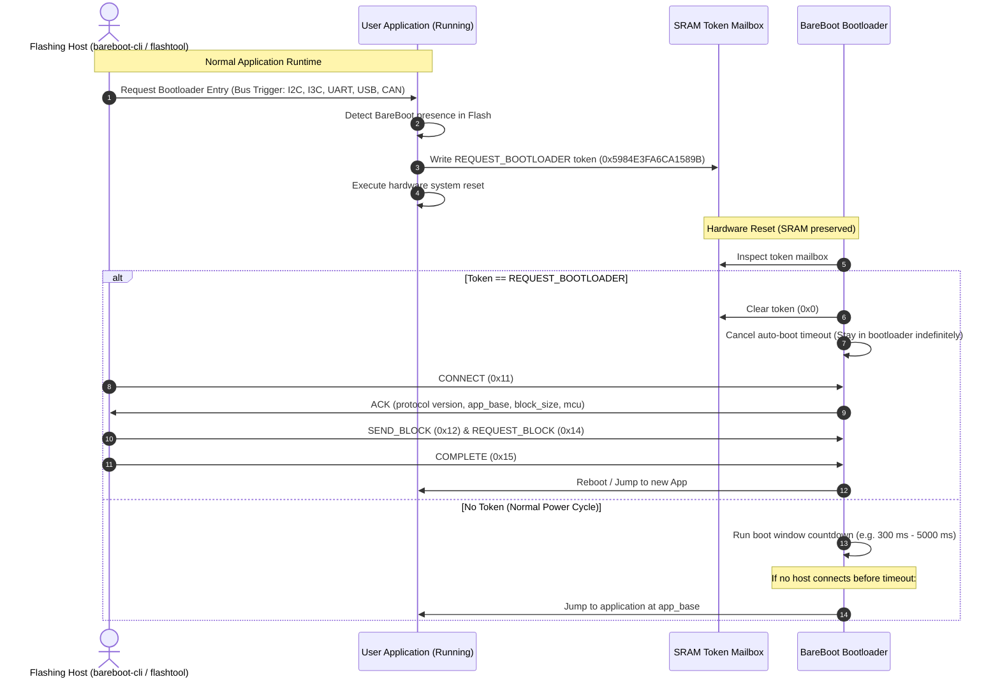
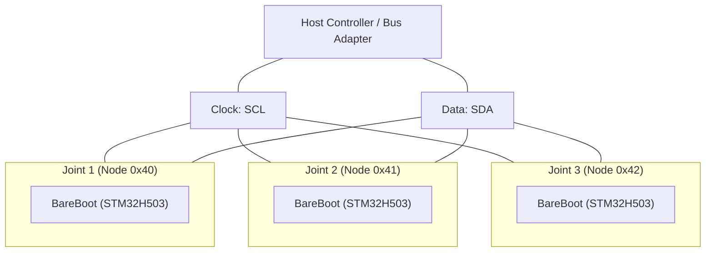

# Handsfree Application Updates with BareBoot

This document specifies the universal architecture, memory contracts, communication protocols, and code implementations for **handsfree application updates** using the BareBoot bootloader across all supported hardware interfaces.

Supported Interfaces:
1. **USB** (CDC 1200-baud touch, DFU Detach, Vendor Control Transfers)
2. **UART / Serial** (In-band magic tokens, framed break commands)
3. **CAN & CAN-FD** (Admin reboot broadcast, UUID addressing, 64-byte FD frames)
4. **I2C Target** (Host single-byte strobe `0xF0`, SMBus General Call, register writes)
5. **I3C Target** (MIPI CCC `RSTACT` Target Reset, ENTDAA/SETDASA, dynamic address `0xF0` strobe)
6. **SPI Target** (Chip-select strobes, magic sync command sequences)
7. **Debug Probe / SWD Mailbox** (Non-intrusive memory poke via CMSIS-DAP, ST-Link, WCH-Link)
8. **Wireless / BLE** (GATT OTA Control Point on CH58x / CH59x)

---

## 1. High-Level Architecture

Handsfree flashing allows updating device firmware over existing communication buses without requiring:
- Physical access to BOOT0 / BOOT1 pins or DIP switches.
- Hardware reset or boot buttons.
- External SWD/JTAG debug probes (ST-Link, WCH-Link, J-Link).

### Update Lifecycle



---

## 2. Katapult Protocol Compatibility

BareBoot maintains wire and protocol compatibility with Katapult (formerly CanBoot). Support across different transports is structured as follows:

| Interface | Katapult Mechanism | Payload / Command |
|---|---|---|
| **USB CDC** | 1200-baud touch | `termios.B1200` + DTR toggle |
| **UART Serial** | Magic string | `~ \x1c Request Serial Bootloader!! ~` |
| **CAN Bus** | Admin reboot frame | Frame on ID `0x3F0`, payload `[0x02, uuid_0..5]` |
| **I2C Target** | Host strobe | Single byte `0xF0` written to target address |
| **I3C Target** | Dynamic strobe or CCC | Dynamic address write `0xF0` or CCC `RSTACT` (`0x2A`/`0x9A`) |

### Cross-Reset RAM Mailbox

Katapult and BareBoot coordinate handoff between application and bootloader using a 64-bit token stored at the top of SRAM:
- **Magic Request Token**: `REQUEST_CANBOOT = 0x5984E3FA6CA1589B`
- **Application Exit Token**: `REQUEST_START_APP = 0x7b06ec45a9a8243d`

#### Dynamic Mailbox Location Calculation
In linker scripts, BareBoot reserves an 8-byte section immediately following the bootloader's stack:
```ld
_stack_start = CONFIG_RAM_START + CONFIG_RAM_SIZE - CONFIG_STACK_SIZE - 8;
.stack _stack_start (NOLOAD) : {
    . = . + CONFIG_STACK_SIZE;
    _stack_end = .;
} > ram
.reserved (NOLOAD) : {
    . = . + 8;
} > ram
```

The bootloader's initial stack pointer (`bl_vectors[0]`) points to `_stack_end`. An application can locate this token dynamically without hardcoding physical RAM boundaries:

```rust
//! Rust dynamic mailbox derivation
pub unsafe fn write_bootloader_cookie(flash_boot_address: usize) {
    let bl_vectors = flash_boot_address as *const usize;
    let initial_sp = core::ptr::read_volatile(bl_vectors);
    let cookie_ptr = initial_sp as *mut u64;
    core::ptr::write_volatile(cookie_ptr, 0x5984_E3FA_6CA1_589B);
}
```

---

## 3. Universal Interface Specifications

```text
+-------------------+-----------------------------------------+------------------------------------------+
| Interface         | Trigger Format / Command                | Application Action                       |
+-------------------+-----------------------------------------+------------------------------------------+
| USB CDC           | Baud rate changed to 1200 bps           | Write token to RAM & issue System Reset  |
| USB DFU           | DFU_DETACH request (bRequest = 0)       | Write token to RAM & issue System Reset  |
| USB Vendor        | Control transfer (bRequest = 0xBB)      | Write token to RAM & issue System Reset  |
| UART / Serial     | ASCII "~ \x1c Request Serial Bootloader!! ~" | Write token to RAM & issue System Reset  |
| CAN (Classic)     | ID 0x3F0, data: [0x02, UUID(6 bytes)]   | Match UUID, write token & System Reset   |
| CAN-FD            | ID 0x3F0 (or FD frame), [0x02, UUID]    | Match UUID, write token & System Reset   |
| I2C Target        | Write byte 0xF0 to target address       | Write token to RAM & issue System Reset  |
| I3C Target        | CCC RSTACT (0x2A/0x9A) or byte 0xF0     | Write token to RAM & issue System Reset  |
| SPI Target        | CS low + byte sequence [0xF0, 0x59...]  | Write token to RAM & issue System Reset  |
| SWD / Probe Poke  | Direct memory write to bl_vectors[0]    | No app code needed (handled by debugger) |
| BLE / Wireless    | Write 0x01 to OTA Control Point Char    | Write token to RAM & issue System Reset  |
+-------------------+-----------------------------------------+------------------------------------------+
```

---

## 4. Application-Side Trigger Robustness (Critical Contract)

The single most critical implementation requirement for handsfree entry is **where the trigger is detected**. The application firmware must recognize the entry strobe in **interrupt context**, not inside a cooperative or polled background task.

### Why Task-Context Polling Fails

On cooperative asynchronous runtimes (such as Embassy or cooperative event loops), a busy computational task (such as FOC motor commutations, calibration routines, or logging) can starve the background task servicing communication endpoints. If the `0xF0` check runs at task level, the strobe is silently dropped whenever the task is not scheduled. This causes the host flashtool to time out, forcing developers to resort to physical power cycling or SWD recovery.

### Implementation Requirements

1. **Preemptive Interrupt Context**:
   Decode the strobe at the peripheral hardware interrupt level (e.g. `I2C_EV` / `I3C_EV` ISR or an interrupt-driven executor priority).
2. **Dedicated Single-Byte Matching**:
   Detect exactly a one-byte write `[0xF0]` to the target address. Do not consume bytes belonging to standard register reads/writes.
3. **Atomic Mailbox Commit**:
   On match:
   - Write `REQUEST_BOOTLOADER` (`0x5984E3FA6CA1589B`) to the address read from `bl_vectors[0]`.
   - Issue a compiler barrier / memory fence.
   - Trigger `NVIC_SystemReset()`.
4. **No Application Register Coupling**:
   Do not assign `0xF0` as a command register index inside your normal protocol register table. Doing so keeps the trigger bound to the application state machine's health.

---

## 5. Multi-Architecture In-App Integration Guide

### Universal `#![no_std]` Rust Helper (`bareboot-app-helper`)

```rust
//! Universal BareBoot Application Integration Helper
#![no_std]

pub const BAREBOOT_MAGIC: u64 = 0x2174_6F6F_426E_6143; // "CanBoot!"
pub const REQUEST_BOOTLOADER: u64 = 0x5984_E3FA_6CA1_589B;

/// Detects whether BareBoot is present in flash.
pub fn is_bareboot_present(flash_base: u32, app_base: u32) -> bool {
    unsafe {
        let initial_sp = core::ptr::read_volatile(flash_base as *const u32);
        let reset_vec = core::ptr::read_volatile((flash_base + 4) as *const u32);
        (initial_sp >= 0x2000_0000 && initial_sp <= 0x2008_0000)
            && (reset_vec >= flash_base && reset_vec < app_base)
    }
}

/// Handsfree reboot into BareBoot (ARM Cortex-M: STM32F1/G0/H5, RP2040, RP2350).
pub unsafe fn enter_bareboot_cortex_m(flash_base: u32) -> ! {
    core::arch::asm!("cpsid i"); // Disable all interrupts

    // Mailbox is located at bootloader's initial stack pointer
    let bl_sp = core::ptr::read_volatile(flash_base as *const u32);
    let mailbox = bl_sp as *mut u64;
    core::ptr::write_volatile(mailbox, REQUEST_BOOTLOADER);

    core::sync::atomic::compiler_fence(core::sync::atomic::Ordering::SeqCst);

    // Trigger Cortex-M SYSRESETREQ via SCB_AIRCR
    const SCB_AIRCR: *mut u32 = 0xE000_ED0C as *mut u32;
    core::ptr::write_volatile(SCB_AIRCR, (0x05FA << 16) | (1 << 2));

    loop {
        core::hint::spin_loop();
    }
}

/// Handsfree reboot into BareBoot (WCH RISC-V: CH32V203, CH592).
pub unsafe fn enter_bareboot_ch32v(sram_top: u32) -> ! {
    core::arch::asm!("csrci mstatus, 8"); // Disable interrupts

    let mailbox = (sram_top - 8) as *mut u64;
    core::ptr::write_volatile(mailbox, REQUEST_BOOTLOADER);

    // Trigger PFIC CFGR System Reset
    const PFIC_CFGR: *mut u32 = 0xE000_E048 as *mut u32;
    core::ptr::write_volatile(PFIC_CFGR, 0x5AA5_0000 | (1 << 7));

    loop {
        core::hint::spin_loop();
    }
}
```

---

## 6. Multi-Drop Bus Topology Architecture

In multi-actuator robotics, robotic hands, and multi-joint industrial arms, multiple BareBoot target nodes share a common communication bus (e.g., I2C or I3C lines driven by a Host Controller / Bus Adapter).



### Multi-Drop Safeguards

1. **Sequential Node Rollouts with Pre-Flight Inventory**:
   Updates must proceed sequentially ($Node_1 \rightarrow Node_2 \rightarrow \dots$). A pre-flight inventory scan validates connectivity to all nodes before entering the flashing phase. If any node fails to respond, the update aborts before rebooting any device.
2. **Strict `NOSTRETCH` Enforcement**:
   Target hardware must never assert clock stretching on shared multi-drop buses. If a flash page erase requires 20 ms, the bootloader commits data after the bus transaction STOP condition or responds immediately with busy status.
3. **Addressed In-Band Triggers**:
   The `0xF0` strobe is transmitted only within a transaction addressed to the target node's address. Unaddressed nodes ignore the transaction completely.
4. **Indefinite Timeout Override**:
   When entered via the `0xF0` strobe, the node disables its autoboot countdown timer (`boot_window_active = 0`), remaining in bootloader mode until the flashing session completes.
