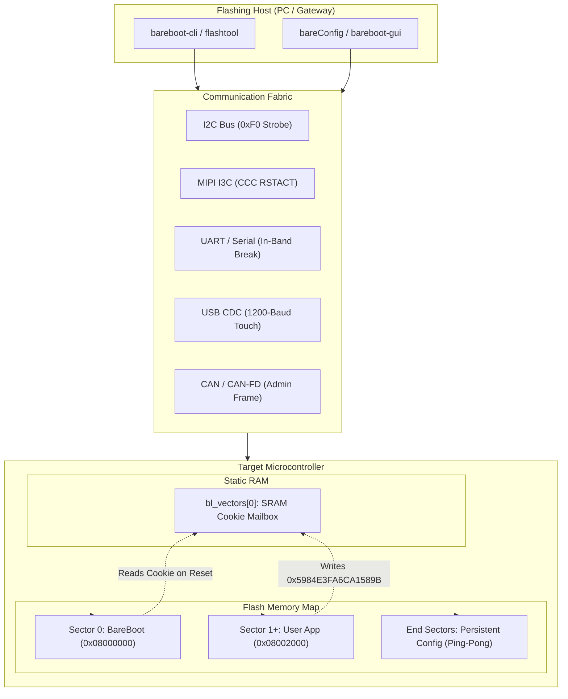

# BareBoot: Universal Handsfree Embedded Bootloader

BareBoot is a lightweight, single-slot bootloader ecosystem engineered for deterministic, handsfree in-system firmware updates across multi-drop and point-to-point buses. Designed to operate alongside the BareFOC real-time motor control stack, BareBoot provides zero-probe, zero-button firmware deployment over I2C, MIPI I3C, UART, CAN/CAN-FD, SPI, and USB CDC/DFU.

BareBoot maintains protocol framing compatibility with upstream Katapult (formerly CanBoot) while introducing enhanced multi-architecture target support, non-volatile ping-pong configuration storage, blank-vector failsafe parking, and unified tooling across CLI and GUI environments.

---

## Core Architectural Principles

1. **Zero-Physical-Intervention Updates (Handsfree Entry)**:
   Firmware upgrades do not require hardware reset switches, BOOT0/BOOT1 jumpers, or SWD/JTAG debug probes. Host flashing utilities emit in-band bus strobes or common command codes that are detected in-app to coordinate a graceful reboot directly into the bootloader.

2. **Cross-Reset SRAM Token Mailbox**:
   Bootloader entry requests are passed across hardware resets via a 64-bit cookie stored at the bootloader's initial stack boundary:
   ```rust
   pub const REQUEST_BOOTLOADER: u64 = 0x5984_E3FA_6CA1_589B;
   ```
   When detected on reset, the bootloader cancels its automatic timeout and remains parked in flash mode indefinitely.

3. **Strict Elimination of Bus Lockups**:
   On shared multi-drop buses (such as I2C and I3C), clock stretching is strictly disabled (`NOSTRETCH`). Target nodes buffer block payloads and process flash page write operations asynchronously, ensuring sibling nodes on the bus never experience stalled bus clocks.

4. **Blank-Vector & Torn-Flash Failsafe Parking**:
   If flashing is aborted mid-stream or flash sectors are left blank, BareBoot inspects the application vector table (validating initial stack pointer bounds and reset vector alignment). An unpopulated or invalid application vector automatically cancels the auto-boot countdown, parking the bootloader permanently for recovery without bricking the device.

5. **Single-Slot Memory Efficiency**:
   Unlike complex dual-bank A/B partitioning schemes that cut usable application memory in half, BareBoot utilizes a minimal footprint single-slot design. The bootloader occupies only Sector 0 (e.g. 8 KB on STM32H503 or 16 KB on RP2350), leaving maximum flash available for application logic.

---

## Architecture Diagram



---

## Documentation Sections

1. [**Handsfree Updates**](/bareboot/handsfree/):
   Universal architecture, sequence diagrams, RAM mailbox contracts, ISR-level trigger handling, and multi-drop bus topology recommendations.

2. [**Target MCU Guides**](/bareboot/targets/):
   Microcontroller flash layouts, memory boundaries, vector relocations, and linker scripts:
   - [STM32H503](/bareboot/targets/stm32h5/) (UFQFPN32, 128 KB flash, 32 KB RAM, dual ping-pong config storage)
   - [RP2350 & RP2040](/bareboot/targets/rp2350/) (Dual-image boundary, recovery bootloader, LittleFS preservation)

3. [**Protocols & Transports**](/bareboot/protocols/):
   Wire format, handshake sequences, opcodes, and CRC validation across buses:
   - [I2C Target Protocol](/bareboot/protocols/i2c/) (`0xF0` strobe, `NOSTRETCH`, CCITT-CRC16)
   - [MIPI I3C Protocol](/bareboot/protocols/i3c/) (CCC `RSTACT`, dynamic address assignment, SDR speeds)
   - [UART Serial Protocol](/bareboot/protocols/uart/) (In-band magic tokens, framed break commands)
   - [USB CDC & DFU Protocol](/bareboot/protocols/usb/) (1200-baud touch, `DFU_DETACH`, vendor control endpoints)

4. [**GUI Workbench & Flasher**](/bareboot/tui/):
   Cross-platform graphical workbench, `bareboot-engine` headless pipeline, makeflash orchestration, and integration into `bareConfig`.

5. [**Host Flashtool Reference**](/bareboot/flashtool/):
   Command-line flashing guide with `bareboot-cli` and `multidrop_flashtool.py`.
