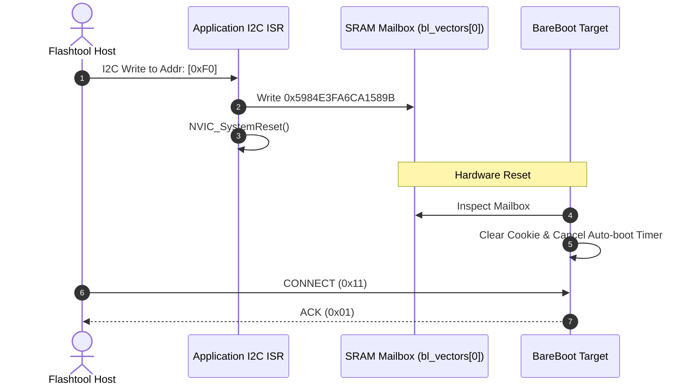

# I2C Target Protocol & 0xF0 Entry Strobe

The I2C transport allows flashing slave microcontrollers over standard two-wire bus lines (SCL and SDA) at 100 kHz (Standard Mode), 400 kHz (Fast Mode), or 1 MHz (Fast Mode Plus).

---

## 1. The 0xF0 Handsfree Entry Strobe

To transition an operational application into BareBoot mode without a hardware reset line or debug probe:

1. **Host Action**: The host flashing utility issues a 1-byte master write transaction to the target node's 7-bit slave address:
   ```text
   START -> [Addr + W] -> ACK -> [0xF0] -> ACK -> STOP
   ```
2. **Interrupt Interception**: The running application detects `0xF0` inside its I2C event interrupt service routine (ISR).
3. **Mailbox Handoff**: The application writes `REQUEST_BOOTLOADER = 0x5984E3FA6CA1589B` to `bl_vectors[0]` and triggers `NVIC_SystemReset()`.
4. **Bootloader Initialization**: On reboot, BareBoot initializes its I2C peripheral as a target at the same address, disables the autoboot countdown timer, and waits for `CMD_CONNECT`.



---

## 2. Strict Clock-Stretching Prohibition (`NOSTRETCH`)

On shared multi-drop buses, holding the SCL line low (clock stretching) freezes bus traffic for all connected slave nodes, blocking real-time telemetry or sister actuator communications.

### Rules for BareBoot I2C Implementations:
- The `NOSTRETCH` bit must be enabled in the microcontroller's I2C control registers (e.g. `I2C_CR1_NOSTRETCH` on STM32).
- Data buffering occurs asynchronously: when a `CMD_SEND_BLOCK` (64 bytes) is received, the bootloader returns an immediate ACK over I2C and initiates flash sector programming in the background, or returns `0xFF` if read before ready.
- Host flashtool inserts a 1 ms to 5 ms delay between block writes to accommodate internal flash charge-pump write cycles without relying on hardware clock stretching.

---

## 3. Frame Layout & CCITT-CRC16 Checksum

Block write packets (`CMD_SEND_BLOCK = 0x12`) are structured as follows:

```text
+--------+---------------+---------------+--------------------+---------------+
| Opcode | Address (4B)  | Length (2B)   | Payload Data (N B) | CRC16 (2B)    |
| 0x12   | Little-Endian | Little-Endian | Up to 64 bytes     | CCITT-FALSE   |
+--------+---------------+---------------+--------------------+---------------+
```

### CCITT-CRC16 Verification

The checksum is computed across all bytes including Opcode, Address, Length, and Payload:
- **Polynomial**: `0x1021` ($x^{16} + x^{12} + x^5 + 1$)
- **Initial Value**: `0xFFFF`
- **RefIn / RefOut**: `false`
- **XorOut**: `0x0000`

```rust
//! Rust CCITT-CRC16 calculation for Katapult/BareBoot framing
pub fn compute_crc16(data: &[u8]) -> u16 {
    let mut crc: u16 = 0xFFFF;
    for &byte in data {
        crc ^= (byte as u16) << 8;
        for _ in 0..8 {
            if (crc & 0x8000) != 0 {
                crc = (crc << 1) ^ 0x1021;
            } else {
                crc <<= 1;
            }
        }
    }
    crc
}
```
