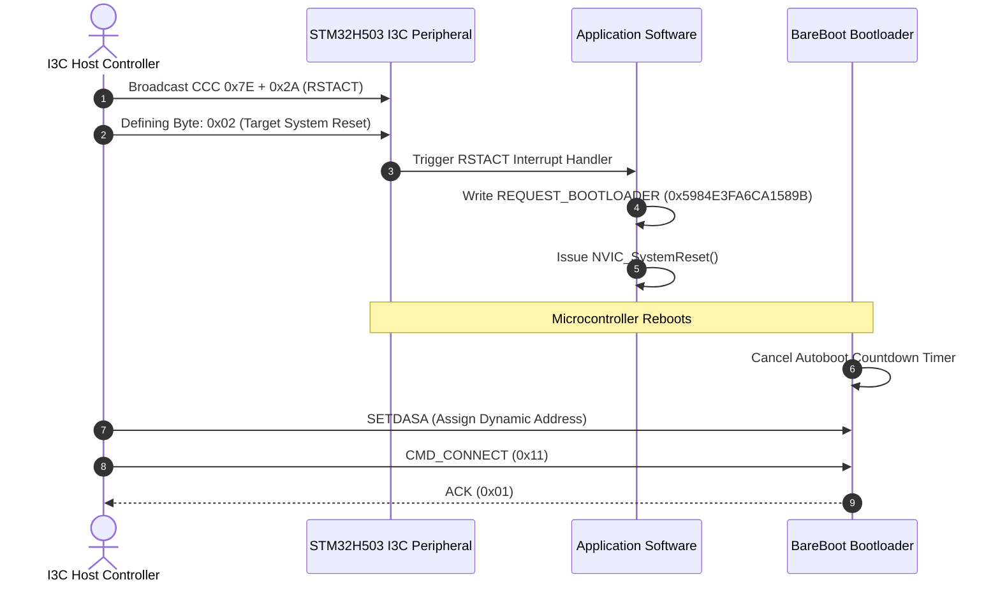

# MIPI I3C Protocol & CCC RSTACT Reset

MIPI Improved Inter-Integrated Circuit (I3C) is a high-speed serial bus protocol providing up to 12.5 MHz Single Data Rate (SDR) communication, dynamic address assignment, and in-band Common Command Codes (CCC). In the BareFOC ecosystem, targets like the STM32H503 utilize I3C to accelerate firmware flashing while retaining backwards compatibility with standard I2C buses.

---

## 1. Dynamic Address Assignment (ENTDAA & SETDASA)

Before communicating over I3C, the host controller enumerates connected targets using dynamic addressing:

1. **`SETDASA` (Set Dynamic Address from Static Address)**:
   Assigns a dynamic address to a target whose static I2C address is known (e.g. converting static `0x40` to dynamic `0x08`).
2. **`ENTDAA` (Enter Dynamic Address Assignment)**:
   Enumerates targets by reading each node's 48-bit Provisional ID, Characteristic Register (BCR), and Device Capability Register (DCR).

---

## 2. In-Band Reset via CCC RSTACT (Target Reset Action)

MIPI I3C standardizes chip-level reset commands through Common Command Codes, allowing hardware or controller-level reset triggers without dedicated GPIO lines:

- **Broadcast CCC**: `0x2A` (`RSTACT`)
- **Direct CCC**: `0x9A` (`RSTACT`, alternate `0xAA`)
- **Hardware Target Reset Pattern (`EVR_RSTF`)**: 14 SDA transitions while SCL is low (monitored on `I3C_EVR` bit 27). In `Stm32I3cTarget`, either `EVR_RSTF` or `CCC RSTACT` (`0x02`) triggers `barefoc_failsafe_recovery()`. In BareBoot, `EVR_RSTF` clears `BootLoopGuard`, resets RX/TX FIFO state, and parks permanently in `ENTDAA`-ready recovery mode.
- **Stuck-`SDA` Bus-Wedge Recovery (`RCC_APB3RSTR`)**: Both BareBoot and `Stm32I3cTarget` sample `PB4` (`I3C2_SDA`) against bus event progress; if `SDA == 0` persists for 50 ms continuously, firmware pulses `RCC_APB3RSTR.I3C2RST` (bit 9) and re-initializes `I3C2`. Application `IWDG` feeding is gated on `I3C2` bus health so any unrecoverable line fault forces a ~2.0 s hardware watchdog reset.

### RSTACT Defining Byte Codes

| Defining Byte | Action Name | Hardware Behavior |
|---|---|---|
| `0x00` | No Action | Target ignores reset sequence |
| `0x01` | I3C Peripheral Reset | Resets only internal I3C peripheral state machines |
| `0x02` | **Target System Reset** | **Triggers full microcontroller hardware system reset** |
| `0x03` | Target Debug Reset | Enters debug halt mode |

### Handsfree Entry Workflow

---

## 3. High-Speed SDR Flashing Throughput

Compared to standard I2C (400 kHz Fast Mode), MIPI I3C SDR mode transfers data at up to 12.5 Mbps:
- Flash block write overhead ($64\text{ bytes} \times \approx 800\text{ ns/byte} \approx 51\,\mu\text{s}$) is drastically lower than the flash sector erase/program time.
- Total update time for a 104 KB user application binary decreases from $\approx 14\text{ seconds}$ over I2C to $\approx 1.2\text{ seconds}$ over I3C.
