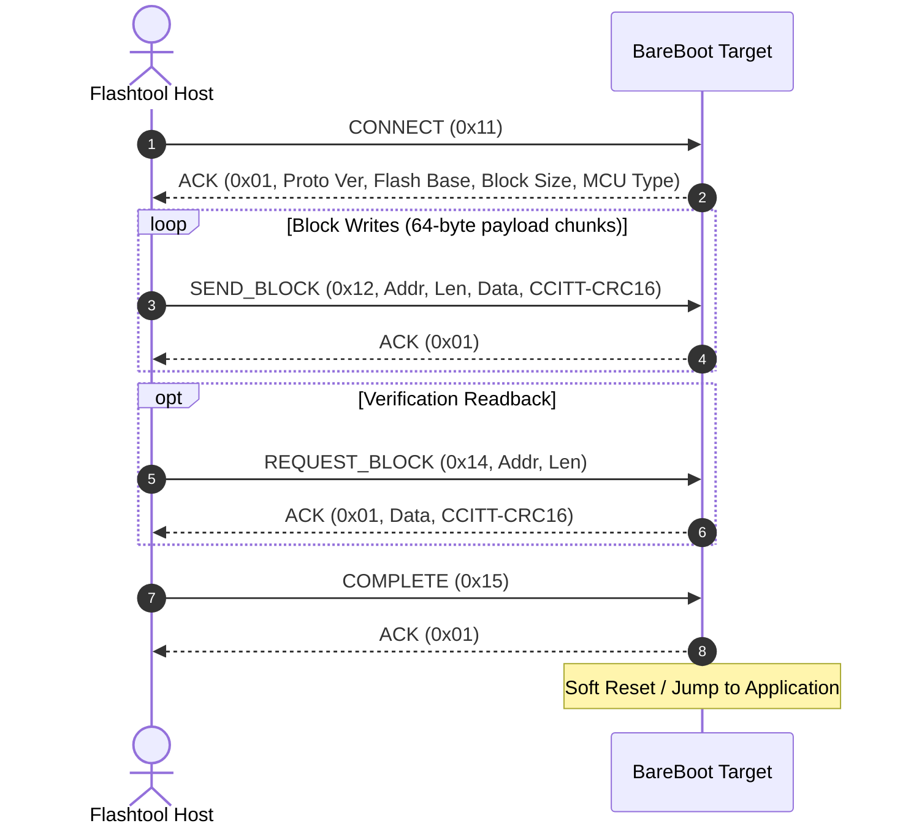

# Protocols & Transports

BareBoot implements a lean, packet-oriented command protocol derived from Katapult, supporting multiple physical physical transport layers.

---

## Katapult Wire Protocol Overview

All flashing sessions follow a standardized packet sequence:

---

## Protocol Opcode Definitions

| Opcode | Hex | Name | Payload Arguments | Description |
|---|---|---|---|---|
| `CMD_CONNECT` | `0x11` | Connect | None | Handshake query; returns hardware capabilities |
| `CMD_SEND_BLOCK` | `0x12` | Send Block | Address (4B), Length (2B), Data ($N$), CRC16 (2B) | Writes a block of binary data to target flash |
| `CMD_REQUEST_BLOCK` | `0x14` | Request Block | Address (4B), Length (2B) | Reads back flash contents for host verification |
| `CMD_COMPLETE` | `0x15` | Complete | None | Commits flashing session and issues system reset |
| `RESP_ACK` | `0x01` | Acknowledge | Optional response payload | Target success response |
| `RESP_NACK` | `0x02` | Negative Acknowledge | Error Code | Target error indication |

---

## Transport Guides

1. [**I2C Target (0xF0 Strobe)**](/bareboot/protocols/i2c/):
   1-byte strobe entry, `NOSTRETCH` compliance, multi-drop addressing, and CCITT-CRC16 framing.
2. [**MIPI I3C (CCC RSTACT)**](/bareboot/protocols/i3c/):
   Dynamic address allocation (ENTDAA/SETDASA), Common Command Code `RSTACT`, and high-speed SDR transfers up to 12.5 MHz.
3. [**UART Serial Protocol**](/bareboot/protocols/uart/):
   In-band magic tokens, framed serial break commands, and streaming flash transfers over RS-485 / TTL.
4. [**USB CDC & DFU Touch**](/bareboot/protocols/usb/):
   Standard 1200-baud touch reset, USB DFU Detach requests, and vendor control endpoint transfers.
