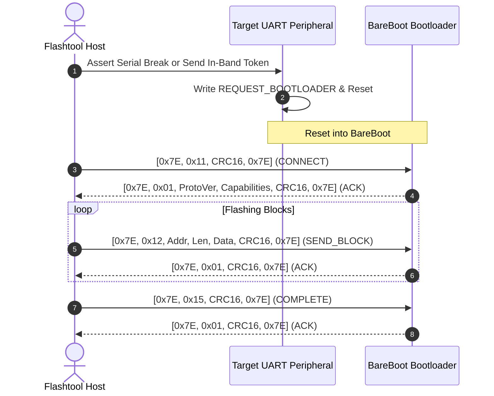

# UART Serial Protocol & Break Entry

The UART transport provides point-to-point firmware update capabilities over asynchronous serial interfaces (RS-232, RS-485, TTL logic levels, and USB-to-UART bridge ICs such as FTDI, CH340, CP2102, or WCH-LinkE).

---

## 1. Serial Bootloader Entry Triggers

To transition a device running an active application into BareBoot over UART, the host can issue one of three triggers:

### Method A: Katapult In-Band Magic Token String
The host emits the standard Katapult ASCII sync string:
```text
~ \x1c Request Serial Bootloader!! ~
```
The application serial parser intercepts the sequence, writes the cross-reset mailbox token `0x5984E3FA6CA1589B` to RAM, and reboots.

### Method B: Serial Line Break Condition
The host asserts a continuous UART Break (holding the TX line at logic LOW for at least 10 bit-times, exceeding a normal character frame length):
```python
import serial, time
ser = serial.Serial('/dev/ttyUSB0', baudrate=250000)
ser.send_break(duration=0.25) # Assert 250 ms break
```
Microcontrollers with hardware LIN/Break detection (e.g. STM32 USART `LBD` or framing error flags) trigger an interrupt immediately upon break detection.

### Method C: Single-Byte Console Escape Trigger
In development profiles (such as the Miniata USART1 console @ 250,000 baud), the serial listener checks incoming bytes for `0xF0` or character `'r'`:
```rust
//! Miniata in-app UART receiver snippet
pub fn process_uart_byte(byte: u8) {
    if byte == 0xF0 || byte == b'r' {
        unsafe {
            reboot_to_bareboot();
        }
    }
}
```

---

## 2. Serial Wire Framing & Escaping

Because UART is a raw byte stream without hardware packet delimitation, Katapult and BareBoot wrap frames using SLIP-style byte framing:

- **Frame Sync**: `0x7E` (Tilde `~`) marks the beginning and end of each packet.
- **Escape Character**: `0x7D`
  - Byte `0x7E` in payload is encoded as `[0x7D, 0x5E]`.
  - Byte `0x7D` in payload is encoded as `[0x7D, 0x5D]`.


