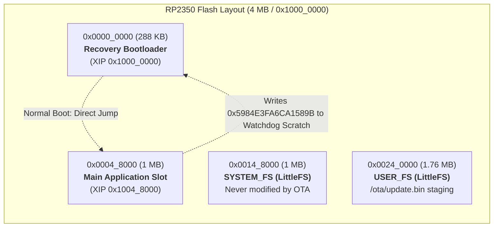

# RP2350 & RP2040 Target Guide

The **RP2350** (and predecessor RP2040) is Raspberry Pi's high-performance microcontroller featuring dual ARM Cortex-M33 (or Hazard3 RISC-V) cores running up to 150+ MHz with external QSPI/XIP flash memory. On RP2350 and RP2040 targets, BareBoot provides non-intrusive recovery, staged OTA, and application-slot protection services.

---

## 1. Fixed Two-Image Flash Layout

To eliminate fragile A/B candidate/confirm rollbacks while guaranteeing recovery under all failure modes, the RP2350 flash memory (e.g. 4 MB W25Q32 or 16 MB flash) is partitioned into fixed, non-overlapping regions:

```text
+-------------------+-------------+----------------------------------------------+
| Flash Offset      | Size        | Allocation / Filesystem                      |
+-------------------+-------------+----------------------------------------------+
| 0x00000000        | 288 KB      | Recovery Bootloader Slot (XIP 0x10000000)    |
| 0x00048000        | 1024 KB     | Main Application Slot (XIP 0x10048000)       |
| 0x00148000        | 1024 KB     | SYSTEM_FS (LittleFS: WebUI & System Assets)  |
| 0x00248000        | 1760 KB     | USER_FS (LittleFS: Configurations & Staging) |
+-------------------+-------------+----------------------------------------------+
```

### Partition Diagram



---

## 2. Bounded Application-Slot Protection Rules

To prevent bricking or filesystem corruption during updates, the following invariant boundaries are strictly enforced:

1. **Strict Flash Bounds**:
   Every in-place or recovery flashing operation is bounded strictly to `[0x00048000, 0x00148000)`. Flashing writes below `0x00048000` (recovery bootloader) or at/above `0x00148000` (filesystems) are rejected immediately with write-protection errors.
2. **Filesystem Preservation**:
   Neither `SYSTEM_FS` nor `USER_FS` can ever be overwritten via raw flash block flashing. Updates to user configurations and web assets occur exclusively through LittleFS filesystem abstractions.

---

## 3. Staged OTA and Watchdog Scratch Mailbox

The preferred update flow on RP2350 decouples file download from flash programming using a two-stage process:

1. **Staging**:
   The host streams the new application binary to the device, saving it into `USER_FS` at `/ota/update.bin`.
2. **Bootloader Handoff**:
   The application writes the 64-bit magic cookie `0x5984E3FA6CA1589B` into the hardware watchdog scratch registers and triggers a system reset:

```rust
//! RP2350 Watchdog Scratch Handoff Routine
const WATCHDOG_BASE: usize = 0x400D_8000;
const WATCHDOG_SCRATCH0: *mut u32 = (WATCHDOG_BASE + 0x0C) as *mut u32;
const WATCHDOG_SCRATCH1: *mut u32 = (WATCHDOG_BASE + 0x10) as *mut u32;

pub const MAGIC_RECOVERY_TOKEN: u64 = 0x5984_E3FA_6CA1_589B;

pub unsafe fn reboot_to_recovery_bootloader() -> ! {
    // Write lower and upper 32 bits into persistent hardware scratch registers
    let lo = (MAGIC_RECOVERY_TOKEN & 0xFFFF_FFFF) as u32;
    let hi = ((MAGIC_RECOVERY_TOKEN >> 32) & 0xFFFF_FFFF) as u32;

    core::ptr::write_volatile(WATCHDOG_SCRATCH0, lo);
    core::ptr::write_volatile(WATCHDOG_SCRATCH1, hi);

    core::sync::atomic::compiler_fence(core::sync::atomic::Ordering::SeqCst);

    // Trigger system reset
    cortex_m::peripheral::SCB::sys_reset();
}
```

3. **Verification & Installation**:
   On reboot, the recovery bootloader inspects the watchdog scratch registers:
   - If the token matches, it stays in recovery mode, reads `/ota/update.bin` from `USER_FS`, verifies its checksum and vector alignment, and burns it into the application slot `[0x00048000, 0x00148000)`.
   - If no token is present, the recovery bootloader performs a zero-overhead direct vector jump to `0x10048000`.

---

## 4. Hardware Fallback: BOOTSEL / ROM UF2

If both the application and recovery bootloader partitions are blank or corrupted, the RP2350/RP2040 on-chip ROM bootloader serves as the immutable hardware fallback. Entering BOOTSEL mode mounts a standard USB Mass Storage device presenting virtual UF2 files, enabling initial factory provisioning without specialized hardware programmers.
