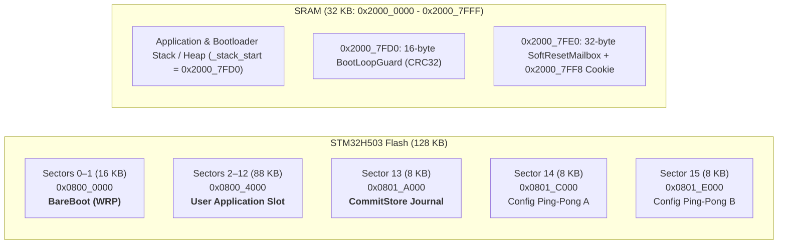

# STM32H503 Target Guide

The **STM32H503KBU6** is an ARM Cortex-M33 microcontroller running up to 250 MHz, featuring 128 KB embedded dual-bank flash, 32 KB SRAM, and hardware support for MIPI I3C, high-speed I2C, and USB. It serves as a primary microcontroller target for real-time motor control and multi-drop actuator nodes in the BareFOC ecosystem.

---

## 1. Flash & SRAM Partition Map

The STM32H503 flash consists of 16 sectors of 8 KB each (`0x0800_0000` to `0x0801_FFFF`). BareBoot configures a deterministic single-slot partition layout with a 16 KiB bootloader slot:

```text
+-------------------+-------------+----------------------------------------------+
| Memory Region     | Size        | Purpose / Allocation                         |
+-------------------+-------------+----------------------------------------------+
| 0x08000000        | 16 KB       | Sectors 0–1: BareBoot Bootloader (WRP)       |
| 0x08004000        | 88 KB       | Sectors 2–12: User Application (BareFOC)     |
| 0x0801A000        | 8 KB        | Sector 13: Monotonic CommitStore + CRC32     |
| 0x0801C000        | 8 KB        | Sector 14: Persistent Config Journal Bank A  |
| 0x0801E000        | 8 KB        | Sector 15: Persistent Config Journal Bank B  |
+-------------------+-------------+----------------------------------------------+
| 0x20000000        | 32 KB - 48B | SRAM: Application & Bootloader BSS/Data/Stack|
| 0x20007FD0        | 16 Bytes    | BootLoopGuard: 3-strike CRC32 crash counter  |
| 0x20007FE0        | 32 Bytes    | SoftResetMailbox & Legacy Cookie (0x20007FF8)|
+-------------------+-------------+----------------------------------------------+
```

### Partition Diagram



---

## 2. Hardware Pin Mappings

Depending on the target board hardware profile, BareBoot and the application multiplex communications across specific pin configurations:

### Generic STM32H5 Multi-Drop I3C / I2C Target Profile
- **Bus Peripheral**: `I2C2` / `I3C2`
- **Pins**: `PB3` (`SCL`), `PB4` (`SDA`)
- **Default Target Address**: `0x40` (Dynamic binding from Sector 14/15 storage)

### Alternate UART / I2C1 Profile (`PB6` / `PB7`)
- **UART Profile**:
  - `PB6` = `USART1_TX` (MCU TX to Host RX)
  - `PB7` = `USART1_RX` (MCU RX to Host TX)
  - Baud rate: `250,000` baud
- **I2C / I3C Profile**:
  - `PB6` = `I2C1_SCL` / `I3C1_SCL`
  - `PB7` = `I2C1_SDA` / `I3C1_SDA`
  - Default target address: `0x30`

> [!IMPORTANT]
> **Protocol Synchronization Requirement**: When switching bootloader modes between UART and I2C/I3C, the application in the application slot must be updated simultaneously to prevent pin function conflicts upon boot timeout.

---

## 3. Interrupt Vector Relocation

Because the Cortex-M33 hardware reset starts execution at `0x0800_0000` (Sector 0), the user application at `0x0800_4000` must configure `SCB->VTOR` immediately upon startup:

```rust
//! In user application main.rs or startup hook
#[cortex_m_rt::pre_init]
unsafe fn pre_init() {
    // Relocate Vector Table to Sector 2 (16 KiB bootloader offset)
    const SCB_VTOR: *mut u32 = 0xE000_ED08 as *mut u32;
    core::ptr::write_volatile(SCB_VTOR, 0x0800_4000);
}
```

---

## 4. In-App Handsfree Entry Implementation

The application monitors incoming bytes on the communication bus. When the entry strobe is received, it executes the dynamic handoff:

```rust
//! STM32H503 In-App Reboot Routine
pub const REQUEST_BOOTLOADER: u64 = 0x5984_E3FA_6CA1_589B;

pub unsafe fn reboot_to_bareboot() -> ! {
    // 1. Safe shutdown of motor gate driver
    // Disable DRV8311 PWM and pull DRV_SLEEP low
    
    // 2. Disable interrupts
    cortex_m::interrupt::disable();

    // 3. Resolve mailbox address from bootloader initial SP at 0x0800_0000
    let bl_sp = core::ptr::read_volatile(0x0800_0000 as *const u32);
    let mailbox = bl_sp as *mut u64;
    core::ptr::write_volatile(mailbox, REQUEST_BOOTLOADER);

    // 4. Memory fence & System Reset
    core::sync::atomic::compiler_fence(core::sync::atomic::Ordering::SeqCst);
    cortex_m::peripheral::SCB::sys_reset();
}
```

---

## 5. Zero-Lockout Recovery & Persistent Configuration Protection

- **Monotonic CommitStore (Sector 13, `0x0801_A000..0x0801_BFFF`)**: 16-byte alignment-generic `CommitRecord { magic, state, app_len, app_crc32 }` entries record `IN_PROGRESS` before application slot (Sectors 2–12) erase and `VALID(app_len, app_crc32)` only upon `CMD_COMPLETE`. Boot jumps require `CommitState::Valid`, valid vector table, and full-image IEEE 802.3 CRC32 verification.
- **IWDG & BootLoopGuard (`0x2000_7FD0..0x2000_7FDF`)**: BareBoot starts `IWDG` (~2.0 s) and increments `BootLoopGuard.attempts` before jumping to the application. The application feeds `IWDG` and clears `attempts = 0` after 500 ms of healthy execution; 3 consecutive crashes or hangs trap BareBoot permanently in I3C recovery mode.
- **1500 ms Cold-Boot Window & Hardware WRP/BOR**: On cold boot with a valid image, BareBoot listens on `I3C2` for `1500 ms` (`ENTDAA` / `SETDASA` / `EVR_RSTF` cancels auto-boot). Bootloader Sectors 0–1 (`0x0800_0000..0x0800_3FFF`) are protected via hardware flash `WRP` (`WRPSGN1R` bits 0–1) with `BOR` Level 3 (~2.7 V).
- **Persistent NVM Calibration (Sectors 14–15, `0x0801_C000..0x0801_FFFF`)**: BareBoot rejects any `RX_BLOCK` write at or above `0x0801_A000`, keeping Sectors 14–15 bit-exact across all OTA and recovery cycles.
