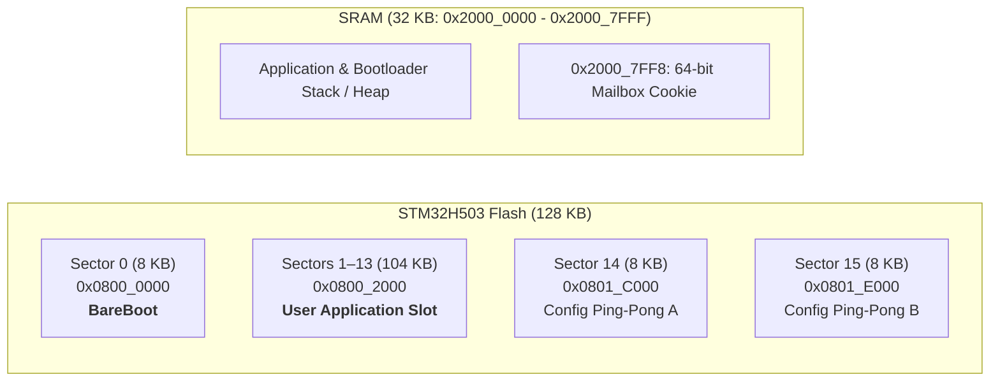

# STM32H503 Target Guide

The **STM32H503KBU6** is an ARM Cortex-M33 microcontroller running up to 250 MHz, featuring 128 KB embedded dual-bank flash, 32 KB SRAM, and hardware support for MIPI I3C, high-speed I2C, and USB. It serves as the primary motor controller target for the Miniata and FishyServo actuators in the BareFOC ecosystem.

---

## 1. Flash & SRAM Partition Map

The STM32H503 flash consists of 16 sectors of 8 KB each (`0x0800_0000` to `0x0801_FFFF`). BareBoot configures a deterministic single-slot partition layout:

```text
+-------------------+-------------+----------------------------------------------+
| Memory Region     | Size        | Purpose / Allocation                         |
+-------------------+-------------+----------------------------------------------+
| 0x08000000        | 8 KB        | Sector 0: BareBoot Bootloader (Katapult)     |
| 0x08002000        | 104 KB      | Sectors 1–13: User Application (BareFOC)     |
| 0x0801C000        | 8 KB        | Sector 14: Persistent Config Journal Bank A  |
| 0x0801E000        | 8 KB        | Sector 15: Persistent Config Journal Bank B  |
+-------------------+-------------+----------------------------------------------+
| 0x20000000        | 32 KB - 8B  | SRAM: Application & Bootloader BSS/Data/Stack|
| 0x20007FF8        | 8 Bytes     | Mailbox Cookie: bl_vectors[0] (0x5984E3FA...) |
+-------------------+-------------+----------------------------------------------+
```

### Partition Diagram



---

## 2. Hardware Pin Mappings

Depending on the actuator board hardware profile, BareBoot and the application multiplex communications across specific pin configurations:

### Miniata Hardware Profile
- **Development Profile (UART)**:
  - `PB6` = `USART1_TX` (MCU TX to Host RX)
  - `PB7` = `USART1_RX` (MCU RX to Host TX)
  - Baud rate: `250,000` baud
- **Production Profile (I2C / I3C)**:
  - `PB6` = `I2C1_SCL` / `I3C1_SCL`
  - `PB7` = `I2C1_SDA` / `I3C1_SDA`
  - Default target address: `0x30`

> [!IMPORTANT]
> **Protocol Synchronization Requirement**: When switching bootloader modes between UART and I2C/I3C, the application in Sector 1 must be updated simultaneously to prevent pin function conflicts upon boot timeout.

### FishyServo / AgentLA Multi-Drop Profile
- **Bus Peripheral**: `I2C2` / `I3C2`
- **Pins**: `PB3` (`SCL`), `PB4` (`SDA`)
- **Default Target Address**: `0x40` (Dynamic binding from Sector 14/15 storage)

---

## 3. Interrupt Vector Relocation

Because the Cortex-M33 hardware reset starts execution at `0x0800_0000` (Sector 0), the user application at `0x0800_2000` must configure `SCB->VTOR` immediately upon startup:

```rust
//! In user application main.rs or startup hook
#[cortex_m_rt::pre_init]
unsafe fn pre_init() {
    // Relocate Vector Table to Sector 1
    const SCB_VTOR: *mut u32 = 0xE000_ED08 as *mut u32;
    core::ptr::write_volatile(SCB_VTOR, 0x0800_2000);
}
```

---

## 4. In-App Handsfree Entry Implementation

The application monitors incoming bytes on the communication bus. When the entry strobe is received, it executes the dynamic handoff:

```rust
//! STM32H503 In-App Reboot Routine
pub const REQUEST_BOOTLOADER: u64 = 0x5984_E3FA_6CA1_589B;

pub unsafe fn reboot_to_bareboot() -> ! {
    // 1. Safe shutdown of motor gate driver
    // Disable DRV8311 PWM and pull DRV_SLEEP low
    
    // 2. Disable interrupts
    cortex_m::interrupt::disable();

    // 3. Resolve mailbox address from bootloader initial SP at 0x0800_0000
    let bl_sp = core::ptr::read_volatile(0x0800_0000 as *const u32);
    let mailbox = bl_sp as *mut u64;
    core::ptr::write_volatile(mailbox, REQUEST_BOOTLOADER);

    // 4. Memory fence & System Reset
    core::sync::atomic::compiler_fence(core::sync::atomic::Ordering::SeqCst);
    cortex_m::peripheral::SCB::sys_reset();
}
```

---

## 5. Persistent Configuration Protection (Ping-Pong Storage)

Sectors 14 and 15 (`0x0801_C000` and `0x0801_E000`) are explicitly isolated from bootloader flash erasure:
- BareBoot flashing routines reject any `SEND_BLOCK` payload whose address falls at or above `0x0801_C000`.
- The application stores calibration data (electrical angle offset, pole pair counts, bus node ID, PID gains) using an alternating ping-pong journal with CRC32 verification.
- Re-flashing application firmware in Sectors 1–13 preserves calibration and node addressing across updates.
