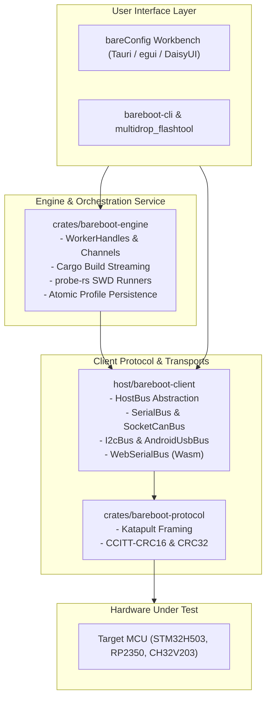

# Graphical Workbench & bareConfig Flasher

> [!NOTE] Architecture Migration Notice
> The standalone `bareboot-gui` desktop flasher has been absorbed and unified into the **`bareConfig`** workbench inside `bareFOC` (`bareFOC/bareConfig`).
> For all graphical bootloader flashing, motor setup, bus analysis, and target configuration, developers use `bareConfig`.
> The underlying headless engine (`crates/bareboot-engine`) and client library (`host/bareboot-client`) remain active in `bareBoot` to provide the core service layer powering `bareConfig`.

---

## 1. Multi-Tiered Architecture

The BareBoot flashing subsystem is constructed from modular `#![no_std]` and host-side Rust components:

---

## 2. Key Components

### A. `bareboot-engine` (`crates/bareboot-engine`)
A headless background execution library extracted from the original TUI:
- **`WorkerHandles` & Non-blocking Channels**: Decouples UI event loops from synchronous I/O operations and blocking firmware flash routines.
- **`stream_cargo_build`**: Invokes host Rust toolchains (`cargo build --target thumbv8m.main-none-eabihf`) and streams compiler errors and warnings in real time.
- **`probe-rs` Runners**: Provides zero-configuration handsfree SWD flashing and register inspection over CMSIS-DAP, ST-Link, and WCH-Link probes.
- **Atomic Profile Management**: Uses `craft-atomic` to save target configuration profiles without risking TOML file truncation during power loss.

### B. `bareboot-client` (`host/bareboot-client`)
Provides unified `HostBus` trait abstractions across diverse operating systems and physical connections:
- `SerialBus`: POSIX and Windows serial port driver with 1200-baud touch and serial break support.
- `SocketCanBus`: Linux native SocketCAN driver with CAN-FD 64-byte payload framing.
- `I2cBus`: Linux `/dev/i2c-X` user-space driver and CH341 USB-to-I2C adapter bridge.
- `AndroidUsbBus`: Native Android USB Host (`RawFd`) OTG driver for mobile field flashing without root privileges.
- `WebSerialBus`: Browser-based WebAssembly WebSerial driver.

---

## 3. Workbench Workflows in `bareConfig`

Inside `bareConfig`, the BareBoot flasher provides three integrated workflows:

1. **Target Configuration & Profile Presets**:
   - Pre-configured hardware templates (e.g. `STM32H503-I2C`, `Miniata-UART-250k`, `FishyServo-I2C-0x40`, `RP2350-Recovery`).
   - Visual configuration of baud rates, node addresses, flash offsets, and boot window timings (validated to prevent intervals shorter than 50 ms).
2. **Makeflash Pipeline**:
   - Single-click action that compiles embedded firmware with `cargo build`, automatically discovers the compiled binary, and streams it to the microcontroller over the configured transport or SWD probe.
3. **Live Bus Traffic Analyzer**:
   - Real-time frame sniffer displaying timestamps, direction (`[TX]` / `[RX]`), opcode (`CONNECT`, `SEND_BLOCK`, `ACK`, `NACK`), DLC, and payload bytes.
