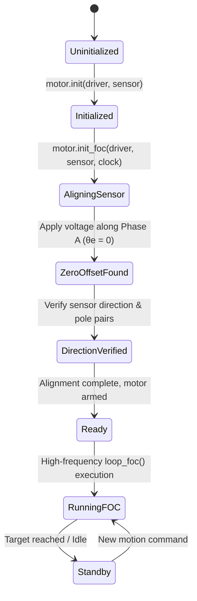

# BLDC Motors (`BLDCMotor`)

The `BLDCMotor` struct in `barefoc::motor::bldc` is the core controller for 3-phase Brushless DC and Permanent Magnet Synchronous Motors.

---

## Motor Parameter Configuration

```rust,no_run
use barefoc::motor::bldc::BLDCMotor;

// Pole pairs: number of rotor magnetic pole pairs (Rotor Magnets / 2)
let mut motor = BLDCMotor::new(7); // e.g., 14-pole drone motor

// Inverter power supply rail
motor.voltage_power_supply = 12.0; // Volts

// Phase resistance (phase-to-neutral or terminal-to-terminal / 2)
motor.phase_resistance = 0.55; // Ohms

// Phase inductance (phase-to-neutral)
motor.phase_inductance = 15e-6; // 15 microHenries

// Velocity constant (RPM per Volt)
motor.kv_rating = 4300.0;
```

---

## Motion Control Modes

BareFOC supports multiple motion control modes configured via `motor.controller`:

| `MotionControlType` | Description | Target Units |
|---|---|---|
| `torque` | Direct quadrature voltage ($V_q$) or current ($I_q$) command | Volts or Amps |
| `velocity` | Closed-loop velocity tracking via velocity PID | Radians/second |
| `angle` | Closed-loop position tracking via cascaded Angle P $\to$ Velocity PID | Radians |
| `velocity_openloop` | Open-loop rotating voltage vector without sensor feedback | Radians/second |
| `angle_openloop` | Open-loop positioning without sensor feedback | Radians |

```rust,no_run
use barefoc::motor::enums::MotionControlType;

// Select velocity mode
motor.controller = MotionControlType::velocity;

// Set safety limits
motor.voltage_limit = 3.0;     // Saturate phase voltage at 3.0 V
motor.velocity_limit = 100.0;  // Saturate target velocity at 100 rad/s
```

---

## Torque Control Types

When running in torque mode (or inside the inner loop of velocity/angle control), `motor.torque_controller` determines how torque is synthesized:

1. **`Voltage` (Default)**:
   Estimates torque assuming $I_q \approx \frac{V_q - e}{R}$. Suitable for simple applications without current sensing shunts.
2. **`DC_Current`**:
   Regulates total DC bus current or magnitude using single-channel current sensing.
3. **`FOC_Current`**:
   True vector current control using dual/triple phase current sensors. Closed-loop PID controllers regulate both $I_d = 0$ and $I_q = I_{\text{target}}$ at high frequency.



---

## Torque Control Types Comparison

| Torque Mode | Sensor Feedback | Loop Dynamics | Efficiency | Use Case |
|---|---|---|---|---|
| **`Voltage`** | Position Sensor only | Open-loop voltage synthesis ($V_q = I_{\text{target}} \cdot R + \omega \cdot K_e$) | Low to Moderate (losses during rotor transients) | Gimbal motors, educational setups, simple position servos |
| **`DC_Current`** | Single DC bus shunt + Position | Scalar current PI regulation | Good | Low-cost ESCs, power tools |
| **`FOC_Current`** | 2 or 3 Phase Shunts + Position | Dual independent $d$-$q$ vector current PIDs | Maximum (Exact MTPA $I_d = 0$, minimum copper loss) | High-performance robotics, CNC spindles, direct-drive actuators |

---

## Real-Time Execution

```rust,no_run
use barefoc::motor::base::FOCMotor;

// High frequency loop (call as fast as possible, typically 10 kHz - 40 kHz)
motor.loop_foc(driver, sensor, clock);

// Outer motion loop (call at 1 kHz - 5 kHz or inside loop_foc)
motor.move_motor(driver, sensor, clock, target_value);
```
