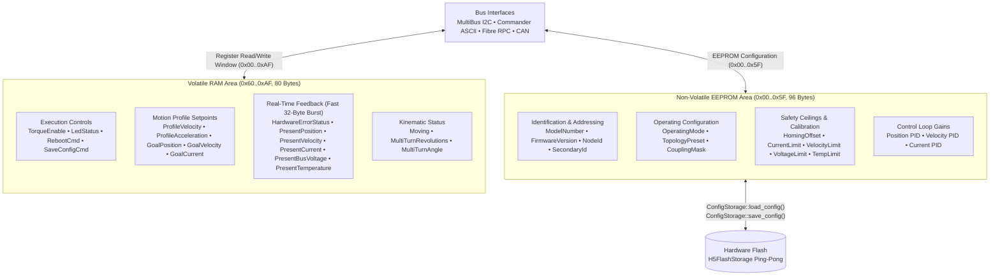

# Universal Control Table (`barefoc::control_table`)

The `barefoc::control_table` module provides a standardized 176-byte register map and configuration engine for Dynamixel-grade smart servos. It models high-performance industrial actuators with strict separation between non-volatile configuration parameters (EEPROM) and high-speed operational registers (RAM).

---

## 1. Memory Architecture & Partitioning

The Control Table occupies a fixed 176-byte contiguous memory block divided into two functional areas:



### Area Boundaries

| Memory Area | Address Range | Size | Mutability | Persistence | Purpose |
|---|:---:|:---:|:---:|---|---|
| **EEPROM Area** | `0x00` – `0x5F` | 96 bytes | R/W | Stored in Flash via `ConfigStorage` | Node address, operating mode, kinematics preset, limits, PID gains |
| **RAM Area** | `0x60` – `0xAF` | 80 bytes | R/W & RO | Volatile (resets to default on boot) | Torque enable, motion profile targets, real-time sensor telemetry, error flags |

---

## 2. Register Map Reference

### A. Non-Volatile EEPROM Section (`0x00` – `0x5F`)

| Offset | Register Name | Data Type | Access | Default | Unit | Description |
|:---:|---|---|:---:|:---:|:---:|---|
| `0x00` | `ModelNumber` | `u16` | RO | `0x0503` | – | Hardware actuator model code |
| `0x02` | `FirmwareVersion` | `u8` | RO | `0x01` | – | Application firmware release version |
| `0x03` | `ProtocolVersion` | `u8` | RO | `0x02` | – | Supported communication protocol revision |
| `0x04` | `NodeId` | `u8` | R/W | `0x40` | – | Primary bus device address (I2C 7-bit slave address) |
| `0x05` | `BaudRate` | `u8` | R/W | `0x00` | – | Serial baud rate index |
| `0x06` | `ReturnDelayTime` | `u8` | R/W | `0x00` | $2\ \mu\text{s}$ | Bus response turnaround delay |
| `0x07` | `OperatingMode` | `u8` | R/W | `2` (Position) | – | Active motion control regime (0–7) |
| `0x08` | `SecondaryId` | `u8` | R/W | `0xFD` | – | Secondary / group broadcast address |
| `0x09` | `TopologyPreset` | `u8` | R/W | `0` (4x 1-DOF) | – | Kinematics topology mode |
| `0x0A` | `CouplingMask` | `u8` | R/W | `0x00` | – | Differential joint coupling bitmask |
| `0x0C` | `HomingOffset` | `f32` | R/W | `0.0` | rad | Zero reference mechanical offset |
| `0x10` | `CurrentLimit` | `f32` | R/W | `1.5` | A | Maximum continuous phase current |
| `0x14` | `AccelerationLimit` | `f32` | R/W | `50.0` | $\text{rad/s}^2$ | Maximum profile trajectory acceleration |
| `0x18` | `VelocityLimit` | `f32` | R/W | `25.0` | rad/s | Maximum permitted shaft velocity |
| `0x1C` | `MinPositionLimit` | `f32` | R/W | $-\pi$ | rad | Software travel floor |
| `0x20` | `MaxPositionLimit` | `f32` | R/W | $+\pi$ | rad | Software travel ceiling |
| `0x24` | `VoltageLimit` | `f32` | R/W | `5.0` | V | Maximum inverter bridge drive voltage |
| `0x28` | `TemperatureLimit` | `f32` | R/W | `75.0` | °C | Thermal shutdown trip threshold |
| `0x2C` | `MinBusVoltage` | `f32` | R/W | `3.0` | V | Undervoltage detection threshold |
| `0x30` | `MaxBusVoltage` | `f32` | R/W | `7.0` | V | Overvoltage protection trip threshold |
| `0x34` | `PositionPGain` | `f32` | R/W | `20.0` | – | Position closed-loop proportional gain |
| `0x38` | `PositionIGain` | `f32` | R/W | `0.0` | – | Position closed-loop integral gain |
| `0x3C` | `PositionDGain` | `f32` | R/W | `0.1` | – | Position closed-loop derivative gain |
| `0x40` | `VelocityPGain` | `f32` | R/W | `0.5` | – | Velocity closed-loop proportional gain |
| `0x44` | `VelocityIGain` | `f32` | R/W | `10.0` | – | Velocity closed-loop integral gain |
| `0x48` | `VelocityDGain` | `f32` | R/W | `0.0` | – | Velocity closed-loop derivative gain |
| `0x4C` | `CurrentPGain` | `f32` | R/W | `3.0` | – | Current/torque loop proportional gain |
| `0x50` | `CurrentIGain` | `f32` | R/W | `300.0` | – | Current/torque loop integral gain |
| `0x54` | `CurrentDGain` | `f32` | R/W | `0.0` | – | Current/torque loop derivative gain |

---

### B. Volatile RAM Section (`0x60` – `0xAF`)

| Offset | Register Name | Data Type | Access | Default | Unit | Description |
|:---:|---|---|:---:|:---:|:---:|---|
| `0x60` | `TorqueEnable` | `u8` | R/W | `0` | – | Motor enable state (`0`=Coast/Disarm, `1`=Armed) |
| `0x61` | `LedStatus` | `u8` | R/W | `0` | – | User LED indicator state |
| `0x62` | `StatusReturnLevel` | `u8` | R/W | `2` | – | Response verbosity level |
| `0x63` | `RebootCommand` | `u8` | WO | `0` | – | Write `0xF0` to enter Katapult bootloader |
| `0x64` | `SaveConfigCommand` | `u8` | WO | `0` | – | Write `0x55` to save EEPROM; write `0xAA` for factory reset |
| `0x66` | `ProfileVelocity` | `f32` | R/W | `10.0` | rad/s | Trajectory generator peak cruise velocity |
| `0x6A` | `ProfileAcceleration` | `f32` | R/W | `25.0` | $\text{rad/s}^2$ | Trajectory generator profile acceleration |
| `0x6E` | `GoalPosition` | `f32` | R/W | `0.0` | rad | Target position setpoint |
| `0x72` | `GoalVelocity` | `f32` | R/W | `0.0` | rad/s | Target velocity setpoint |
| `0x76` | `GoalCurrent` | `f32` | R/W | `0.0` | A | Target torque / current setpoint |
| `0x7A` | `GoalTorque` | `f32` | R/W | `0.0` | Nm | Target torque setpoint |
| `0x80` | `HardwareErrorStatus` | `u16` | RO | `0` | – | Critical safety trip bitfield flags |
| `0x84` | `PresentPosition` | `f32` | RO | `0.0` | rad | Measured shaft angle feedback |
| `0x88` | `PresentVelocity` | `f32` | RO | `0.0` | rad/s | Measured shaft velocity feedback |
| `0x8C` | `PresentCurrent` | `f32` | RO | `0.0` | A | Measured motor phase current magnitude |
| `0x90` | `PresentBusVoltage` | `f32` | RO | `0.0` | V | Measured DC input supply voltage |
| `0x94` | `PresentTemperature` | `f32` | RO | `0.0` | °C | Measured microcontroller die temperature |
| `0xA0` | `Moving` | `u8` | RO | `0` | – | Profile motion active indicator |
| `0xA2` | `MultiTurnRevolutions`| `i32` | RO | `0` | rev | Accumulated full rotations across boundaries |
| `0xA6` | `MultiTurnAngle` | `f32` | RO | `0.0` | rad | Continuous unwrapped position ($2\pi \cdot \text{rev} + \theta$) |

---

## 3. Standard Operating Modes

The actuator control loop switches dynamically according to the `OperatingMode` register (`0x07`):

```rust
#[derive(Debug, Clone, Copy, PartialEq, Eq)]
#[repr(u8)]
pub enum OperatingMode {
    Torque = 0,               // Closed-loop current / torque control
    Velocity = 1,             // Closed-loop velocity PID control
    Position = 2,             // Closed-loop single-turn position control [-pi, +pi]
    MultiTurnPosition = 3,    // Continuous multi-turn extended position control
    CurrentBasedPosition = 4, // Closed-loop position control with active current clamp
    OpenLoopVoltage = 5,      // Direct phase voltage drive without feedback
    OpenLoopVelocity = 6,     // Sensorless velocity stepping
    OpenLoopAngle = 7,        // Sensorless angle positioning
}
```

---

## 4. Safety Protection & Fault Evaluation

The `HardwareErrorStatus` register (`0x80`) is evaluated on every control cycle to protect the actuator from mechanical and electrical failure:

| Bit Flag | Constant Name | Trip Condition | Safety Response |
|:---:|---|---|---|
| `1 << 0` | `OVERCURRENT` | Current $> I_{\text{limit}}$ | Disarms PWM outputs into Coast mode |
| `1 << 1` | `OVERHEAT` | Temperature $> T_{\text{limit}}$ | Disarms PWM outputs; thermal shutdown |
| `1 << 2` | `OVERVOLTAGE` | Supply voltage $> V_{\text{bus,max}}$ | Flags warning; clamps dynamic braking |
| `1 << 3` | `UNDERVOLTAGE` | Supply voltage $< V_{\text{bus,min}}$ | Disarms PWM outputs |
| `1 << 4` | `POSITION_LIMIT`| Target requested outside soft limits | Clamps target to $[P_{\min}, P_{\max}]$ |
| `1 << 5` | `VELOCITY_LIMIT`| Velocity $> V_{\text{limit}}$ | Saturates command to $V_{\text{limit}}$ |
| `1 << 6` | `DRIVER_FAULT` | Hardware gate driver error flag | Latches error; requires manual re-arm |
| `1 << 7` | `FLASH_CORRUPT` | Flash CRC32 header verification failed | Reverts parameters to factory defaults |

### Fault Evaluation Logic

```rust,no_run
let err = table.evaluate_errors(present_current, present_temp, present_voltage);
if err & (error_flags::OVERCURRENT | error_flags::OVERHEAT | error_flags::UNDERVOLTAGE) != 0 {
    motor.disable();
    table.write_u8(REG_TORQUE_ENABLE, 0);
}
```

---

## 5. Rust Integration Example

```rust,no_run
use barefoc::control_table::{ControlTable, OperatingMode, TopologyPreset};
use barefoc::traits::storage::ConfigStorage;

// 1. Initialize Control Table (zero-initialized in static memory)
let mut table = ControlTable::empty();

// 2. Load persisted parameters from Flash (or fall back to factory defaults)
if storage.load_config(&mut table).is_err() {
    table.load_factory_defaults();
    let _ = storage.save_config(&table);
}

// 3. Configure operating mode and soft limits
table.set_operating_mode(OperatingMode::MultiTurnPosition);
table.set_goal_position(3.14159);

// 4. Update real-time telemetry from sensor loop
table.set_present_position(sensor.get_angle());
table.set_present_velocity(sensor.get_velocity());
table.set_present_bus_voltage(v_bus);
table.set_present_temperature(temp_c);

// 5. Enforce software bounds on incoming setpoints
let clamped_target = table.enforce_limits(table.goal_position());
```
