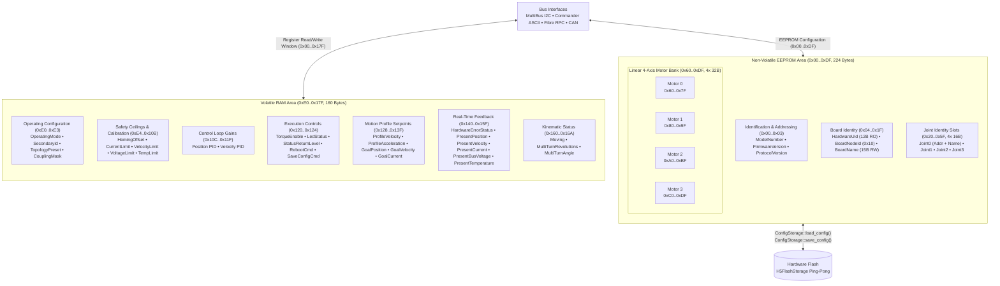
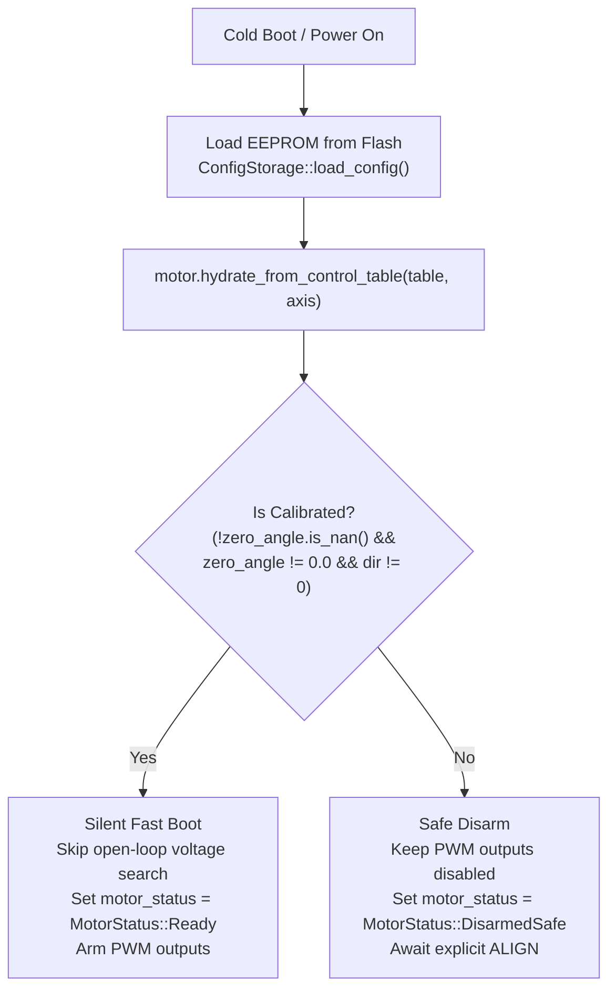
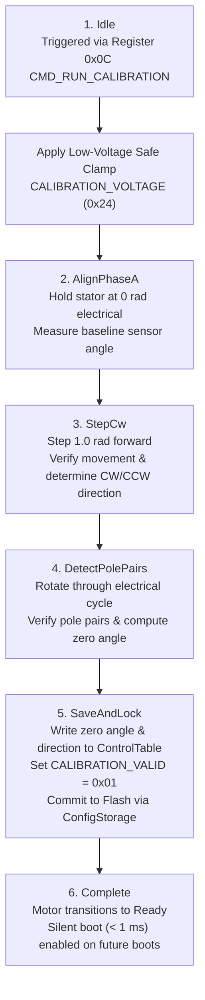

# Universal Control Table (`barefoc::control_table`)

The `barefoc::control_table` module provides a standardized 384-byte (`0x180`) register map and configuration engine for Dynamixel-grade smart servos and multi-axis actuator modules. It models high-performance industrial actuators with strict separation between non-volatile configuration parameters (EEPROM) and high-speed operational registers (RAM).

---

## 1. Memory Architecture & Partitioning

The Control Table occupies a contiguous 384-byte memory block divided into two primary functional areas:



### Area Boundaries

| Memory Area | Address Range | Size | Mutability | Persistence | Purpose |
|---|:---:|:---:|:---:|---|---|
| **EEPROM Area** | `0x00` – `0xDF` | 224 bytes | R/W | Stored in Flash via `ConfigStorage` | Board UID, node address, board name, 4x joint addresses/names, 4-axis motor physical calibration parameters |
| **RAM Area** | `0xE0` – `0x17F` | 160 bytes | R/W & RO | Volatile (resets to default on boot) | Operating modes, safety limits, PID gains, torque enable, trajectory targets, real-time sensor telemetry, error flags |

---

## 2. Register Map Reference

### A. Non-Volatile EEPROM Section (`0x00` – `0xDF`)

#### 1. Board & Protocol Identification (`0x00` – `0x1F`)

| Offset | Register Name | Data Type | Access | Default | Unit | Description |
|:---:|---|---|:---:|:---:|:---:|---|
| `0x00` | `ModelNumber` | `u16` | RO | `0x0503` | – | Hardware actuator model code |
| `0x02` | `FirmwareVersion` | `u8` | RO | `0x01` | – | Application firmware release version |
| `0x03` | `ProtocolVersion` | `u8` | RO | `0x02` | – | Supported communication protocol revision |
| `0x04` | `HardwareUid` | `[u8; 12]`| RO | Factory | – | 96-bit silicon unique electronic signature |
| `0x06` | `NodeId` | `u8` | R/W | `0x40` | – | Device bus target address (`NODE_ID`) |
| `0x0B` | `CmdRebootBootloader` | `u8` | R/W | `0x00` | – | Writing `0x01` sets mailbox token `0x5984E3FA6CA1589B` & triggers BareBoot reset |
| `0x0C` | `CmdRunCalibration` | `u8` | R/W | `0x00` | – | Writing `0x01` initiates guided non-blocking calibration state machine |
| `0x10` | `BoardNodeId` | `u8` | R/W | `0x40` | – | Primary bus device address alias (`REG_BOARD_NODE_ID`) |
| `0x11` | `BoardName` | `str (15B)`| R/W | `""` | – | User-configurable board node name (null-padded UTF-8) |

#### 2. Joint Identity Slots (`0x20` – `0x5F`)

| Offset | Register Name | Data Type | Access | Default | Unit | Description |
|:---:|---|---|:---:|:---:|:---:|---|
| `0x20` | `Joint0Addr` | `u8` | R/W | `0` | – | Joint 0 servo communication address (0..127) |
| `0x21` | `Joint0Name` | `str (15B)`| R/W | `""` | – | Joint 0 kinematic name (null-padded UTF-8) |
| `0x24` | `CalibrationVoltage` | `f32` | R/W | `1.5` | V | Safety voltage clamp during electrical alignment (`CALIBRATION_VOLTAGE`) |
| `0x25` | `CalibrationValid` | `u8` | R/W | `0` | – | Status flag (`0x01` once calibrated and locked) |
| `0x30` | `Joint1Addr` | `u8` | R/W | `1` | – | Joint 1 servo communication address (0..127) |
| `0x31` | `Joint1Name` | `str (15B)`| R/W | `""` | – | Joint 1 kinematic name (null-padded UTF-8) |
| `0x40` | `Joint2Addr` | `u8` | R/W | `2` | – | Joint 2 servo communication address (0..127) |
| `0x41` | `Joint2Name` | `str (15B)`| R/W | `""` | – | Joint 2 kinematic name (null-padded UTF-8) |
| `0x48` | `KpVelocity` | `f32` | R/W | `0.5` | – | Velocity loop proportional gain Kp (takes effect next control cycle) |
| `0x50` | `Joint3Addr` | `u8` | R/W | `3` | – | Joint 3 servo communication address (0..127) |
| `0x51` | `Joint3Name` | `str (15B)`| R/W | `""` | – | Joint 3 kinematic name (null-padded UTF-8) |

#### 3. Linear 4-Axis Motor Bank (`0x60` – `0xDF`)

The Motor Bank provides four dedicated 32-byte slots (`0x20` bytes each) storing physical motor and sensor calibration constants for multi-axis modules:

| Motor Index | Address Range | Slot Base Constant |
|:---:|:---:|---|
| **Motor 0** | `0x60` – `0x7F` | `REG_MOTOR0_BASE` (`0x60`) |
| **Motor 1** | `0x80` – `0x9F` | `REG_MOTOR1_BASE` (`0x80`) |
| **Motor 2** | `0xA0` – `0xBF` | `REG_MOTOR2_BASE` (`0xA0`) |
| **Motor 3** | `0xC0` – `0xDF` | `REG_MOTOR3_BASE` (`0xC0`) |

Each motor slot implements an identical internal layout relative to its slot base:

| Relative Offset | Register Name | Data Type | Access | Default | Unit | Description |
|:---:|---|---|:---:|:---:|:---:|---|
| `+0x00` | `REG_MOTORx_POLE_PAIRS` | `u16` | R/W | `7` | – | Motor pole pair count ($p$) |
| `+0x02` | `REG_MOTORx_PHASE_RESISTANCE` | `f32` | R/W | `0.0` | $\Omega$ | Measured stator phase winding resistance |
| `+0x06` | `REG_MOTORx_PHASE_INDUCTANCE` | `f32` | R/W | `0.0` | $\text{H}$ | Measured stator phase winding inductance |
| `+0x0A` | `REG_MOTORx_KV_RATING` | `f32` | R/W | `0.0` | $\text{rpm/V}$ | Motor velocity constant rating |
| `+0x0E` | `REG_MOTORx_ZERO_ELECTRIC_ANGLE` | `f32` | R/W | `NaN` | rad | Zero electrical angle offset $\theta_{e,0}$ |
| `+0x12` | `REG_MOTORx_SENSOR_DIRECTION` | `u8` | R/W | `0` (Unknown) | – | Sensor rotation direction (`0`=Unknown, `1`=CW, `2`=CCW) |
| `+0x13` | `REG_MOTORx_SENSOR_TYPE` | `u8` | R/W | `0` | – | Hardware sensor peripheral type code |
| `+0x14` | `REG_MOTORx_VOLTAGE_ALIGN` | `f32` | R/W | `3.0` | V | D-axis alignment test voltage |
| `+0x18` | `REG_MOTORx_HOMING_OFFSET` | `f32` | R/W | `0.0` | rad | Mechanical zero reference offset |
| `+0x1C` | `REG_MOTORx_CURRENT_OFFSET_A` | `f32` | R/W | `0.0` | A | Phase A current shunt analog offset |
| `+0x20` | `REG_MOTORx_CURRENT_OFFSET_B` | `f32` | R/W | `0.0` | A | Phase B current shunt analog offset |

---

### B. Volatile RAM Section (`0xE0` – `0x17F`)

#### 1. Operating Configuration & Limits (`0xE0` – `0x11F`)

| Offset | Register Name | Data Type | Access | Default | Unit | Description |
|:---:|---|---|:---:|:---:|:---:|---|
| `0xE0` | `OperatingMode` | `u8` | R/W | `2` (Position) | – | Active motion control regime (0–7) |
| `0xE1` | `SecondaryId` | `u8` | R/W | `0xFD` | – | Secondary / group broadcast address |
| `0xE2` | `TopologyPreset` | `u8` | R/W | `0` (4x 1-DOF) | – | Kinematics topology configuration mode |
| `0xE3` | `CouplingMask` | `u8` | R/W | `0x00` | – | Differential joint coupling bitmask |
| `0xE4` | `HomingOffset` | `f32` | R/W | `0.0` | rad | Zero reference mechanical offset |
| `0xE8` | `CurrentLimit` | `f32` | R/W | `1.5` | A | Maximum continuous phase current |
| `0xEC` | `AccelerationLimit` | `f32` | R/W | `50.0` | $\text{rad/s}^2$ | Maximum profile trajectory acceleration |
| `0xF0` | `VelocityLimit` | `f32` | R/W | `25.0` | rad/s | Maximum permitted shaft velocity |
| `0xF4` | `MinPositionLimit` | `f32` | R/W | $-\pi$ | rad | Software travel floor |
| `0xF8` | `MaxPositionLimit` | `f32` | R/W | $+\pi$ | rad | Software travel ceiling |
| `0xFC` | `VoltageLimit` | `f32` | R/W | `5.0` | V | Maximum inverter bridge drive voltage |
| `0x100` | `TemperatureLimit` | `f32` | R/W | `75.0` | °C | Thermal shutdown trip threshold |
| `0x104` | `MinBusVoltage` | `f32` | R/W | `3.0` | V | Undervoltage detection threshold |
| `0x108` | `MaxBusVoltage` | `f32` | R/W | `7.0` | V | Overvoltage protection trip threshold |
| `0x10C` | `PositionPGain` | `f32` | R/W | `20.0` | – | Position closed-loop proportional gain |
| `0x110` | `PositionIGain` | `f32` | R/W | `0.0` | – | Position closed-loop integral gain |
| `0x114` | `PositionDGain` | `f32` | R/W | `0.1` | – | Position closed-loop derivative gain |
| `0x118` | `VelocityPGain` | `f32` | R/W | `0.5` | – | Velocity closed-loop proportional gain |
| `0x11C` | `VelocityIGain` | `f32` | R/W | `10.0` | – | Velocity closed-loop integral gain |

#### 2. Execution Controls & Telemetry (`0x120` – `0x16A`)

| Offset | Register Name | Data Type | Access | Default | Unit | Description |
|:---:|---|---|:---:|:---:|:---:|---|
| `0x120` | `TorqueEnable` | `u8` | R/W | `0` | – | Motor enable state (`0`=Coast/Disarm, `1`=Armed) |
| `0x121` | `LedStatus` | `u8` | R/W | `0` | – | User LED indicator state |
| `0x122` | `StatusReturnLevel` | `u8` | R/W | `2` | – | Response verbosity level |
| `0x123` | `RebootCommand` | `u8` | WO | `0` | – | Write `0xF0` to enter Katapult bootloader |
| `0x124` | `SaveConfigCommand` | `u8` | WO | `0` | – | Write `0x55` to save EEPROM; write `0xAA` for factory reset |
| `0x128` | `ProfileVelocity` | `f32` | R/W | `10.0` | rad/s | Trajectory generator peak cruise velocity |
| `0x12C` | `ProfileAcceleration` | `f32` | R/W | `25.0` | $\text{rad/s}^2$ | Trajectory generator profile acceleration |
| `0x130` | `GoalPosition` | `f32` | R/W | `0.0` | rad | Target position setpoint |
| `0x134` | `GoalVelocity` | `f32` | R/W | `0.0` | rad/s | Target velocity setpoint |
| `0x138` | `GoalCurrent` | `f32` | R/W | `0.0` | A | Target torque / current setpoint |
| `0x13C` | `GoalVoltage` | `f32` | R/W | `0.0` | V | Target bridge voltage setpoint |
| `0x140` | `HardwareErrorStatus` | `u16` | RO | `0` | – | Critical safety trip bitfield flags |
| `0x142` | `PresentTemperature` | `f32` | RO | `0.0` | °C | Measured microcontroller die temperature |
| `0x144` | `PresentPosition` | `f32` | RO | `0.0` | rad | Measured shaft angle feedback |
| `0x148` | `PresentVelocity` | `f32` | RO | `0.0` | rad/s | Measured shaft velocity feedback |
| `0x14C` | `PresentCurrent` | `f32` | RO | `0.0` | A | Measured motor phase current magnitude |
| `0x150` | `PresentVoltage` | `f32` | RO | `0.0` | V | Commanded phase voltage |
| `0x154` | `PresentBusVoltage` | `f32` | RO | `0.0` | V | Measured DC input supply voltage |
| `0x158` | `FilteredCurrent` | `f32` | RO | `0.0` | A | Low-pass filtered current telemetry |
| `0x15C` | `TrajectoryPosition` | `f32` | RO | `0.0` | rad | Instantaneous profile position output |
| `0x160` | `Moving` | `u8` | RO | `0` | – | Profile motion active indicator |
| `0x162` | `MultiTurnRevolutions`| `i32` | RO | `0` | rev | Accumulated full rotations across boundaries |
| `0x166` | `MultiTurnAngle` | `f32` | RO | `0.0` | rad | Continuous unwrapped position ($2\pi \cdot \text{rev} + \theta$) |

---

## 3. Board, Joint & Motor Bank Management

The Control Table provides zero-allocation (`#![no_std]`) accessors for multi-axis configurations:

```rust,no_run
use barefoc::control_table::ControlTable;

let mut table = ControlTable::new();

// 1. Board Identity
let uid = [0x12, 0x34, 0x56, 0x78, 0x9A, 0xBC, 0xDE, 0xF0, 0x11, 0x22, 0x33, 0x44];
table.set_hardware_uid(&uid);
table.set_board_node_id(0x40);
table.set_board_name("quad_actuator");

// 2. Joint Identity (0..3)
table.set_joint_addr(0, 10);
table.set_joint_name(0, "wrist_pitch");
table.set_joint_addr(1, 11);
table.set_joint_name(1, "wrist_roll");

// 3. Motor Bank Parameter Configuration (Motor 0..3)
table.set_motor_pole_pairs(0, 7);
table.set_motor_phase_resistance(0, 0.28);
table.set_motor_phase_inductance(0, 0.00015);
table.set_motor_kv_rating(0, 380.0);
table.set_motor_zero_electric_angle(0, 1.5708);
table.set_motor_sensor_direction(0, 1); // 1 = Direction::CW

// Read back configured values
assert_eq!(table.board_name(), "quad_actuator");
assert_eq!(table.joint_addr(0), 10);
assert_eq!(table.motor_pole_pairs(0), 7);
assert_eq!(table.motor_phase_resistance(0), 0.28);
```

### Factory Defaults & Uncalibrated States

When initializing a new `ControlTable` or executing a factory reset:
- `motor_zero_electric_angle(index)` defaults to `f32::NAN`. Firmware uses this value to determine whether rotor electrical zero alignment must be performed before enabling closed-loop FOC.
- `motor_sensor_direction(index)` defaults to `0` (`Direction::UNKNOWN`), indicating unverified sensor phasing.

### String Buffer Layout & Null-Padding

All board and joint names are stored as fixed 15-byte slices. When setting names shorter than 15 bytes, trailing bytes are null-padded (`0x00`). When queried, the accessor returns a `&str` sliced up to the first null byte, requiring zero heap allocation.

### Kinematics Assembly Synchronization

`ActuatorAssembly` synchronizes joint identifiers and addresses directly with `ControlTable`:

```rust,no_run
use barefoc::kinematics::assembly::ActuatorAssembly;
use barefoc::control_table::ControlTable;

let mut assembly = ActuatorAssembly::<4, 4>::new();
let mut table = ControlTable::new();

table.set_joint_addr(0, 5);
table.set_joint_name(0, "pitch");

assembly.sync_from_control_table(&table);
assert_eq!(assembly.joint_addr(0), 5);
assert_eq!(assembly.joint_name(0), "pitch");
```

---

## 4. Standard Operating Modes

The actuator control loop switches dynamically according to the `OperatingMode` register (`0xE0`):

```rust
#[derive(Debug, Clone, Copy, PartialEq, Eq)]
#[repr(u8)]
pub enum OperatingMode {
    Torque = 0,               // Closed-loop current / torque control
    Velocity = 1,             // Closed-loop velocity PID control
    Position = 2,             // Closed-loop single-turn position control [-pi, +pi]
    MultiTurnPosition = 3,    // Continuous multi-turn extended position control
    CurrentBasedPosition = 4, // Closed-loop position control with active current clamp
    OpenLoopVoltage = 5,      // Direct phase voltage drive without feedback
    OpenLoopVelocity = 6,     // Sensorless velocity stepping
    OpenLoopAngle = 7,        // Sensorless angle positioning
}
```

---

## 5. Safety Protection & Fault Evaluation

The `HardwareErrorStatus` register (`0x140`) is evaluated on every control cycle to protect the actuator from mechanical and electrical failure:

| Bit Flag | Constant Name | Trip Condition | Safety Response |
|:---:|---|---|---|
| `1 << 0` | `OVERCURRENT` | Current $> I_{\text{limit}}$ | Disarms PWM outputs into Coast mode |
| `1 << 1` | `OVERHEAT` | Temperature $> T_{\text{limit}}$ | Disarms PWM outputs; thermal shutdown |
| `1 << 2` | `OVERVOLTAGE` | Supply voltage $> V_{\text{bus,max}}$ | Flags warning; clamps dynamic braking |
| `1 << 3` | `UNDERVOLTAGE` | Supply voltage $< V_{\text{bus,min}}$ | Disarms PWM outputs |
| `1 << 4` | `POSITION_LIMIT`| Target requested outside soft limits | Clamps target to $[P_{\min}, P_{\max}]$ |
| `1 << 5` | `VELOCITY_LIMIT`| Velocity $> V_{\text{limit}}$ | Saturates command to $V_{\text{limit}}$ |
| `1 << 6` | `DRIVER_FAULT` | Hardware gate driver error flag | Latches error; requires manual re-arm |
| `1 << 7` | `FLASH_CORRUPT` | Flash CRC32 header verification failed | Reverts parameters to factory defaults |

---

## 6. Runtime Calibration, Cold-Boot Hydration & Safety Protocol

BareFOC implements a "Flash Once and Forget" runtime calibration pipeline that decouples compile-time constants from runtime hardware characteristics, ensuring safety on cold boot and allowing single-command calibration over serial bus protocols.

### A. Cold-Boot Hydration & Fast Boot Flow

On system startup before `init_foc()` is executed, the motor configuration is hydrated from the active `ControlTable`:



```rust,no_run
use barefoc::control_table::ControlTable;
use barefoc::motor::bldc::BLDCMotor;
use barefoc::motor::enums::FOCMotorStatus;

// 1. Hydrate from ControlTable
motor.hydrate_from_control_table(&table, 0);

// 2. Initialize FOC commutation
let status = motor.init_foc(&clock);
if status == 1 {
    // Calibrated: ready for closed-loop control immediately
    assert_eq!(motor.config.motor_status, FOCMotorStatus::Ready);
} else {
    // Uncalibrated: outputs disarmed safely, waiting for ALIGN
    assert_eq!(motor.config.motor_status, FOCMotorStatus::DisarmedSafe);
}
```

### B. MultiBus Register `0xB0` (`CALIB_CMD`)

The MultiBus protocol profile registers `REG_CALIB_CMD` (`0xB0`) with self-clearing command semantics:

| Command Byte | Constant | Description | Action |
|:---:|---|---|---|
| `0x01` | `CMD_CALIB_ALIGN` | Electrical Zero Alignment | Runs electrical alignment sweep, updates zero angle and direction in `ControlTable`, auto-commits to Flash, and transitions to `Ready`. |
| `0x02` | `CMD_CALIB_SWEEP` | Step Sweep | Executes step-response motor sweep test. |
| `0x03` | `CMD_CALIB_SAVE` | Manual Flash Save | Commits active EEPROM configuration to Flash storage immediately. |
| `0x04` | `CMD_CALIB_SET_ORIGIN` | Set Mechanical Origin | Records current shaft angle as `HomingOffset` in `ControlTable` and auto-commits to Flash. |

### C. Smart Servo Commander Calibration Commands

The ASCII console commander exposes matching calibration triggers:

- `ALIGN` or `M<id> ALIGN`: Triggers electrical zero search on the specified motor (or joint 0 if omitted), synchronizes measured zero angle and direction to `ControlTable`, and commits to non-volatile Flash.
- `ZERO` or `M<id> ZERO`: Sets the current shaft angle as the mechanical origin offset and commits to Flash.

```text
>> M0 ALIGN
ALIGN OK
>> M0 ZERO
ZERO OK
>> SAVE
CONFIG SAVED
```

---

## 5. Guided Calibration State Machine (`CalibrationStateMachine`)

To eliminate violent startup jerks and current spikes, BareFOC introduces the guided `CalibrationStateMachine` operating under software low-voltage clamps (`CALIBRATION_VOLTAGE`, register `0x24`, default 1.5 V):



### Key Safety Guarantees

- **Low-Voltage Safe Clamp (`CALIBRATION_VOLTAGE`, 0x24)**: The alignment torque is strictly bounded by software voltage limits (typically 1.5 V, or 10-15% of bus voltage), preventing overcurrent trips and mechanical strain on gearboxes.
- **Movement Threshold Verification**: If the rotor is mechanically stalled or locked, the state machine aborts with `CalibrationError::MovementTooSmall` and keeps the inverter in safe high-Z standby.
- **Silent Fast Boot (< 1 ms)**: Once calibrated, `CALIBRATION_VALID` is stored in non-volatile flash. On subsequent power cycles, `motor.hydrate_from_control_table()` loads offsets instantly, enabling immediate closed-loop operation without rotor wiggles or movement.

---

## 6. Declarative Application Macro (`barefoc_app!`) & Unified Transport Bridge

The `barefoc_app!` macro and `UnifiedTransportBridge` reduce board setup boilerplate from over 1,000 lines of manual Embassy code to under 25 lines of clean, declarative Rust.

```rust,no_run
use barefoc::barefoc_app;

barefoc_app! {
    driver: {
        type: BLDCDriver3PWM,
        pins: [PA8, PA9, PA10],
        voltage_limit: 12.0,
    },
    sensor: {
        type: MagneticSensorSPI,
        bus: SPI1,
    },
    transports: {
        multibus: { address: 0x40 },
        commander: { enabled: true },
    },
    foc_frequency: 20_000,
    comms_frequency: 1_000,
}
```

### Unified Transport Bridge

All active communication transports (MultiBus, Fibre, Commander, RTT) route register reads and writes to the single shared 256-byte `ControlTable`:

- **Dynamic Gain Tuning**: Writing a 4-byte float to Register `0x48` (`KP_VELOCITY`) takes effect immediately on the next 20 kHz control cycle without restarting the inverter.
- **Hands-Free Bootloader Entry**: Writing `0x01` to Register `0x0B` (`CMD_REBOOT_BOOTLOADER`) disarms PWM, writes the cross-reset SRAM cookie (`0x5984E3FA6CA1589B`), and executes warm reset into BareBoot.
- **Autonomous Flash Persistence**: Writing `0x55` to Register `0x64` / `0x124` (`REG_SAVE_CONFIG_CMD`) commits the non-volatile EEPROM section to flash.


