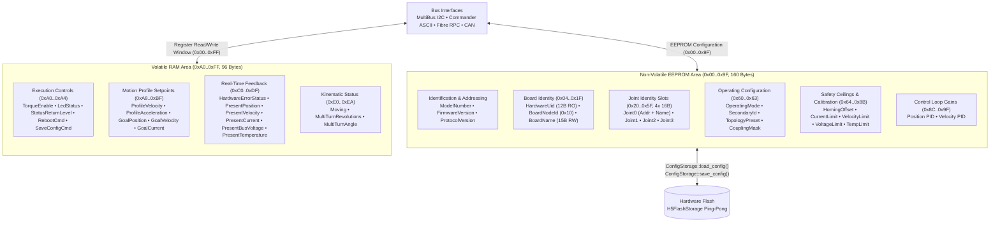

# Universal Control Table (`barefoc::control_table`)

The `barefoc::control_table` module provides a standardized 256-byte register map and configuration engine for Dynamixel-grade smart servos. It models high-performance industrial actuators with strict separation between non-volatile configuration parameters (EEPROM) and high-speed operational registers (RAM).

---

## 1. Memory Architecture & Partitioning

The Control Table occupies a fixed 256-byte contiguous memory block divided into two functional areas:



### Area Boundaries

| Memory Area | Address Range | Size | Mutability | Persistence | Purpose |
|---|:---:|:---:|:---:|---|---|
| **EEPROM Area** | `0x00` – `0x9F` | 160 bytes | R/W | Stored in Flash via `ConfigStorage` | Board UID, node address, board name, 4x joint addresses/names, operating mode, kinematics preset, limits, PID gains |
| **RAM Area** | `0xA0` – `0xFF` | 96 bytes | R/W & RO | Volatile (resets to default on boot) | Torque enable, motion profile targets, real-time sensor telemetry, error flags |

---

## 2. Register Map Reference

### A. Non-Volatile EEPROM Section (`0x00` – `0x9F`)

| Offset | Register Name | Data Type | Access | Default | Unit | Description |
|:---:|---|---|:---:|:---:|:---:|---|
| `0x00` | `ModelNumber` | `u16` | RO | `0x0503` | – | Hardware actuator model code |
| `0x02` | `FirmwareVersion` | `u8` | RO | `0x01` | – | Application firmware release version |
| `0x03` | `ProtocolVersion` | `u8` | RO | `0x02` | – | Supported communication protocol revision |
| `0x04` | `HardwareUid` | `[u8; 12]`| RO | Factory | – | 96-bit silicon unique electronic signature |
| `0x10` | `BoardNodeId` | `u8` | R/W | `0x40` | – | Primary bus device address (I2C/CAN node ID) |
| `0x11` | `BoardName` | `str (15B)`| R/W | `""` | – | User-configurable board node name (null-padded UTF-8) |
| `0x20` | `Joint0Addr` | `u8` | R/W | `0` | – | Joint 0 servo communication address (0..127) |
| `0x21` | `Joint0Name` | `str (15B)`| R/W | `""` | – | Joint 0 kinematic name (null-padded UTF-8) |
| `0x30` | `Joint1Addr` | `u8` | R/W | `1` | – | Joint 1 servo communication address (0..127) |
| `0x31` | `Joint1Name` | `str (15B)`| R/W | `""` | – | Joint 1 kinematic name (null-padded UTF-8) |
| `0x40` | `Joint2Addr` | `u8` | R/W | `2` | – | Joint 2 servo communication address (0..127) |
| `0x41` | `Joint2Name` | `str (15B)`| R/W | `""` | – | Joint 2 kinematic name (null-padded UTF-8) |
| `0x50` | `Joint3Addr` | `u8` | R/W | `3` | – | Joint 3 servo communication address (0..127) |
| `0x51` | `Joint3Name` | `str (15B)`| R/W | `""` | – | Joint 3 kinematic name (null-padded UTF-8) |
| `0x60` | `OperatingMode` | `u8` | R/W | `2` (Position) | – | Active motion control regime (0–7) |
| `0x61` | `SecondaryId` | `u8` | R/W | `0xFD` | – | Secondary / group broadcast address |
| `0x62` | `TopologyPreset` | `u8` | R/W | `0` (4x 1-DOF) | – | Kinematics topology mode |
| `0x63` | `CouplingMask` | `u8` | R/W | `0x00` | – | Differential joint coupling bitmask |
| `0x64` | `HomingOffset` | `f32` | R/W | `0.0` | rad | Zero reference mechanical offset |
| `0x68` | `CurrentLimit` | `f32` | R/W | `1.5` | A | Maximum continuous phase current |
| `0x6C` | `AccelerationLimit` | `f32` | R/W | `50.0` | $\text{rad/s}^2$ | Maximum profile trajectory acceleration |
| `0x70` | `VelocityLimit` | `f32` | R/W | `25.0` | rad/s | Maximum permitted shaft velocity |
| `0x74` | `MinPositionLimit` | `f32` | R/W | $-\pi$ | rad | Software travel floor |
| `0x78` | `MaxPositionLimit` | `f32` | R/W | $+\pi$ | rad | Software travel ceiling |
| `0x7C` | `VoltageLimit` | `f32` | R/W | `5.0` | V | Maximum inverter bridge drive voltage |
| `0x80` | `TemperatureLimit` | `f32` | R/W | `75.0` | °C | Thermal shutdown trip threshold |
| `0x84` | `MinBusVoltage` | `f32` | R/W | `3.0` | V | Undervoltage detection threshold |
| `0x88` | `MaxBusVoltage` | `f32` | R/W | `7.0` | V | Overvoltage protection trip threshold |
| `0x8C` | `PositionPGain` | `f32` | R/W | `20.0` | – | Position closed-loop proportional gain |
| `0x90` | `PositionIGain` | `f32` | R/W | `0.0` | – | Position closed-loop integral gain |
| `0x94` | `PositionDGain` | `f32` | R/W | `0.1` | – | Position closed-loop derivative gain |
| `0x98` | `VelocityPGain` | `f32` | R/W | `0.5` | – | Velocity closed-loop proportional gain |
| `0x9C` | `VelocityIGain` | `f32` | R/W | `10.0` | – | Velocity closed-loop integral gain |

---

### B. Volatile RAM Section (`0xA0` – `0xFF`)

| Offset | Register Name | Data Type | Access | Default | Unit | Description |
|:---:|---|---|:---:|:---:|:---:|---|
| `0xA0` | `TorqueEnable` | `u8` | R/W | `0` | – | Motor enable state (`0`=Coast/Disarm, `1`=Armed) |
| `0xA1` | `LedStatus` | `u8` | R/W | `0` | – | User LED indicator state |
| `0xA2` | `StatusReturnLevel` | `u8` | R/W | `2` | – | Response verbosity level |
| `0xA3` | `RebootCommand` | `u8` | WO | `0` | – | Write `0xF0` to enter Katapult bootloader |
| `0xA4` | `SaveConfigCommand` | `u8` | WO | `0` | – | Write `0x55` to save EEPROM; write `0xAA` for factory reset |
| `0xA8` | `ProfileVelocity` | `f32` | R/W | `10.0` | rad/s | Trajectory generator peak cruise velocity |
| `0xAC` | `ProfileAcceleration` | `f32` | R/W | `25.0` | $\text{rad/s}^2$ | Trajectory generator profile acceleration |
| `0xB0` | `GoalPosition` | `f32` | R/W | `0.0` | rad | Target position setpoint |
| `0xB4` | `GoalVelocity` | `f32` | R/W | `0.0` | rad/s | Target velocity setpoint |
| `0xB8` | `GoalCurrent` | `f32` | R/W | `0.0` | A | Target torque / current setpoint |
| `0xBC` | `GoalVoltage` | `f32` | R/W | `0.0` | V | Target bridge voltage setpoint |
| `0xC0` | `HardwareErrorStatus` | `u16` | RO | `0` | – | Critical safety trip bitfield flags |
| `0xC2` | `PresentTemperature` | `f32` | RO | `0.0` | °C | Measured microcontroller die temperature |
| `0xC4` | `PresentPosition` | `f32` | RO | `0.0` | rad | Measured shaft angle feedback |
| `0xC8` | `PresentVelocity` | `f32` | RO | `0.0` | rad/s | Measured shaft velocity feedback |
| `0xCC` | `PresentCurrent` | `f32` | RO | `0.0` | A | Measured motor phase current magnitude |
| `0xD0` | `PresentVoltage` | `f32` | RO | `0.0` | V | Commanded phase voltage |
| `0xD4` | `PresentBusVoltage` | `f32` | RO | `0.0` | V | Measured DC input supply voltage |
| `0xD8` | `FilteredCurrent` | `f32` | RO | `0.0` | A | Low-pass filtered current telemetry |
| `0xDC` | `TrajectoryPosition` | `f32` | RO | `0.0` | rad | Instantaneous profile position output |
| `0xE0` | `Moving` | `u8` | RO | `0` | – | Profile motion active indicator |
| `0xE2` | `MultiTurnRevolutions`| `i32` | RO | `0` | rev | Accumulated full rotations across boundaries |
| `0xE6` | `MultiTurnAngle` | `f32` | RO | `0.0` | rad | Continuous unwrapped position ($2\pi \cdot \text{rev} + \theta$) |

---

## 3. Board & Joint Identity Management

The 256-byte Control Table introduces first-class multi-joint identification supporting up to 4 kinematic axes per board unit:

```rust,no_run
use barefoc::control_table::ControlTable;

let mut table = ControlTable::new();

// 1. Board Identity
let uid = [0x12, 0x34, 0x56, 0x78, 0x9A, 0xBC, 0xDE, 0xF0, 0x11, 0x22, 0x33, 0x44];
table.set_hardware_uid(&uid);
table.set_board_node_id(0x40);
table.set_board_name("wrist_module");

// 2. Joint Identity (0..3)
table.set_joint_addr(0, 10);
table.set_joint_name(0, "wrist_pitch");

table.set_joint_addr(1, 11);
table.set_joint_name(1, "wrist_roll");

// Query identity
assert_eq!(table.board_name(), "wrist_module");
assert_eq!(table.joint_addr(0), 10);
assert_eq!(table.joint_name(0), "wrist_pitch");
```

### String Buffer Layout & Null-Padding

All board and joint names are stored as fixed 15-byte slices. When setting names shorter than 15 bytes, trailing bytes are null-padded (`0x00`). When queried, the accessor returns a `&str` sliced up to the first null byte, requiring zero heap allocation (`#![no_std]`).

### Kinematics Assembly Synchronization

`ActuatorAssembly` directly synchronizes joint identifiers and addresses with `ControlTable`:

```rust,no_run
use barefoc::kinematics::assembly::ActuatorAssembly;
use barefoc::control_table::ControlTable;

let mut assembly = ActuatorAssembly::<4, 4>::new();
let mut table = ControlTable::new();

table.set_joint_addr(0, 5);
table.set_joint_name(0, "pitch");

assembly.sync_from_control_table(&table);
assert_eq!(assembly.joint_addr(0), 5);
assert_eq!(assembly.joint_name(0), "pitch");
```

---

## 4. Standard Operating Modes

The actuator control loop switches dynamically according to the `OperatingMode` register (`0x60`):

```rust
#[derive(Debug, Clone, Copy, PartialEq, Eq)]
#[repr(u8)]
pub enum OperatingMode {
    Torque = 0,               // Closed-loop current / torque control
    Velocity = 1,             // Closed-loop velocity PID control
    Position = 2,             // Closed-loop single-turn position control [-pi, +pi]
    MultiTurnPosition = 3,    // Continuous multi-turn extended position control
    CurrentBasedPosition = 4, // Closed-loop position control with active current clamp
    OpenLoopVoltage = 5,      // Direct phase voltage drive without feedback
    OpenLoopVelocity = 6,     // Sensorless velocity stepping
    OpenLoopAngle = 7,        // Sensorless angle positioning
}
```

---

## 5. Safety Protection & Fault Evaluation

The `HardwareErrorStatus` register (`0xC0`) is evaluated on every control cycle to protect the actuator from mechanical and electrical failure:

| Bit Flag | Constant Name | Trip Condition | Safety Response |
|:---:|---|---|---|
| `1 << 0` | `OVERCURRENT` | Current $> I_{\text{limit}}$ | Disarms PWM outputs into Coast mode |
| `1 << 1` | `OVERHEAT` | Temperature $> T_{\text{limit}}$ | Disarms PWM outputs; thermal shutdown |
| `1 << 2` | `OVERVOLTAGE` | Supply voltage $> V_{\text{bus,max}}$ | Flags warning; clamps dynamic braking |
| `1 << 3` | `UNDERVOLTAGE` | Supply voltage $< V_{\text{bus,min}}$ | Disarms PWM outputs |
| `1 << 4` | `POSITION_LIMIT`| Target requested outside soft limits | Clamps target to $[P_{\min}, P_{\max}]$ |
| `1 << 5` | `VELOCITY_LIMIT`| Velocity $> V_{\text{limit}}$ | Saturates command to $V_{\text{limit}}$ |
| `1 << 6` | `DRIVER_FAULT` | Hardware gate driver error flag | Latches error; requires manual re-arm |
| `1 << 7` | `FLASH_CORRUPT` | Flash CRC32 header verification failed | Reverts parameters to factory defaults |
