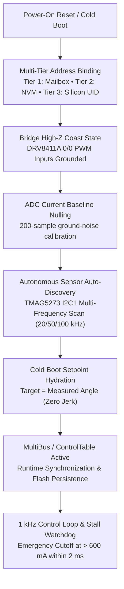
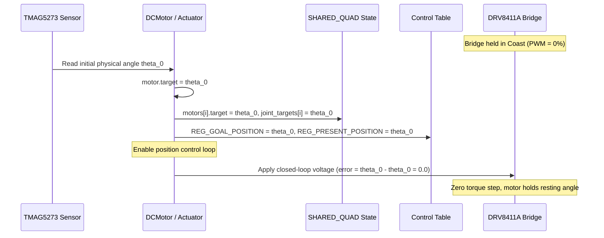
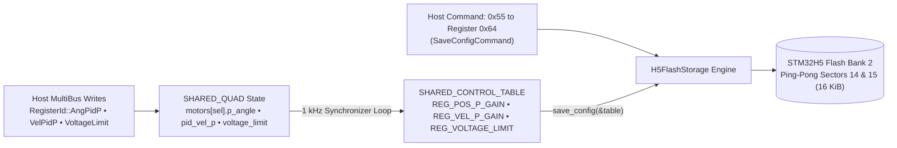

# Flash-Once-and-Play Autonomous Actuator Architecture

The BareFOC Flash-Once-and-Play architecture enables embedded motion controllers (such as FishyServo and multi-axis robotics modules) to deploy deterministically directly from manufacturing flashing without requiring host setup scripts, manual address assignment, or external calibration sequences.



---

## 1. Multi-Tier Deterministic Address Resolution

To avoid bus address collisions when multiple unconfigured actuators are connected to the same MultiBus physical bus, BareFOC implements a 3-tier deterministic addressing hierarchy:

| Priority Tier | Source | Storage Location | Address Range | Validation Rule |
|---|---|---|---|---|
| **Tier 1 (High)** | Soft-Reset Mailbox | SRAM `0x2000_7FE0` | `0x08..=0x77` | Valid `magic` (`REQUEST_CANBOOT` or `REQUEST_APP`) and matching IEEE 802.3 CRC32 |
| **Tier 2 (Mid)** | Non-Volatile Flash | Bank 2 Sectors 14 & 15 | `0x08..=0x77` | Persisted `ControlTable::node_id()` with valid sector checksum |
| **Tier 3 (Base)** | Factory Silicon UID | ROM `0x08FF_F800` | `0x10..=0x70` | Deterministic CRC32 modulo hash of 96-bit hardware unique ID: `0x10 + (CRC32(UID) % 97)` |

### Deterministic Hash Implementation

```rust,no_run
pub fn derive_uid_node_id(uid: &[u8; 12]) -> u8 {
    let crc = calculate_crc32(uid);
    0x10 + (crc % 97) as u8
}
```

This ensures every microcontroller possesses an immutable, factory-unique default bus address out of the box, preventing address collisions during first power-up.

---

## 2. Autonomous Multi-Tier Startup & Zeroing

### Safe Coast Hardware Initialization
At power-up, all bridge inputs (Channels A, B, C, D) are driven to 0 V (`0/0` logic state). On DRV8411A dual H-bridges, this commands low-side MOSFETs open and places motor windings in high-impedance Coast mode, preventing current draw or mechanical motion.

### 200-Sample ADC Baseline Nulling
Before motor bridges are energized, `CurrentMirrorSense` samples the analog current mirror pins (`ISENS_A..D`) across 200 consecutive ADC conversion rounds. The measured average voltage represents the hardware zero-current ground offset, which is subtracted from all subsequent telemetry and torque calculations:

```rust,no_run
cs_a.calibrate_offsets_rounds(&CLOCK, 200);
cs_b.calibrate_offsets_rounds(&CLOCK, 200);
cs_c.calibrate_offsets_rounds(&CLOCK, 200);
cs_d.calibrate_offsets_rounds(&CLOCK, 200);
```

### Sensor Auto-Discovery with Graceful Fallback
The sensor bus (I2C1) scans candidate bus frequencies (`20 kHz`, `50 kHz`, `100 kHz`) and known 7-bit device addresses (`0x35`, `0x22`, `0x78`, `0x44`). When an acknowledgment is received, manufacturer register `0x0E` is read to verify TI manufacturer ID (`0x5449`), and register `0x0D` is checked to select between Generation 1 and Generation 2 device variants (`A1/A2`, `B1/B2`, `C1/C2`, `D1/D2`). If no physical sensor responds, the subsystem transitions to `DummySensor`, allowing safe open-loop velocity debugging without firmware panics.

---

## 3. Cold Boot Setpoint Hydration (Zero Startup Jerk)

Conventional servo controllers initialize target position to `0.0` radians. If the physical output horn rests at an angle of `+1.8` radians when power is applied, enabling closed-loop position control produces a violent full-torque step toward `0.0`, risking gear teeth stripping and mechanical linkage damage.

BareFOC eliminates startup shock through Cold Boot Setpoint Hydration:



```rust,no_run
// Cold Boot Setpoint Hydration
let init_ang_a = if has_sensor { motor_a.shaft_angle() } else { 0.0 };
motor_a.target = init_ang_a;

SHARED_QUAD.lock(|sq| {
    let mut sq = sq.borrow_mut();
    for i in 0..4 {
        sq.motors[i].target = init_angles[i];
        sq.motors[i].current_angle = init_angles[i];
        sq.joint_targets[i] = init_angles[i];
        sq.joint_angles[i] = init_angles[i];
    }
});

SHARED_CONTROL_TABLE.lock(|ct| {
    let mut table = ct.borrow_mut();
    table.write_f32(REG_GOAL_POSITION, init_ang_a);
    table.write_f32(REG_PRESENT_POSITION, init_ang_a);
});
```

---

## 4. MultiBus-to-NVM Synchronization & Flash Persistence

During active operation, external host controllers update position setpoints, velocity limits, and PID parameters across the physical MultiBus I2C/SPI interface into `SHARED_QUAD`. To ensure parameter adjustments persist across reboots, the firmware continuously synchronizes runtime registers into `SHARED_CONTROL_TABLE`.

### Live Parameter Synchronization Map



When a host issues command `0x55` to register `0x64` (`REG_SAVE_CONFIG_MULTIBUS`):
1. `multibus_save_config_hook` and `bootloader_write_hook` detect `CMD_SAVE_CONFIG` (`0x55`).
2. Live parameters from `SHARED_QUAD` (PID gains, limits, homing offsets, active node ID) are synchronized into `SHARED_CONTROL_TABLE`.
3. `H5FlashStorage` verifies sector validity and commits the updated configuration into Bank 2 ping-pong Sectors 14 & 15.
4. On subsequent boots, `boot_table` restores the exact user-tuned gains.

---

## 5. Overcurrent Emergency Stall Protection (< 2 ms)

Micro-gear motors (such as N20 actuators) possess low thermal mass; sustained stall currents exceeding 600 mA can burn armature windings within hundreds of milliseconds.

BareFOC integrates high-speed hardware current protection directly into the 1 kHz motor regulation task:

```rust,no_run
// Emergency overcurrent stall protection (> 600 mA)
if cur_ma > 600.0 && motors[i].enabled != 0 {
    rprintln!("EMERGENCY OVERCURRENT TRIP ON MOTOR {}! I={:.1} mA > 600 mA. Coasting.", i, cur_ma);
    motors[i].disable();
    wrapped[i].move_motor(0.0, &CLOCK);
    SHARED_QUAD.lock(|sq| {
        sq.borrow_mut().motors[i].enabled = false;
    });
    SHARED_CONTROL_TABLE.lock(|ct| {
        ct.borrow_mut().set_error_flag(error_flags::OVERCURRENT);
    });
}
```

### Safety Guarantees:
- **Sub-2 ms Intervention**: Current sensing runs inside the 1 ms control interrupt loop. An overcurrent event triggers immediate motor disarming and zero-duty output within at most 2 loop cycles (< 2 ms).
- **High-Impedance Coast**: The bridge is placed in Coast mode rather than active brake mode, preventing regenerative overvoltage back into the DC power rail.
- **Visual & Register Signaling**: The active fault sets `error_flags::OVERCURRENT` in register `0x140` (`HARDWARE_ERROR_STATUS`) and illuminates the active-low red error LED.
