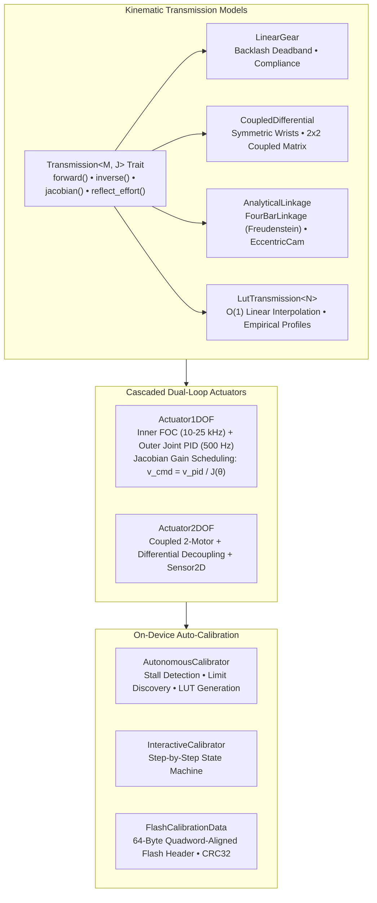
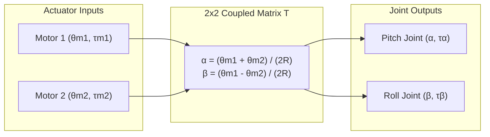
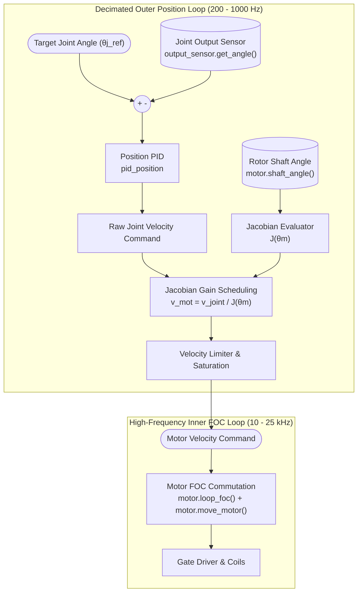
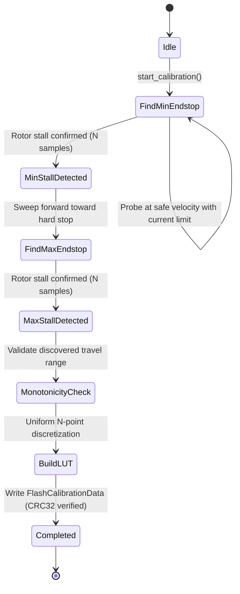

# Kinematics & Transmissions (`barefoc::kinematics`)

The `barefoc::kinematics` module provides `#![no_std]` coordinate transformations, transmission models, multi-axis coupled joint decoupling, cascaded dual-loop controllers, and on-device auto-calibration routines for robotic mechanisms.

---

## Architecture Overview



---

## 1. The `Transmission<M, J>` Trait

All transmission models implement the generic `Transmission<const MOTORS: usize, const JOINTS: usize>` trait:

```rust
pub trait Transmission<const MOTORS: usize, const JOINTS: usize> {
    /// Forward kinematics: Maps motor rotor angles (rad) to joint output angles (rad)
    fn forward(&self, mot_angles: &[f32; MOTORS]) -> [f32; JOINTS];

    /// Inverse kinematics: Maps joint output angles (rad) to motor rotor angles (rad)
    fn inverse(&self, joint_angles: &[f32; JOINTS]) -> [f32; MOTORS];

    /// Instantaneous Jacobian matrix J: partial derivatives ∂θ_joint[j] / ∂θ_mot[m]
    fn jacobian(&self, mot_angles: &[f32; MOTORS]) -> [[f32; MOTORS]; JOINTS];

    /// Forward velocity projection: v_joint = J * v_mot
    fn forward_velocity(
        &self,
        mot_angles: &[f32; MOTORS],
        mot_velocities: &[f32; MOTORS],
    ) -> [f32; JOINTS];

    /// Effort reflection: projects joint torques to motor torques: τ_mot = J^T * τ_joint
    fn reflect_effort(
        &self,
        mot_angles: &[f32; MOTORS],
        joint_torques: &[f32; JOINTS],
    ) -> [f32; MOTORS];
}
```

### Mathematical Formulation:

- **Position Forward Kinematics**:
  $$\boldsymbol{\theta}_j = f(\boldsymbol{\theta}_m)$$

- **Instantaneous Jacobian Matrix ($\mathbf{J}$)**:
  $$J_{j,m} = \frac{\partial \theta_{j}}{\partial \theta_{m}}, \quad \mathbf{J} \in \mathbb{R}^{J \times M}$$

- **Velocity Mapping**:
  $$\mathbf{v}_j = \mathbf{J}(\boldsymbol{\theta}_m) \cdot \mathbf{v}_m$$

- **Effort Reflection (Virtual Work Duality)**:
  $$\boldsymbol{\tau}_m = \mathbf{J}^T(\boldsymbol{\theta}_m) \cdot \boldsymbol{\tau}_j$$

---

## 2. Transmission Models

| Transmission Type | Motors $\to$ Joints | Model Class | Characteristics |
|---|---|---|---|
| **`LinearGear`** | $1 \to 1$ | Linear / Direct | Constant reduction ratio $R$, smooth backlash deadband, torsional elasticity |
| **`CoupledDifferential`** | $2 \to 2$ | Coupled Linear | 2-DOF differential wrists and gimbals via 2x2 coupling matrices |
| **`FourBarLinkage`** | $1 \to 1$ | Non-linear Analytical | Exact closed-form Freudenstein equation, open/crossed branch selection |
| **`EccentricCam`** | $1 \to 1$ | Non-linear Analytical | Rocker follower angle derived from eccentric crank geometry |
| **`LutTransmission<N>`** | $1 \to 1$ | Non-linear Empirical | $\mathcal{O}(1)$ piecewise linear interpolation over $N$ uniform grid points |

---

### A. Linear Gear Reduction (`LinearGear`)

Models planetary gearboxes, harmonic drives, belt pulleys, and lead screws. Includes active compensation for **mechanical backlash** and **structural torsional compliance**.

```rust,no_run
use barefoc::kinematics::transmission::LinearGear;

let gearbox = LinearGear::new(50.0)             // 50:1 reduction ratio
    .with_inverted(false)                       // Preserve direction
    .with_zero_offset(0.0)                      // Rotor zero reference
    .with_backlash(0.002, 0.05)                 // δ = 2 mrad deadband, ω_thresh = 0.05 rad/s
    .with_torsional_stiffness(1500.0);          // K_gear = 1500 Nm/rad stiffness
```

#### Backlash & Compliance Formulation:

To prevent discontinuous chatter at velocity zero-crossings, BareFOC models backlash hysteresis using a smooth hyperbolic tangent transition:

$$\Delta\theta_{\text{backlash}} = \delta \cdot \tanh\left(\frac{\omega_m}{\omega_{\text{thresh}}}\right)$$

Torsional gear flex under load is compensated using linear elastic feedforward:

$$\Delta\theta_{\text{flex}} = \frac{\tau_j}{K_{\text{gear}}}$$

The compensated joint output angle is evaluated as:

$$\theta_j = \frac{\theta_m - \theta_0 - \Delta\theta_{\text{backlash}}}{R} - \Delta\theta_{\text{flex}}$$

---

### B. Coupled Differential Transmission (`CoupledDifferential`)

Coordinates 2-motor to 2-joint coupled mechanisms such as robotic pitch/roll differential wrists and spherical camera gimbals.



```rust,no_run
use barefoc::kinematics::transmission::CoupledDifferential;

// Symmetric differential wrist with 10:1 bevel gear reduction
let diff = CoupledDifferential::symmetric(10.0);

// Forward kinematics: [θm1, θm2] -> [Pitch (α), Roll (β)]
let joint_angles = diff.forward_2d([motor1_pos, motor2_pos]);

// Reflect joint torques to motor torques: [τα, τβ] -> [τm1, τm2]
let motor_torques = diff.reflect_torques_2d([pitch_torque, roll_torque]);
```

---

### C. Analytical Linkages (`FourBarLinkage` & `EccentricCam`)

For mechanical linkages with closed-form geometric solutions, BareFOC provides exact analytical kinematics and exact continuous Jacobian derivatives:

#### Four-Bar Linkage (`FourBarLinkage`):
Solves Freudenstein's equation for crank-rocker and double-rocker mechanisms:

$$K_1 \cos\theta_4 - K_2 \cos\theta_2 + K_3 = \cos(\theta_2 - \theta_4)$$

Where the Freudenstein constants are:

$$K_1 = \frac{L_1}{L_2}, \quad K_2 = \frac{L_1}{L_4}, \quad K_3 = \frac{L_1^2 + L_2^2 - L_3^2 + L_4^2}{2 L_2 L_4}$$

```rust,no_run
use barefoc::kinematics::transmission::{FourBarLinkage, FourBarBranch};

// Construct 4-bar linkage: L1=100mm (ground), L2=30mm (crank), L3=90mm (coupler), L4=50mm (follower)
let linkage = FourBarLinkage::new(0.100, 0.030, 0.090, 0.050, FourBarBranch::Open);

let follower_angle = linkage.forward_1d(crank_angle);
let instantaneous_gear_ratio = linkage.jacobian_1d(crank_angle);
```

---

### D. Look-Up Table Transmissions (`LutTransmission<N>`)

When linkage geometries, non-circular cams, or tendon routings lack convenient closed-form expressions, `LutTransmission<const N: usize>` provides $\mathcal{O}(1)$ table lookups with linear interpolation:

```rust,no_run
use barefoc::kinematics::transmission::LutTransmission;

// 65-point empirical transmission curve over [0, π] radians
const N: usize = 65;
let table: [f32; N] = [ /* calibrated joint angles */ 0.0; N ];

let lut = LutTransmission::new(0.0, core::f32::consts::PI, table);

// O(1) piecewise linear interpolation
let joint_angle = lut.forward_1d(motor_angle);
let jacobian = lut.jacobian_1d(motor_angle);
```

---

## 3. Cascaded Dual-Loop Actuator Control

High-performance robotic actuators typically feature **dual encoders**:
1. An **on-rotor high-speed sensor** (e.g., 14-bit magnetic SSI) feeding the high-frequency motor FOC commutation loop (10 kHz – 25 kHz).
2. An **on-joint output sensor** (mounted after the gearbox/linkage) tracking the true mechanical load position (200 Hz – 1 kHz) free from transmission backlash and structural compliance.



### Jacobian Gain Scheduling

For non-linear linkages (cams, 4-bar linkages, tendon spools), the mechanical leverage $J(\theta) = \frac{d\theta_j}{d\theta_m}$ varies continuously across the workspace. A fixed PID gain would result in sluggish response at low leverage and instability/oscillation at high leverage.

`Actuator1DOF` automatically applies **Jacobian gain scheduling**:

$$v_{\text{mot, cmd}} = \frac{v_{\text{PID}}}{J(\theta_m)}$$

Normalizing the outer position loop gain by the instantaneous transmission Jacobian guarantees consistent closed-loop bandwidth across the entire range of motion.

### Actuator Integration Example:

```rust,no_run
use barefoc::kinematics::actuator::Actuator1DOF;
use barefoc::common::pid::PIDController;

let mut actuator = Actuator1DOF::new(motor, transmission, joint_sensor, pid_position)
    .with_downsample(10); // Run outer position loop once every 10 FOC steps

loop {
    // High-frequency loop tick: automatically executes outer loop every 10 ticks
    actuator.step(target_joint_angle, &clock);
}
```

---

## 4. On-Device Auto-Calibration

BareFOC includes automated calibration state machines that discover mechanical limits, measure hysteresis, and record non-linear transmission curves directly on embedded hardware.



### Autonomous Limit Discovery (`AutonomousCalibrator`):

```rust,no_run
use barefoc::kinematics::calibration::{AutonomousCalibrator, CalibrationConfig};

let config = CalibrationConfig {
    sweep_velocity: 1.0,           // 1.0 rad/s safe search speed
    probe_limit: 1.5,              // Low torque/voltage limit during stall probe
    stall_vel_threshold: 0.05,     // < 0.05 rad/s considered stalled
    stall_confirm_samples: 50,     // 50 consecutive ticks to confirm endstop
    timeout_us: 10_000_000,        // 10s timeout
};

let mut calibrator = AutonomousCalibrator::<65>::new(config);
let result = calibrator.calibrate(&mut motor, &mut joint_sensor, &clock)?;

// Access generated monotonic LUT transmission
let calibrated_lut = result.lut;
```

---

## 5. Non-Volatile Flash Storage (`FlashCalibrationData`)

Calibration results are packed into a 64-byte quadword-aligned binary header designed for direct programming into microcontroller non-volatile flash memory sectors:

```rust
#[repr(C, align(64))]
pub struct FlashCalibrationData {
    pub magic: u32,               // Magic signature: 0x4246_4F43 ("BFOC")
    pub version: u16,             // Format version (1)
    pub flags: u16,               // Feature flags
    pub gear_ratio: f32,          // Nominal gear ratio
    pub zero_offset: f32,         // Rotor zero offset (rad)
    pub backlash_delta: f32,      // Measured backlash half-deadband (rad)
    pub torsional_stiffness: f32, // Torsional gear stiffness (Nm/rad)
    pub joint_min: f32,           // Discovered minimum joint angle (rad)
    pub joint_max: f32,           // Discovered maximum joint angle (rad)
    pub lut_mot_min: f32,         // LUT range minimum motor angle (rad)
    pub lut_mot_max: f32,         // LUT range maximum motor angle (rad)
    pub lut_points: u16,          // Number of points in LUT table
    pub reserved: [u8; 18],       // Reserved padding for alignment
    pub checksum: u32,            // CRC32 checksum over the preceding 60 bytes
}
```

### Flash Memory Layout Reference:

| Byte Offset | Field Name | Data Type | Purpose |
|:---:|---|---|---|
| `0x00` – `0x03` | `magic` | `u32` | Magic identification word (`0x4246_4F43` / `"BFOC"`) |
| `0x04` – `0x05` | `version` | `u16` | Schema version identifier |
| `0x06` – `0x07` | `flags` | `u16` | Configuration flags (inverted, backlash active, compliance active) |
| `0x08` – `0x0B` | `gear_ratio` | `f32` | Kinematic reduction ratio |
| `0x0C` – `0x0F` | `zero_offset` | `f32` | Motor electrical/mechanical zero offset (rad) |
| `0x10` – `0x13` | `backlash_delta` | `f32` | Half-width of backlash hysteresis deadband (rad) |
| `0x14` – `0x17` | `torsional_stiffness` | `f32` | Torsional compliance $K_{\text{gear}}$ (Nm/rad) |
| `0x18` – `0x1F` | `joint_min`, `joint_max` | `f32`, `f32` | Calibrated mechanical travel limits (rad) |
| `0x20` – `0x27` | `lut_mot_min`, `lut_mot_max` | `f32`, `f32` | Non-linear LUT input range bounds |
| `0x28` – `0x29` | `lut_points` | `u16` | Number of discretized interpolation samples |
| `0x2A` – `0x3B` | `reserved` | `[u8; 18]` | Quadword alignment padding |
| `0x3C` – `0x3F` | `checksum` | `u32` | CRC32 data integrity checksum |
