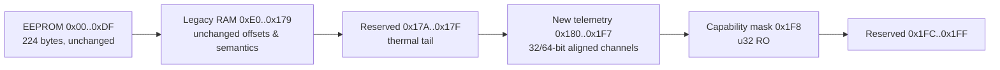
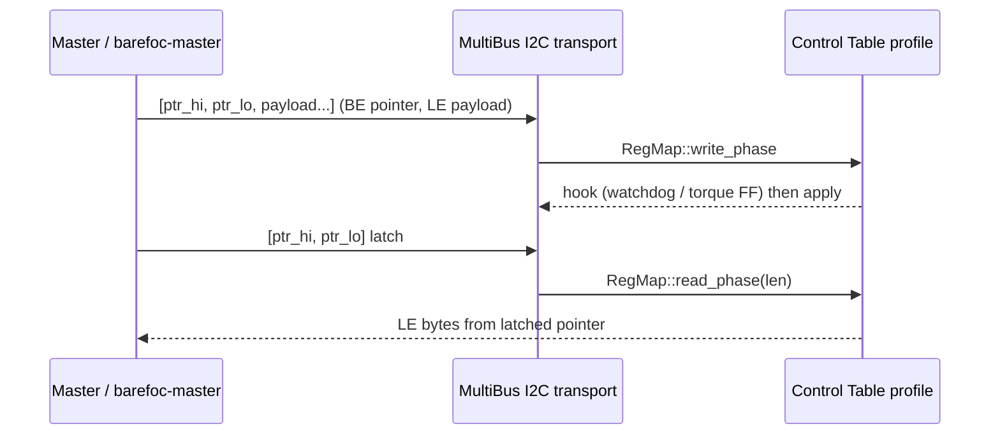

# Extended Telemetry & Control Registers

The `extended-telemetry-controls` change expands the [Universal Control Table](/actuators/control_table/) from 384 to 512 bytes (`CONTROL_TABLE_SIZE = 0x200`). The EEPROM area stays at 224 bytes (`0x00..0xDF`); the volatile RAM area grows from 160 to 288 bytes (`0xE0..0x1FF`). The expansion is additive: every existing offset, including the [multi-zone thermal registers](/sensors/temperature/), keeps its address and meaning.

## 1. Allocation Principles



- **Expand, never relocate.** Proposal-drafted offsets such as `0x154`, `0x162`, `0x172` and `0x176` collided with live telemetry and the preceding thermal change, so the authoritative allocation places all new channels in `0x180..0x1FF`. The multi-zone thermal registers remain at `0x142` (legacy u16 MOSFET), `0x16A`, `0x16E`, `0x100`, `0x172` and `0x176`.
- **No RW aliasing.** The capability mask is not overlaid on any RW field. In particular, the 15-byte `BoardName` at `0x11..0x1F` is untouched, so writing a full-length name cannot corrupt hardware detection.
- **Natural alignment.** Every `f32`/`u32` channel begins at a 4-byte boundary, the `f64` channel at `0x1E0` is 8-byte aligned, and every `u16` channel is 2-byte aligned.
- **Unequipped sentinels.** Float channels report `f32::NAN`; integer and status channels report `0`. A master reads the capability mask first and skips queries for unequipped channels.
- **Legacy error word unchanged.** The 16-bit `HardwareErrorStatus` at `0x140` is not widened; widening in place would overwrite `REG_PRESENT_TEMP_MOSFET` (`0x142`) and `REG_PRESENT_POSITION` (`0x144`).

## 2. Capability Bitmask (`0x1F8`, u32, RO)

`REG_HARDWARE_CAPABILITIES` publishes the peripherals fitted to a node. It is read-only on every bus profile; firmware writes it through `ControlTable::set_hardware_capabilities`. The register is 4-byte aligned at `0x1F8`, immediately after the 16-byte fault FIFO and before the four reserved bytes `0x1FC..0x1FF`. It does not overlap `REG_BOARD_NAME` (`0x11..0x1F`) or `REG_FAULT_HISTORY` (`0x1E8..0x1F8`).

| Bit | Constant (`barefoc::control_table::capabilities`) | Meaning |
|:---:|---|---|
| 0 | `CURRENT_SENSE` | On-board current sensing fitted |
| 1 | `DUAL_ENCODER` | Second encoder fitted; gear deflection available |
| 2 | `TEMPERATURE` | At least one temperature channel fitted |
| 3 | `BRAKE_CHOPPER` | Brake chopper / dump switch fitted |
| 4 | `MAGNETIC_DIAGNOSTICS` | Magnetic field magnitude and status available |
| 5 | `POWER_TELEMETRY` | Bus current / power / energy telemetry available |
| 6 | `WATCHDOG` | Communication watchdog implemented |
| 7 | `RTOS_PROFILING` | Loop time, jitter and CPU load available |

## 3. Canonical Register Allocation

This table is the authoritative allocation from the change design; it supersedes the proposal's drafted offsets.

| Register | Type | Address | Proposal address (rejected) |
|---|:---:|:---:|:---:|
| `REG_HARDWARE_CAPABILITIES` | u32 | `0x1F8` | `0x08`; later `0x1C` (overlapped `BoardName`) — both rejected |
| `REG_PRESENT_BUS_CURRENT` | f32 | `0x180` | `0x156` |
| `REG_PRESENT_BUS_POWER` | f32 | `0x184` | `0x15A` |
| `REG_ACCUMULATED_ENERGY` | f32 | `0x188` | `0x15E` |
| `REG_FOC_IQ_MEASURED` | f32 | `0x18C` | `0x162` |
| `REG_FOC_ID_MEASURED` | f32 | `0x190` | `0x166` |
| `REG_MODULATION_INDEX` | f32 | `0x194` | `0x172` |
| `REG_BRAKE_CHOPPER_DUTY` | u8 | `0x198` | `0x176` |
| `REG_PRESENT_TORQUE` | f32 | `0x19C` | `0x178` |
| `REG_PRESENT_ACCELERATION` | f32 | `0x1A0` | `0x17C` |
| `REG_TRACKING_ERROR` | f32 | `0x1A4` | `0x180` |
| `REG_GEAR_DEFLECTION` | f32 | `0x1A8` | `0x184` |
| `REG_GOAL_TORQUE_FF` | f32 | `0x1AC` | `0x188` |
| `REG_IMPEDANCE_KP` | f32 | `0x1B0` | `0x18C` |
| `REG_IMPEDANCE_KD` | f32 | `0x1B4` | `0x190` |
| `REG_MAG_FIELD_MAGNITUDE` | f32 | `0x1B8` | `0x194` |
| `REG_MAG_STATUS_FLAGS` | u8 | `0x1BC` | `0x198` |
| `REG_SENSOR_CRC_ERRORS` | u16 | `0x1BE` | `0x19A` |
| `REG_WATCHDOG_TIMEOUT_MS` | u16 | `0x1C0` | `0x19C` |
| `REG_WATCHDOG_TIME_LEFT_MS` | u16 | `0x1C2` | `0x19E` |
| `REG_TRAJECTORY_STATUS` | u8 | `0x1C4` | `0x1A0` |
| `REG_IN_POSITION_BAND` | f32 | `0x1C8` | `0x1A2` |
| `REG_POSITION_DEADBAND` | f32 | `0x1CC` | `0x1A6` |
| `REG_LOOP_TIME_US` | u16 | `0x1D0` | `0x1AA` |
| `REG_MAX_LOOP_JITTER_US` | u16 | `0x1D2` | `0x1AC` |
| `REG_CPU_LOAD_PCT` | u8 | `0x1D4` | `0x1AE` |
| `REG_HARDWARE_ERROR_STATUS_EXT` | u32 | `0x1D8` | `0x140` (widened — rejected) |
| `REG_TOTAL_OPERATING_HOURS` | f32 | `0x1DC` | `0x1B0` |
| `REG_TOTAL_REVOLUTIONS` | f64 | `0x1E0` | `0x1B4` |
| `REG_FAULT_HISTORY` | 16 bytes | `0x1E8..0x1F8` | `0x1BC..0x1C4` |

`0x1D5..0x1D7` and `0x1FC..0x1FF` remain reserved.

## 4. Telemetry Groups

### Electrical power & energy

`PresentBusCurrent` (A), `PresentBusPower` (W) and `AccumulatedEnergy` (W·h) expose supply telemetry. `FocIqMeasured` / `FocIdMeasured` report the measured $d$–$q$ currents, `ModulationIndex` the SVPWM modulation index $\in [0,1]$, and `BrakeChopperDuty` the dump-switch duty cycle. `ControlTable::accumulate_energy(power_w, dt_s)` integrates power into watt-hours with a non-negative clamp.

### Robotics dynamics & impedance

`PresentTorque` (N·m), `PresentAcceleration` (rad/s²), `TrackingError` (rad) and `GearDeflection` (rad) provide inverse-dynamics feedback. Gear deflection is defined as

$$\delta = \frac{\theta_{\text{rotor}}}{R} - \theta_{\text{horn}}$$

where $R$ is the gear ratio. A master writes `GoalTorqueFF` (N·m) to inject feedforward torque additively into the current loop, and configures `ImpedanceKp` / `ImpedanceKd` for virtual joint stiffness and damping. `update_tracking(goal, present, deadband)` refreshes the tracking error and in-position flag.

### Sensor integrity

`MagFieldMagnitude` (mT), `MagStatusFlags` and `SensorCrcErrors` diagnose sensor degradation and interference. `set_magnet_fault(status_bit)` sets a status bit and latches `MAGNET_FAULT` in the extended error word. The CRC counter saturates at `u16::MAX`.

### Communication watchdog

`WatchdogTimeoutMs` (RW, milliseconds, `0` disables) and `WatchdogTimeLeftMs` (RO) implement a bus-silence watchdog. Writes to the timeout register through the MultiBus profile fire a keepalive hook that re-arms the countdown. When the countdown reaches zero, `tick_watchdog(dt_ms)` clears `TorqueEnable` (Coast mode) and latches `BUS_WATCHDOG` in the extended word. This is a Control Table policy, not a transport feature.

### Trajectory & profiling

`TrajectoryStatus`, `InPositionBand`, `PositionDeadband`, `LoopTimeUs`, `MaxLoopJitterUs` and `CpuLoadPct` expose trajectory state and RTOS execution profiling. The timing values are supplied by the firmware clock; no fixed delay primitives are used.

### Lifecycle odometer

`TotalOperatingHours` (f32) and `TotalRevolutions` (f64) track lifetime usage. The 16-byte `FaultHistory` at `0x1E8..0x1F8` is a bounded ring of four 4-byte records:

| Byte in record | Field | Type | Meaning |
|:---:|---|---|---|
| `+0` | `code` | u8 | Firmware fault code (`0` = empty slot) |
| `+1` | `zone` | u8 | Fault zone / subsystem identifier |
| `+2..+4` | `timestamp_ms` | u16 LE | Monotonic timestamp in milliseconds |

The FIFO head is the slot with the smallest timestamp among occupied records; empty slots are filled first. When all four slots are occupied the oldest record is overwritten in place, so no byte outside `0x1E8..0x1F8` changes.

## 5. Extended Error Flags (`0x1D8`, u32, RO)

`HardwareErrorStatusExt` is a **separate** shadow of the legacy 16-bit word at `0x140`, which remains byte-for-byte unchanged. Bits 0..15 are reserved; bits 16..20 are defined:

| Bit | Constant (`error_flags_ext`) | Trip condition |
|:---:|---|---|
| 16 | `STALL_DETECTED` | Rotor stalled while torque is commanded |
| 17 | `BUS_WATCHDOG` | Watchdog countdown expired |
| 18 | `SENSOR_LOSS` | Position sensor signal lost |
| 19 | `MAGNET_FAULT` | Magnetic field outside valid range |
| 20 | `PHASE_OPEN` | Motor phase open-circuit |

## 6. Protocol & Client Surfaces



MultiBus register pointers widened from `u8` to `u16` (`RegEntry::offset`, `RegMap::ptr`, `set`/`get`/`find_entry`). The I2C pointer latch is now a two-byte big-endian address, matching `barefoc-master::I2cTransport`. Without this change, `0x180` would alias to `0x80` and collide with the motor bank. The master SDK mirrors every constant, validates accesses against 512 bytes, and provides `read_u32` / `read_f64` for capability and odometer channels.

The ASCII `SmartServoCommander` adds `CUR`, `PWR`, `NRG`, `TRQ`, `ACC`, `MAG`, `ODOM`, `WDT`, `CPU`, `CAP` and `ERRX` queries. The legacy `TM` / `TU` / `TW` thermal queries and `LT <zone> <deg>` limit command are unchanged.

```rust,no_run
use barefoc::control_table::{ControlTable, capabilities, error_flags_ext};

let mut table = ControlTable::new();
table.set_hardware_capabilities(capabilities::CURRENT_SENSE | capabilities::POWER_TELEMETRY);
table.set_present_bus_power(24.0);
table.accumulate_energy(24.0, 3600.0); // 24 W·h
table.set_watchdog_timeout_ms(500);
table.feed_watchdog();
if table.tick_watchdog(500) {
    table.set_error_flag_ext(error_flags_ext::BUS_WATCHDOG);
}
assert!(!table.torque_enable());
```

See the [Control Table reference](/actuators/control_table/) for the complete legacy map and [MultiBus](/communication/multibus/) for the transport framing.
