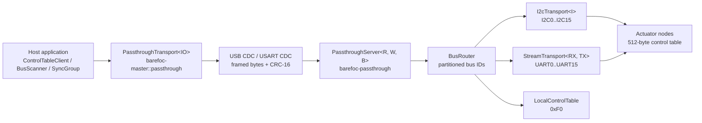
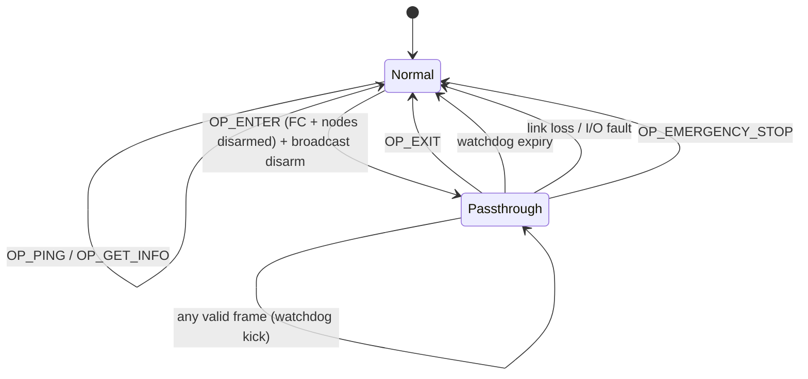

# Bus Passthrough (`barefoc-passthrough`)

Bus passthrough lets a PC running the [Master Controller SDK](/master/) reach
downstream BareFOC actuator nodes through a flight controller's (FC) existing
USB or USART link, without a separate USB-to-I2C/UART adapter. The FC acts as a
transport-to-transport bridge: each framed request is decoded into an ordinary
`barefoc_master::Transport` call on the selected downstream bus.

The feature is split across three crates:

| Crate | Side | Responsibility |
|---|---|---|
| `barefoc-master::passthrough` | Host | Frame codec, constants, `PassthroughTransport<IO>` |
| `barefoc-passthrough` | Device | `PassthroughServer<R, W, B>`, `BusRouter`, safety FSM, local FC table |
| `barefoc-stm32::usb_cdc` | Device | Feature-gated `embedded_io` bridge over embassy-usb CDC ACM |

The central FC example in the repository (`examples/central_fc_stm32h5`) wires
a native USB CDC link to I2C and framed UART downstream buses.

---

## 1. Architecture



Only the transport is swapped in host code; the typed client, scanner and sync
group are unchanged. The device server reuses the same inner transports as a
local master, so register-pointer semantics, bulk reads and atomic
`SYNC_WRITE` dispatch are identical on both sides. The full register map is
described in [Universal Control Table](/actuators/control_table/) and the
servo framing in [MultiBus](/communication/multibus/).

---

## 2. Frame format

```text
[0xA5][version][opcode][bus][node][hi][lo][len][payload ...][crc16]
   0     1        2      3    4    5   6    7      8..8+len   +2
```

| Field | Size | Meaning |
|---|---|---|
| sync | 1 | `0xA5` |
| version | 1 | `0x01` |
| opcode | 1 | Request opcode; responses set bit 7 (`opcode \| 0x80`) |
| bus | 1 | Partitioned bus ID (§4) |
| node | 1 | Target node address on that bus |
| hi / lo | 1 + 1 | Request: big-endian 16-bit register pointer. Response: typed status / sub-status flags |
| len | 1 | Payload length, `0..=128` |
| payload | `len` | Little-endian register values or opcode-specific data |
| crc16 | 2 | CRC-16/CCITT-FALSE (poly `0x1021`, init `0xFFFF`, no reflection, XOR-out `0x0000`) over bytes `0..8+len`, appended little-endian |

Maximum payload is `128` bytes (`barefoc_master::MAX_STREAM_PAYLOAD`), giving a
deterministic maximum frame of **138 bytes**. Both sides use one stack buffer;
there is no heap and no `dyn Transport`.

A frame with an invalid CRC, unsupported version or oversized payload is
discarded without any bus transaction. On the device it is answered with an
error status but **does not exit passthrough mode**.

---

## 3. Opcodes and status codes

| Opcode | Name | Purpose |
|---|---|---|
| `0x01` | `OP_PING` | Link/status check; legal in normal mode |
| `0x02` | `OP_ENTER` | Enter passthrough (disarmed only) |
| `0x03` | `OP_EXIT` | Leave passthrough, broadcast disarm |
| `0x04` | `OP_GET_INFO` | Protocol version, bus mask, MTU, firmware version |
| `0x10` | `OP_READ` | Register read on selected bus |
| `0x11` | `OP_WRITE` | Register write on selected bus |
| `0x12` | `OP_SYNC_WRITE` | Atomic raw packet dispatch (`send_packet`) |
| `0x20` | `OP_SCAN_BUS` | Single-frame I2C address bitmask |
| `0x30` | `OP_KEEPALIVE` | Refresh watchdog without bus I/O |
| `0x31` | `OP_EMERGENCY_STOP` | Immediate disarm and exit |

Responses echo `opcode | 0x80` and set `hi` to one of:

| Code | Status | Code | Status |
|---|---|---|---|
| `0x00` | `Ok` | `0x07` | `InvalidLength` |
| `0x01` | `NotDisarmed` | `0x08` | `InvalidCrc` |
| `0x02` | `NotInPassthrough` | `0x09` | `UnsupportedOpcode` |
| `0x03` | `InvalidBus` | `0x0A` | `UnsupportedVersion` |
| `0x04` | `BusNak` | `0x0B` | `ExecutionFault` |
| `0x05` | `BusTimeout` | | |
| `0x06` | `BusBusy` | | |

On the host, `BusNak` maps to `TransportError::NoAcknowledge`, `BusTimeout` to
`TransportError::Timeout`, and the safety/protocol statuses to
`TransportError::Protocol` with a stable static message.

`OP_GET_INFO` returns 11 bytes: protocol version (`u8`), supported bus bitmask
(`u32` LE), maximum payload (`u16` LE), firmware version (`u32` LE).

---

## 4. Multi-bus addressing

| Bus ID | Class | Device implementation |
|---|---|---|
| `0x00..=0x0F` | I2C0..I2C15 | `I2cTransport<I>` (2-byte big-endian pointer) |
| `0x10..=0x1F` | UART0..UART15 | `StreamTransport<RX, TX>` (framed register protocol only; no ASCII Commander) |
| `0x20..=0x2F` | CAN0..CAN15 | Reserved in protocol v1 (available via a custom `BusAccess`) |
| `0xF0` | `LOCAL_FC` | Local control table: firmware, capabilities, error flags, thermal telemetry, mode state |
| `0xFF` | `BROADCAST_ALL` | Mode entry verification and disarm broadcast |

The local FC table begins at `0x00`: mode state (`u8`, `0` normal / `1`
passthrough), firmware version (`u32` at `0x02`), capabilities (`u32` at
`0x08`), error flags (`u32` at `0x0C`), temperature in °C (`f32` at `0x10`),
and watchdog timeout mirror (`u16` at `0x14`). Writing the watchdog register
over `0xF0` reconfigures the device's safety timer.

`OP_SCAN_BUS` returns a **16-byte bitmask** covering all 128 seven-bit I2C
addresses in one round trip; bit `n` is set when address `n` acknowledged.
Ordinary host-side `BusScanner` reads are still forwarded verbatim, so no
host-side variant is required.

---

## 5. Safety state machine



1. **Entry verification** — `OP_ENTER` is rejected with `NotDisarmed` while the
   FC is armed or any downstream `REG_TORQUE_ENABLE` (`0x12C`) is nonzero.
2. **Active disarm** — on accepted entry the FC broadcasts
   `REG_TORQUE_ENABLE = 0` to every actuator bus before forwarding any frames.
3. **Watchdog** — every valid frame (or `OP_KEEPALIVE`) refreshes a timer sourced
   from `REG_WATCHDOG_TIMEOUT_MS` (`0x1C0`, default 500 ms).
4. **Exit** — exit, timeout, link loss or a safety fault always broadcasts the
   disarm again, clears the mode-state bit, restores bus roles and resumes
   flight-control operation. Later register frames are answered with
   `NotInPassthrough`.
5. **Arbitration** — while active, one passthrough task owns bus I/O; the
   application suspends normal flight-control bus access until exit.

---

## 6. Host and device setup

```rust,ignore
// Host: no other code changes needed.
let mut pt = PassthroughTransport::new(port); // embedded_io::Read + Write
pt.enter_passthrough()?;
let info = pt.get_info()?;
let mut client = ControlTableClient::new(0x40, &mut pt);
let angle = client.read_f32(REG_PRESENT_POSITION)?;
let mask = pt.scan_bus_fast(BUS_I2C_BASE)?; // optional single-frame scan
pt.exit_passthrough()?;
```

```rust,ignore
// Device: application supplies the stream halves and the inner transports.
let buses = DeviceBuses::new(
    Some(I2cTransport::new(i2c_master)),
    Some(StreamTransport::new(uart_rx, uart_tx)),
    LocalControlTable::new(FW_VERSION, capabilities),
);
let mut server = PassthroughServer::new(usb_cdc_reader, usb_cdc_writer, buses);
loop {
    let now_ms = clock.now_ms();
    let _ = server.service(now_ms)?; // auto-disarms on exit / timeout / link loss
}
```

`barefoc-stm32` exposes the blocking CDC bridges behind the
`usb-cdc-passthrough` feature (`UsbCdcReader`, `UsbCdcWriter`, `UsbCdcStream`).
The existing USART CDC path is an interchangeable attachment: the server is
generic over `embedded_io` and produces byte-identical responses for both.

---

## 7. Verification

```bash
cargo check -p barefoc-master && cargo test -p barefoc-master
(cd barefoc-comms && cargo test -p barefoc-passthrough)
(cd barefoc-hal && cargo check -p barefoc-stm32 --features usb-cdc-passthrough)
(cd examples/central_fc_stm32h5 && cargo check --target thumbv8m.main-none-eabihf)
```

Host and device unit tests cover CRC vectors, corrupted/oversized frames,
exact `GET_INFO` and scan bytes, typed client / scanner / sync reuse, entry
refusal and acceptance, single-frame scan, keepalive and watchdog expiry,
emergency stop, local-mode reads, and byte-identical responses across stream
implementations. No test requires hardware.

---

## Related pages

- [Master Controller SDK](/master/)
- [MultiBus register transport](/communication/multibus/)
- [Universal Control Table](/actuators/control_table/)
- [Copper Bridge (`cu-barefoc`)](/communication/copper_bridge/)
