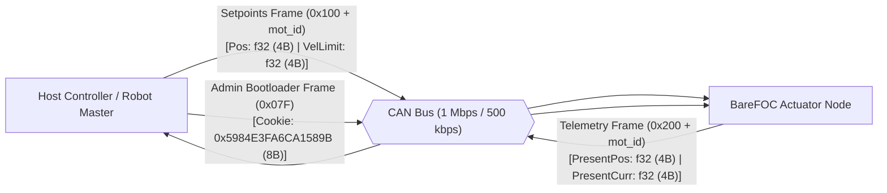

# CAN Bus Protocol (`barefoc::communication::can`)

The `barefoc::communication::can` module defines standardized 8-byte Controller Area Network (CAN 2.0A/B) frame structures for high-speed deterministic robotic buses. It enables host controllers to stream motion targets, monitor high-rate telemetry, and trigger bootloader hand-offs with zero dynamic allocation.

---

## 1. CAN Frame Architecture

All motion and telemetry frames use standard 11-bit identifiers partitioned by function and motor index:



### Identifier Map

| Frame Identifier | Range | Direction | Payload Size | Purpose |
|:---:|:---:|:---:|:---:|---|
| `CAN_ID_SETPOINT_BASE` | `0x100` – `0x103` | Host $\to$ Node | 8 bytes | Goal position (f32) + Velocity limit (f32) for motor $0..3$ |
| `CAN_ID_TELEMETRY_BASE` | `0x200` – `0x203` | Node $\to$ Host | 8 bytes | Present position (f32) + Present current (f32) for motor $0..3$ |
| `CAN_ID_REBOOT_BOOTLOADER` | `0x07F` | Host $\to$ Node | 8 bytes | Administrative reset into Katapult recovery bootloader |

---

## 2. Frame Payload Formats

### A. Motion Setpoint Frame (`0x100` + `mot_id`)

Command frame sent periodically by the master motion controller:

| Byte Offset | Field | Data Type | Encoding | Description |
|:---:|---|---|:---:|---|
| `0..=3` | `position_target` | `f32` | Little-Endian IEEE 754 | Commanded shaft angle target (rad) |
| `4..=7` | `velocity_limit` | `f32` | Little-Endian IEEE 754 | Maximum velocity ceiling for this step (rad/s) |

### B. Telemetry Feedback Frame (`0x200` + `mot_id`)

Feedback frame transmitted by the actuator at regular telemetry intervals:

| Byte Offset | Field | Data Type | Encoding | Description |
|:---:|---|---|:---:|---|
| `0..=3` | `present_position` | `f32` | Little-Endian IEEE 754 | Measured shaft position (rad) |
| `4..=7` | `present_current` | `f32` | Little-Endian IEEE 754 | Measured motor phase current (A) |

### C. Bootloader Reboot Frame (`0x07F`)

Administrative trigger commanding the actuator to disarm PWM and reset into Katapult:

| Byte Offset | Field | Value | Description |
|:---:|---|---|---|
| `0..=7` | `cookie` | `0x5984_E3FA_6CA1_589B` | 64-bit Katapult bootloader request token |

---

## 3. Rust Encoding & Decoding APIs

```rust,no_run
use barefoc::communication::can::{
    encode_can_position_frame, decode_can_position_frame,
    encode_can_telemetry_frame, decode_can_reboot_frame,
    CAN_ID_SETPOINT_BASE, CAN_ID_TELEMETRY_BASE, CAN_ID_REBOOT_BOOTLOADER,
};
use barefoc::control_table::ControlTable;

// 1. Host encoding a setpoint frame for motor 0
let frame_data = encode_can_position_frame(3.14159, 25.0);
// Send CAN frame with ID = CAN_ID_SETPOINT_BASE + 0 (0x100)

// 2. Actuator decoding incoming frame
let (target_pos, vel_limit) = decode_can_position_frame(&frame_data);
table.set_goal_position(target_pos);
table.set_velocity_limit(vel_limit);

// 3. Actuator transmitting telemetry response
let telem_data = encode_can_telemetry_frame(table.present_position(), table.present_current());
// Transmit CAN frame with ID = CAN_ID_TELEMETRY_BASE + 0 (0x200)

// 4. Checking for administrative bootloader request
if rx_id == CAN_ID_REBOOT_BOOTLOADER && decode_can_reboot_frame(&rx_payload) {
    bootloader.enter_bootloader();
}
```
