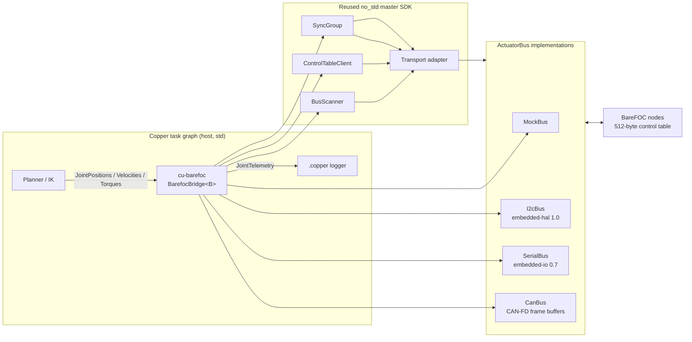
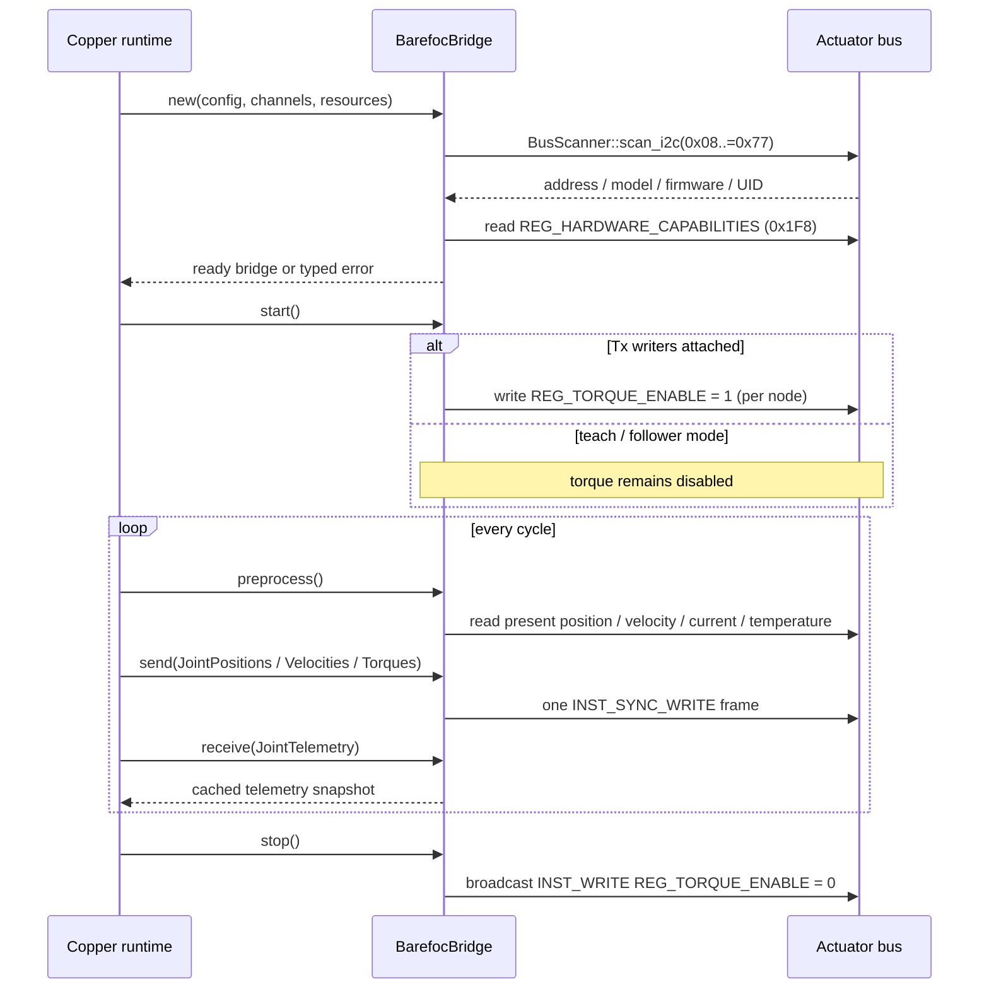

# Copper Bridge (`cu-barefoc`)

The `cu-barefoc` crate connects [Copper](https://github.com/copper-project/copper-rs)
task graphs to BareFOC actuator networks. It implements Copper's `CuBridge`
contract with typed joint channels, atomic multi-axis dispatch, cached
telemetry and a fail-safe disarm.

The bridge itself is host-side and therefore uses `std`: Copper is a host
framework. The actuator-side SDK it reuses, [`barefoc-master`](/tools/master/), stays
`#![no_std]` and zero-heap. No new register definitions are introduced in the
bridge; all addresses come from the [Universal Control Table](/actuators/control_table/).

---

## 1. Architecture



### 1.1 Crate layout

| Module | Responsibility |
|---|---|
| `messages` | `MAX_ACTUATORS`, `JointPositions`, `JointVelocities`, `JointTorques`, `JointTelemetry` |
| `transport` | `ActuatorBus`, `MasterTransport`, `MockBus`, `I2cBus`, `SerialBus`, `CanBus` |
| `bridge` | Channel declarations, `UnitMode`, `BarefocBridge`, `CuBridge` lifecycle |

---

## 2. Channels and messages

| Direction | Channel identifier | Payload | Control-table target |
|---|---|---|---|
| Tx | `JointPositions` | `JointPositions` | `REG_GOAL_POSITION` `0x130` |
| Tx | `JointVelocities` | `JointVelocities` | `REG_GOAL_VELOCITY` `0x134` |
| Tx | `JointTorques` | `JointTorques` | `REG_GOAL_CURRENT` `0x138` |
| Rx | `JointTelemetry` | `JointTelemetry` | present position / velocity / current / temperature |

Every payload is a fixed-capacity wrapper over Copper's `CuArray<f32, MAX_ACTUATORS>`,
with `MAX_ACTUATORS = 16` (the same bound as `barefoc_master::MAX_NODES`).
`Encode`, `Decode`, `Reflect`, `Serialize` and `Deserialize` are implemented for
all payloads, so the standard Copper logger can record them into `.copper`
files without a bespoke format. A value count above `MAX_ACTUATORS`, or above
the number of discovered nodes, produces a typed `BridgeError::Capacity`
instead of truncation or a panic.

Temperature is read from the canonical stage register `REG_PRESENT_TEMPERATURE`
(`0x142`, `u16`, whole degrees Celsius) defined in `barefoc-core/src/control_table.rs`.
Unimplemented channels are reported as `NaN`: current sense is gated by
`CAP_CURRENT_SENSE` (bit 0) and temperature by `CAP_TEMPERATURE` (bit 2) of the
capability mask at `0x1F8`. A `0xFFFF` temperature sentinel also maps to `NaN`.

---

## 3. Angular units

Control-table registers carry radians. `UnitMode` converts at the bridge
boundary:

| `units` value | Meaning | Device write | Device read |
|---|---|---|---|
| `rad` (default) | Radians | $u_d = u$ | $u = u_d$ |
| `raw` | No conversion | $u_d = u$ | $u = u_d$ |
| `deg` | Degrees | $u_d = u \cdot \pi / 180$ | $u = u_d \cdot 180 / \pi$ |
| `normalize` | Normalized $[-1, 1]$ over $[-\pi, \pi]$ | $u_d = u \cdot \pi$ | $u = u_d / \pi$ |

The corresponding Rust methods are `UnitMode::to_device(&self, value: f32) -> f32`
and `UnitMode::from_device(&self, value: f32) -> f32`.

---

## 4. Lifecycle



Atomic dispatch reuses `barefoc_master::SyncGroup`: one Dynamixel v2
`INST_SYNC_WRITE` (`0x83`) frame carries a little-endian `u16` address, a
`u16` data length of `4`, and one `(node_id, f32 target)` pair per node. The
maximum frame size is `MAX_PACKET_LEN = 128` bytes. Position setpoints go
through `SyncGroup::sync_write_position`; velocity and current setpoints use the
same SDK frame builder with their own register address.

---

## 5. Transports

| Adapter | Feature | Underlying API | Notes |
|---|---|---|---|
| `MockBus` | `mock` (default) | in-memory fixed tables | byte-exact frame assertions, no hardware |
| `I2cBus` | `i2c` | `embedded-hal 1.0::I2c` | reuses `barefoc_master::I2cTransport` (2-byte big-endian pointer) |
| `SerialBus` | `serial` | `embedded-io` 0.7 `Read + Write` | `LinuxSerialBus = SerialBus<LinuxSerialPort>` from `cu-linux-resources` |
| `CanBus<B>` | `can` | inner `ActuatorBus` + frame buffers | fragments frames into CAN-FD payloads of 64 bytes |

`SerialBus` uses the same `[0xA5][node][reg_hi][reg_lo][len][payload][XOR]`
framing as `barefoc_master::StreamTransport`. `CanBus` delegates register
accesses to an inner bus and queues `INST_SYNC_WRITE` frames as CAN-FD frames
with a four-byte header `[index, total, length, 0]`; the surrounding Copper
resource layer writes them to a SocketCAN socket. The crate does not bind
`AF_CAN` itself, because that requires raw FFI and `unsafe`, which the project
lint forbids.

---

## 6. Configuration

Bridge configuration is read from the `config` block of `copperconfig.ron`:

| Key | Type | Default | Description |
|---|---|---|---|
| `units` | string | `"rad"` | `rad`, `raw`, `deg` or `normalize` |
| `scan_start` | `u8` | `0x08` | First candidate I2C address |
| `scan_end` | `u8` | `0x77` | Last candidate I2C address |

The `Resources<'r>` associated type is the concrete `ActuatorBus` value. Pass a
`MockBus` in tests, or a `LinuxSerialBus` / `I2cBus` / `CanBus` in a deployment.

---

## 7. Recording and replay

Because every message is reflectable and bincode-encodable, Copper's standard
logger writes complete setpoint and telemetry sequences into `.copper` files.
Replay feeds the recorded messages to the same task graph with the bridge
replaced by a source that publishes the logged payloads in order; those payloads
can be routed into [`barefoc-sim`](/simulation/) for software-in-the-loop
analysis. No firmware changes and no second logging format are required.

---

## 8. Verification

```bash
(cd barefoc-comms && cargo check -p cu-barefoc)
(cd barefoc-comms && cargo test -p cu-barefoc)
(cd barefoc-comms && cargo test -p cu-barefoc --all-features)
(cd barefoc-comms && cargo check --workspace)
```

Host unit tests cover message round-trips, capacity rejection, mock frame
assertions, discovery, teach mode, torque arming, telemetry refresh (including
`NaN` for unequipped channels), exact `INST_SYNC_WRITE` payloads, unit
conversion, capacity error propagation and emergency disarm.

---

## Related pages

- [Master Controller SDK](/tools/master/)
- [MultiBus register transport](/communication/multibus/)
- [CAN Bus Protocol](/communication/can/)
- [SIL simulation](/simulation/sil_testing/)
