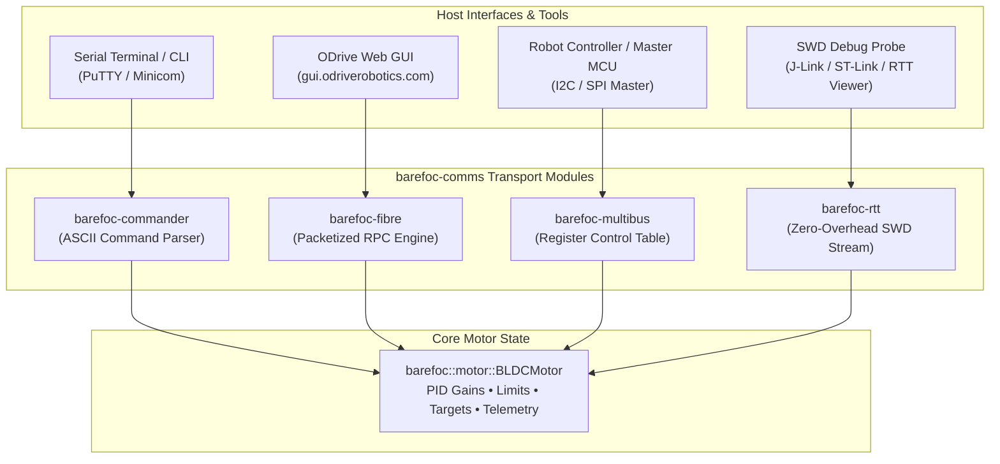

# Communication & GUI

The `barefoc-comms` workspace provides `#![no_std]` serial command parsing, memory-mapped bus tables, and binary RPC protocols for live motor tuning and telemetry.

---

## Communication Protocol Matrix

| Protocol | Crate | Transport Layer | Data Format | Overhead | Typical Use Case |
|---|---|---|---|---|---|
| **Commander** | `barefoc-commander` | UART / USB-CDC / RTT | Human-readable ASCII (`M1 10.0\n`) | Low | Quick interactive shell tuning, debugging |
| **Fibre RPC** | `barefoc-fibre` | USB / UART / TCP WebSocket | Binary typed RPC with JSON schema | Ultra-low | High-speed ODrive GUI live graphing, parameter trees |
| **Multibus** | `barefoc-multibus` | I2C / SPI / I3C | Memory-mapped register table (16-bit registers) | Minimum | Deterministic multi-axis servo bus control |
| **CAN Bus** | `barefoc::communication::can` | CAN 2.0A/B / CAN-FD | 8-byte deterministic binary frames | Ultra-low | High-rate real-time motion control in multi-node robotics |
| **SEGGER RTT** | `barefoc-rtt` | SWD / JTAG debug probe | Ring-buffer memory bridge | Near zero (< 1 µs) | Real-time debugging without consuming UART pins |

1. [**Commander Protocol**](/communication/commander/):
   The ASCII command-line parser implementing the SimpleFOC `commands.h` grammar and Dynamixel-grade smart servo commands.

2. [**Fibre RPC & ODrive GUI**](/communication/fibre_gui/):
   Binary packetized RPC engine natively compatible with the official [ODrive Web GUI](https://gui.odriverobotics.com) and `odrivetool` for real-time oscilloscope plotting and interactive slider tuning.

3. [**Multibus Register Protocol**](/communication/multibus/):
   Descriptor-driven control table framework for address-based multi-drop buses (I2C, SPI, I3C), including the 384-byte universal smart servo profile.

4. [**CAN Bus Protocol**](/communication/can/):
   Standardized 8-byte CAN frame layouts for setpoints, telemetry feedback, and bootloader hand-off.

5. [**SEGGER RTT Transport**](/communication/rtt/):
   Zero-overhead bidirectional byte-stream transport over SWD debug probes implementing `embedded-io`.
