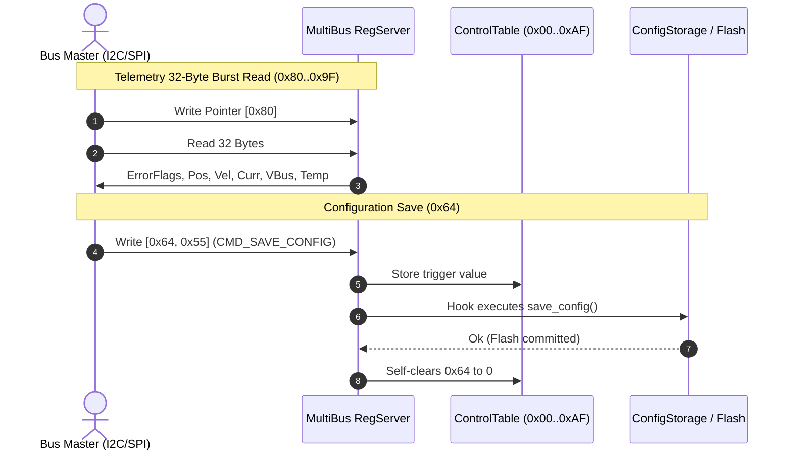

# Multibus Register Protocol (`barefoc-multibus`)

`barefoc-multibus` provides a descriptor-driven, `#![no_std]` control table framework for address-based buses such as I2C, SPI, and I3C. It is modeled after industrial memory-mapped register tables, enabling master controllers to read telemetry, adjust PID parameters, command setpoints, and reconfigure kinematics over physical buses without custom serial parsing.

---

## 1. Multi-Motor Architecture & `multi_motor_profile`

In multi-axis robotics, multiple motor axes frequently share a single bus interface (such as an I2C slave address or an SPI chip-select). `barefoc-multibus` provides `MultiMotorState<const N: usize, B>` and `multi_motor_profile::<N, B>()` to multiplex $N$ motor channels behind a unified register table.

```
                  ┌──────────────────────────────────────────────┐
                  │ I2C / SPI Address Bus (e.g., Slave 0x30)    │
                  └───────────────────────┬──────────────────────┘
                                          │
                                          ▼
                         ┌─────────────────────────────────┐
                         │ Multibus RegMap Dispatcher      │
                         └───────┬─────────────────┬───────┘
                                 │                 │
         Register 0x70 == 0      │                 │ Register 0x70 == 1
         ┌───────────────────────┘                 └───────────────────────┐
         ▼                                                                 ▼
┌─────────────────────────────────┐                       ┌─────────────────────────────────┐
│ Motor Axis 0 (Window 0x00..0x6C)│                       │ Motor Axis 1 (Window 0x00..0x6C)│
│ PID gains, target, angle, vel   │                       │ PID gains, target, angle, vel   │
└────────────────┬────────────────┘                       └────────────────┬────────────────┘
                 │                                                         │
                 └─────────────────────────┬───────────────────────────────┘
                                           │
                                           ▼
                         ┌──────────────────────────────────┐
                         │ Global Kinematics (0x71..0xB4)   │
                         │ Topology, Transmissions, Calib   │
                         └──────────────────────────────────┘
```

### Memory Partitioning:

- **Motor Window (`0x00..=0x6C`)**: Routes dynamically to the currently selected motor (`ctx.motors[ctx.selected]`). Commands written to target (`0x01`), velocity limits (`0x52`), or PID gains (`0x30..0x4B`) apply exclusively to the selected axis. Register `0x64` (`REG_SAVE_CONFIG`) triggers non-volatile parameter persistence across soft and hard resets when commanded (e.g. `0x55`).
- **Motor Selector (`0x70`)**: R/W register (`MotorSelect`). Writing an index $0 \le \text{idx} < N$ switches the active motor. Out-of-bounds selector writes are rejected, leaving `selected` intact while the register bank self-clears to 0.
- **Board & Kinematics Window (`0x71..=0xB4`)**: Global system parameters, multi-axis kinematics, analytical linkage lengths, empirical LUT tables, and calibration state machines route to global context (`ctx.motors[0]`). Register `0x78` (`REG_TOPOLOGY_MODE`) enables dynamic switching between multi-axis joint configurations.

### State Structure:

```rust
pub struct MultiMotorState<const N: usize, B: RegisterBridge> {
    pub motors: [B; N],
    pub selected: u8,
}
```

### Telemetry Synchronization:

Read-only registers (angles, velocities, currents, calibration progress) are refreshed via `refresh_telemetry_multi(&mut map)`, which queries the selected motor for motor-window telemetry (`0x00..0x6C`) and the global supervisor for kinematics telemetry (`0x71..0xB4`).

---

## 2. Extended SimpleFOC + Kinematics Register Table (`0x70..0xB4`)

The control table exposes the complete runtime configuration surface for SimpleFOC motors alongside multi-axis robotic kinematics:

### A. System & Multi-Motor Management (`0x70..0x7F`)

| Offset | Register Name | Data Type | Access | Description |
|:---:|---|---|:---:|---|
| `0x70` | `MotorSelect` | `u8` | R/W | Active motor index ($0 \le \text{idx} < N$) for windowed registers `0x00..0x6C` |
| `0x71` | `NumMotors` | `u8` | RO | Total number of motor axes ($N$) attached to this bus node |
| `0x72` | `SysTime` | `u32` | RO | Microcontroller uptime in milliseconds |
| `0x78` | `TopologyMode` | `u8` | R/W | Active topology preset (`0`=Four1Dof, `1`=Two2Dof, `2`=One1DofOne2Dof, `3`=Two1DofOne2Dof, `0xFF`=Custom) |
| `0x7F` | `MotorAddress` | `u8` | R/W | Bus device hardware address (e.g., 7-bit I2C address) |

---

### B. Kinematic Transmissions & Parameters (`0x80..0x8F`)

| Offset | Register Name | Data Type | Access | Description |
|:---:|---|---|:---:|---|
| `0x80` | `TransmissionType` | `u8` | R/W | Active transmission model (`0`=Linear, `1`=Differential, `2`=LUT, `3`=FourBar, `4`=Cam) |
| `0x81` | `GearRatio` | `f32` | R/W | Transmission gear reduction ratio ($R$) |
| `0x82` | `BacklashDelta` | `f32` | R/W | Half-width of backlash hysteresis deadband $\delta$ (radians) |
| `0x83` | `OmegaThresh` | `f32` | R/W | Backlash velocity smoothing threshold $\omega_{\text{thresh}}$ (rad/s) |
| `0x84` | `TorsionalStiffness`| `f32` | R/W | Torsional compliance $K_{\text{gear}}$ (Nm/rad) |
| `0x85` | `JointOffsetAlpha` | `f32` | R/W | Kinematic zero reference offset for axis Alpha (radians) |
| `0x86` | `JointOffsetBeta` | `f32` | R/W | Kinematic zero reference offset for axis Beta (radians) |
| `0x87` | `JointTargetAlpha` | `f32` | R/W | Commanded target joint angle for axis Alpha (radians) |
| `0x88` | `JointTargetBeta` | `f32` | R/W | Commanded target joint angle for axis Beta (radians) |
| `0x89` | `JointAngleAlpha` | `f32` | RO | Measured joint feedback angle for axis Alpha (radians) |
| `0x8A` | `JointAngleBeta` | `f32` | RO | Measured joint feedback angle for axis Beta (radians) |
| `0x8B` | `JointVelocityAlpha`| `f32` | RO | Measured joint feedback velocity for axis Alpha (rad/s) |
| `0x8C` | `JointVelocityBeta` | `f32` | RO | Measured joint feedback velocity for axis Beta (rad/s) |
| `0x8D` | `OuterDownsample` | `u8` | R/W | Decimation ratio of outer joint loops relative to inner FOC steps |
| `0x8E` | `CalibState` | `u8` | RO | Active calibration state (`0`=Idle, `1`=Running, `2`=Done, `3`=Error) |
| `0x8F` | `CalibProgress` | `u8` | RO | Calibration procedure completion percentage (`0`..`100`) |

---

### C. Outer Cascaded Joint PID Regulators (`0x90..0x99`)

| Offset | Register Name | Data Type | Access | Description |
|:---:|---|---|:---:|---|
| `0x90` | `OuterPidAlpha_P` | `f32` | R/W | Outer position loop proportional gain ($K_p$) for axis Alpha |
| `0x91` | `OuterPidAlpha_I` | `f32` | R/W | Outer position loop integral gain ($K_i$) for axis Alpha |
| `0x92` | `OuterPidAlpha_D` | `f32` | R/W | Outer position loop derivative gain ($K_d$) for axis Alpha |
| `0x93` | `OuterPidAlpha_Lim` | `f32` | R/W | Outer position loop maximum velocity output limit for axis Alpha (rad/s) |
| `0x94` | `OuterPidAlpha_Ramp`| `f32` | R/W | Outer position loop acceleration ramp ceiling for axis Alpha ($\text{rad/s}^2$) |
| `0x95` | `OuterPidBeta_P` | `f32` | R/W | Outer position loop proportional gain ($K_p$) for axis Beta |
| `0x96` | `OuterPidBeta_I` | `f32` | R/W | Outer position loop integral gain ($K_i$) for axis Beta |
| `0x97` | `OuterPidBeta_D` | `f32` | R/W | Outer position loop derivative gain ($K_d$) for axis Beta |
| `0x98` | `OuterPidBeta_Lim` | `f32` | R/W | Outer position loop maximum velocity output limit for axis Beta (rad/s) |
| `0x99` | `OuterPidBeta_Ramp` | `f32` | R/W | Outer position loop acceleration ramp ceiling for axis Beta ($\text{rad/s}^2$) |

---

### D. Coupled Differential & Analytical Linkages (`0x9A..0x9F`)

| Offset | Register Name | Data Type | Access | Description |
|:---:|---|---|:---:|---|
| `0x9A` | `DiffMatrix_T11` | `f32` | R/W | Coupled differential matrix element $T_{11}$ |
| `0x9B` | `DiffMatrix_T12` | `f32` | R/W | Coupled differential matrix element $T_{12}$ |
| `0x9C` | `DiffMatrix_T21` | `f32` | R/W | Coupled differential matrix element $T_{21}$ |
| `0x9D` | `DiffMatrix_T22` | `f32` | R/W | Coupled differential matrix element $T_{22}$ |
| `0x9E` | `LinkageL1` | `f32` | R/W | Planar four-bar linkage ground frame link length $L_1$ (meters) |
| `0x9F` | `LinkageL2_L4` | `12 bytes` | R/W | Linkage link lengths $[L_2, L_3, L_4]$ (crank, coupler, rocker) |

---

### E. Look-Up Table (LUT) Streaming Interface (`0xA0..0xA5`)

| Offset | Register Name | Data Type | Access | Description |
|:---:|---|---|:---:|---|
| `0xA0` | `LutMotMin` | `f32` | R/W | Calibrated input domain lower bound (motor radians) |
| `0xA1` | `LutMotMax` | `f32` | R/W | Calibrated input domain upper bound (motor radians) |
| `0xA2` | `LutPoints` | `u16` | RO | Discretized point capacity $N$ of the LUT buffer |
| `0xA3` | `LutPointIndex` | `u16` | R/W | Table index pointer ($0 \le \text{idx} < N$) |
| `0xA4` | `LutPointValue` | `f32` | R/W | Table sample value at current index. **Auto-increments index pointer on write!** |
| `0xA5` | `LutStatus` | `u8` | RO | Monotonicity and boundary validation flag (`0`=Valid, `1`=Non-Monotonic) |

#### Auto-Increment Streaming Burst Writes:

Writing calibration tables of 65 to 257 points individually would incur severe bus latency. The `LutPointValue` (`0xA4`) register automatically increments the internal `LutPointIndex` pointer (`0xA3`) upon every 4-byte float write:

1. Write `0` to `LutPointIndex` (`0xA3`).
2. Stream contiguous 4-byte floats directly to `LutPointValue` (`0xA4`) in a single I2C or SPI write transaction.
3. Every received float is stored at `table[idx]` and `idx` advances by 1 automatically, allowing entire empirical calibration curves to be loaded in milliseconds.

---

### F. Calibration & Flash Persistence (`0xB0..0xB4`)

| Offset | Register Name | Data Type | Access | Description |
|:---:|---|---|:---:|---|
| `0xB0` | `CalibCommand` | `u8` | R/W | Trigger action (`1`=Stall sweep, `2`=Abort, `3`=Save Flash, `4`=Load Flash, `8`=Reset) |
| `0xB1` | `CalibStatus` / `ProbeLimit` | `f32` / `u8` | R/W | Hard-stop search torque limit / Stall state status |
| `0xB2` | `CalibProgress` / `SweepVel` | `f32` / `u8` | R/W | Search sweep velocity (rad/s) / Percentage complete |
| `0xB3` | `CalibError` / `StallThresh` | `f32` / `u8` | R/W | Stall velocity threshold (rad/s) / Error diagnostic code |
| `0xB4` | `FlashStatus` | `u8` | RO | Flash storage validity (`0`=Clean/Valid, `1`=Dirty, `2`=Saved, `3`=Checksum Error) |

---

## 3. Rust Multi-Motor I2C Server Example

```rust,no_run
use barefoc_multibus::profile::{multi_motor_profile, refresh_telemetry_multi};
use barefoc_multibus::transport::RegServer;
use barefoc::motor::base::{MotorConfig, NullClock};

let clock = NullClock;
let motor0 = MotorConfig::new(&clock);
let motor1 = MotorConfig::new(&clock);

// Initialize 2-motor register map
let map = multi_motor_profile([motor0, motor1]);
let mut server = RegServer::new(map);

// In the high-frequency communication loop:
loop {
    // 1. Refresh telemetry in the register bank from hardware
    refresh_telemetry_multi(server.map_mut());

    // 2. Handle incoming I2C transaction
    // On I2C write: server.on_write(&rx_buffer)?;
    // On I2C read:  server.on_read(req_len, &mut tx_buffer)?;
}
```

---

## 4. Universal Control Table Profile (`control_table_profile`)

For Dynamixel-grade actuators utilizing the 384-byte `ControlTable`, `barefoc-multibus` provides `control_table_profile::<C>()`. This profile maps the registered parameters, enables high-speed 32-byte burst reads, and binds hardware persistence hooks:



### Profile Features:

1. **Full Range Coverage (`0x00..=0xAF`)**:
   Exposes all EEPROM configuration parameters (`0x00..0x5F`) and volatile operational registers (`0x60..0xAF`).

2. **Optimized Telemetry Burst Window (`0x80..0x9F`)**:
   Master controllers can latch pointer `0x80` and perform a single 32-byte burst read to acquire all telemetry fields simultaneously:
   - `0x80`: `HardwareErrorStatus` (`u16`)
   - `0x84`: `PresentPosition` (`f32`)
   - `0x88`: `PresentVelocity` (`f32`)
   - `0x8C`: `PresentCurrent` (`f32`)
   - `0x90`: `PresentBusVoltage` (`f32`)
   - `0x94`: `PresentTemperature` (`f32`)

3. **Autonomous Command Hooks**:
   - **`SaveConfigCommand` (`0x64`)**:
     - Writing `0x55` (`CMD_SAVE_CONFIG`): executes `storage.save_config(&table)` to commit the EEPROM block to flash.
     - Writing `0xAA` (`CMD_FACTORY_RESET`): executes `table.load_factory_defaults()` and overwrites flash.
     - Register automatically self-clears to `0` upon completion.
   - **`RebootCommand` (`0x63`)**:
     - Writing `0xF0` (`CMD_REBOOT_BOOTLOADER`): triggers the `BootloaderHandoff` state machine to disarm PWM and reset into Katapult recovery.

### Rust Usage Example:

```rust,no_run
use barefoc_multibus::control_table_profile::control_table_profile;
use barefoc_multibus::transport::RegServer;
use barefoc::control_table::ControlTable;

struct AppContext {
    table: ControlTable,
}

let ctx = AppContext {
    table: ControlTable::new(),
};

// Create a RegMap bound to the unified Control Table
let map = control_table_profile::<AppContext>();
let mut server = RegServer::new_with_context(map, ctx);
```

---

## 5. Multi-ID Routing & Streaming Servo Protocol

In multi-joint robotics (such as coupled differential wrists or multi-DOF manipulators), multiple joint channels and the composite supervisor board share a single serial bus (RS485, UART, or CAN). `barefoc-multibus` provides multi-ID dispatch and zero-allocation frame parsing to eliminate inter-axis communication skew:

### Multi-ID Router (`MultiIdRouter`)

```rust
use barefoc_multibus::{MultiIdRouter, RouteTarget};

// Board node ID 0x40, Joint 0 -> 1, Joint 1 -> 2
let router = MultiIdRouter::new(0x40, [1, 2, 3, 4]);

assert_eq!(router.resolve(0xFE), RouteTarget::Broadcast);
assert_eq!(router.resolve(0x40), RouteTarget::Board);
assert_eq!(router.resolve(1), RouteTarget::Joint(0));
assert_eq!(router.resolve(2), RouteTarget::Joint(1));
assert_eq!(router.resolve(99), RouteTarget::Ignore);
```

### Streaming Zero-Allocation Parser & Atomic `SYNC_WRITE`

The `StreamingServoParser` ingests incoming bytes one by one without dynamic memory allocation, parsing Dynamixel Protocol 1.0, Feetech STS, and Dynamixel Protocol 2.0 frames.

When a `SYNC_WRITE` (`0x83`) frame arrives on the bus, `parse_sync_write_setpoints` or `apply_sync_write_to_assembly` resolves all targeting joints and applies position setpoints directly to `ActuatorAssembly` in a single atomic pass, eliminating phase delay across coupled kinematic axes:

```rust
use barefoc_multibus::{StreamingServoParser, MultiIdRouter, apply_sync_write_to_assembly};
use barefoc::kinematics::ActuatorAssembly;

let router = MultiIdRouter::new(0x40, [1, 2, 3, 4]);
let mut assembly = ActuatorAssembly::<4, 4>::new();
let mut parser = StreamingServoParser::<128>::new();

// In serial RX byte loop:
if let Some(packet) = parser.parse_byte(rx_byte) {
    if packet.instruction == barefoc_multibus::INST_SYNC_WRITE {
        apply_sync_write_to_assembly(&packet, &router, &mut assembly);
    }
}
```

---

## 5. MultiBus to Control Table Synchronization & Flash Persistence

In the [Flash Once and Play Architecture](/actuators/flash_once_play/), live parameter modifications written to `SHARED_QUAD` via MultiBus (such as PID gains `AngPidP`, velocity limits `VelocityLimit`, voltage limits `VoltageLimit`, and homing offsets) are continuously synchronized into `SHARED_CONTROL_TABLE`.

### Flash Persistence Trigger (`0x64`)
When an external host controller issues command `0x55` to register `0x64` (`SaveConfigCommand`), the runtime table synchronizer commits the entire synchronized Control Table state into non-volatile Flash Bank 2 ping-pong Sectors 14 & 15. The register self-clears upon completion, guaranteeing that user tuning parameters persist across subsequent power cycles.


