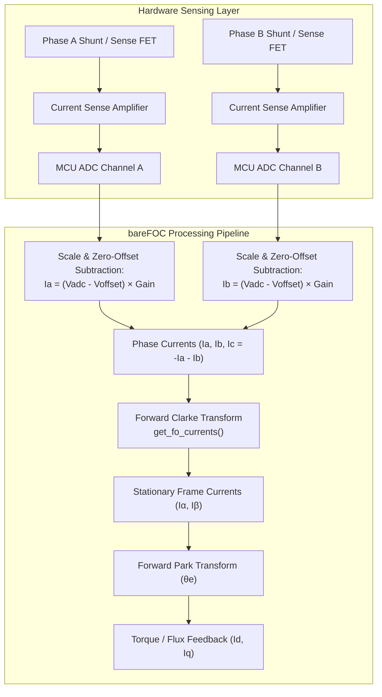

# The `CurrentSense` Trait

All current sensing implementations in BareFOC implement the `CurrentSense` trait defined in `barefoc::traits::current_sense::CurrentSense`.

---

## Trait Definition

```rust
pub trait CurrentSense {
    /// Initialize hardware ADCs, zero offsets, and verify gain signs
    fn init(&mut self) -> Result<(), ()>;

    /// Read instantaneous phase currents (Ia, Ib, Ic) in Amperes
    fn get_phase_currents(&mut self) -> (f32, f32, f32);

    /// Compute orthogonal stationary currents (I_alpha, I_beta) via Clarke transform
    fn get_fo_currents(&mut self) -> (f32, f32);

    /// Calculate instantaneous motor electrical torque in Newton-meters
    fn get_torque(&mut self, kv_rating: f32) -> f32;
}
```

---

## Calibration Routine

During motor startup (`motor.init_foc()`), BareFOC performs an automated current sense alignment:



---

## Current Sensing Architecture Comparison

| Architecture | Sensing Location | PWM Timing Constraint | Hardware Complexity | Common Use Cases |
|---|---|---|---|---|
| **Inline Current Sensing** | In series with phase wires | None (Continuous reading at any point in PWM period) | High (Requires high common-mode rejection amplifiers, e.g. INA240) | Precision robotics, wide duty cycle range |
| **Low-Side Shunt Sensing** | Between low-side FET source and ground | Must sample strictly during PWM low-side conduction window | Moderate (Standard op-amps, requires timer ADC synchronization) | High-volume industrial ESCs, e-bikes |
| **Current Mirror Sensing** | Integrated into Smart Driver IC (e.g. DRV8316, DRV8311) | Samples during low-side FET conduction | Low (Zero external shunt resistors or op-amps needed) | Ultra-compact robotic actuators, micro-drones |
