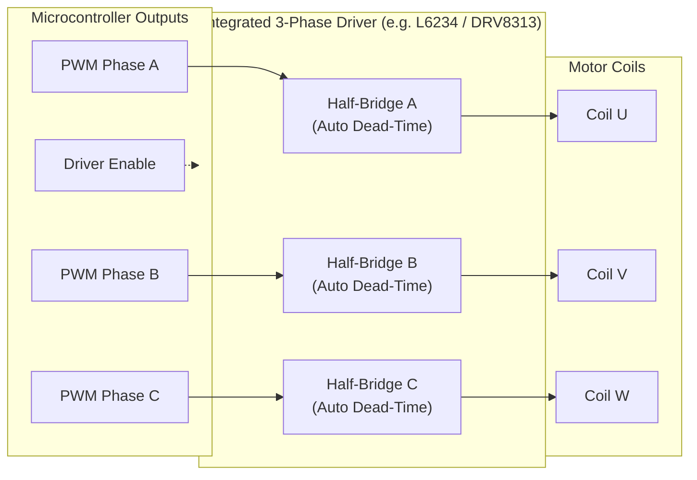
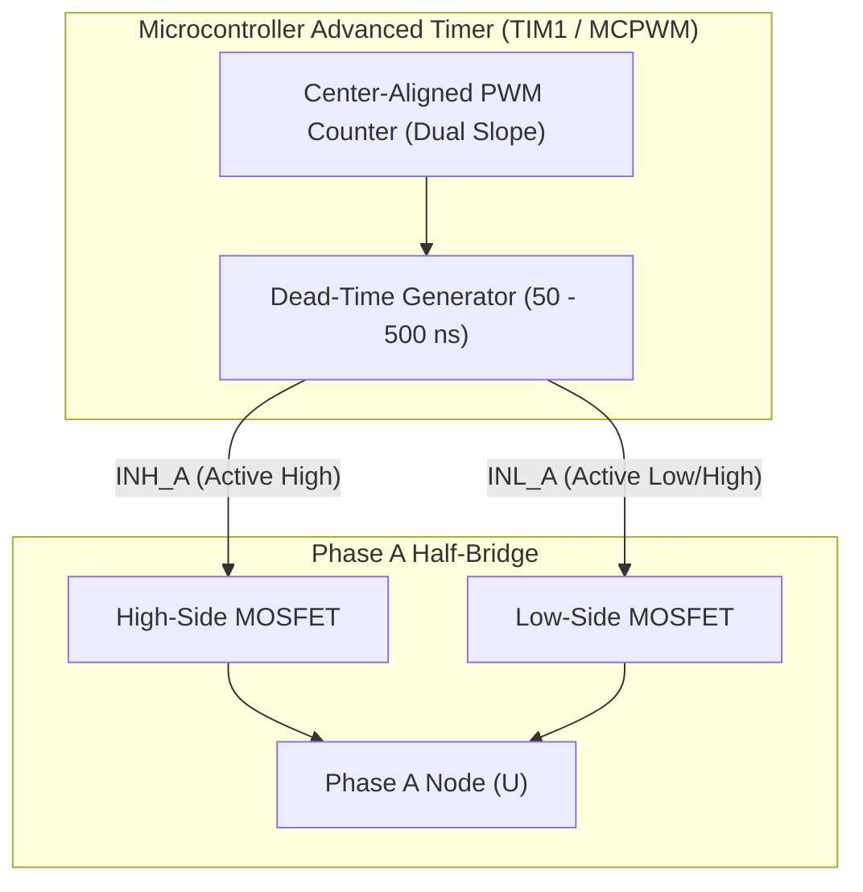

# PWM Gate Drivers

BareFOC provides two primary driver implementations for 3-phase BLDC motors:
1. `BLDCDriver3PWM`
2. `BLDCDriver6PWM`

---

## 1. 3-PWM Driver (`BLDCDriver3PWM`)

The 3-PWM driver uses three independent PWM channels, typically driving integrated half-bridge power stages (such as the L6234, MP6540, or DRV8313) where internal logic automatically generates complementary high-side and low-side switching with built-in dead-time.



### Rust Usage:
```rust,no_run
use barefoc::drivers::bldc_3pwm::BLDCDriver3PWM;
use barefoc::traits::driver::BLDCDriver;

let mut driver = BLDCDriver3PWM::new(pwm_a, pwm_b, pwm_c, Some(enable_pin));
driver.voltage_power_supply = 12.0;
driver.voltage_limit = 10.0;
driver.init();
```

---

## 2. Complementary 6-PWM Driver (`BLDCDriver6PWM`)

For high-power inverters built from discrete MOSFETs or dedicated half-bridge drivers (e.g. DRV8301, FD6288), the microcontroller must independently control both the high-side FET and low-side FET of each phase.



---

## Inverter Topology Comparison

| Topology | Driver Type | MCU Pins Required | Dead-Time Handling | Max Current / Power | Typical Gate Driver ICs |
|---|---|---|---|---|---|
| **3-PWM** | `BLDCDriver3PWM` | 3 PWM + 1 Enable | Automatic internal | Low to Medium ($\le 5\text{ A}$) | L6234, MP6540, DRV8313, TMC6300 |
| **6-PWM** | `BLDCDriver6PWM` | 6 PWM (3 complementary pairs) | MCU Hardware Dead-Time Generator | High to Very High ($10\text{ A} - 200+\text{ A}$) | DRV8301, DRV8305, FD6288, Discrete FETs |
| **Brushed DC** | `DCDriver2PWM` / `1PWM` | 1 or 2 PWM + Direction | Built-in or H-Bridge shoot-through logic | Low to High | DRV8871, L9110S, A4950, BTS7960 |

### Critical Requirements:
- **Hardware Dead-Time Insertion**: When transitioning a phase from high-side to low-side, both transistors must be briefly off ($\approx 50\text{--}500\text{ ns}$) to prevent catastrophic shoot-through current directly from the DC rail to ground.
- **Center-Aligned Switching**: PWM counters count up then down (dual-slope), aligning the center of all pulses to cancel high-frequency ripple harmonics.

In BareFOC, 6-PWM drivers are typically backed by microcontroller hardware timers using `barefoc-hal` (`barefoc-stm32` Advanced Timers TIM1/TIM8 or `barefoc-esp32` MCPWM).
