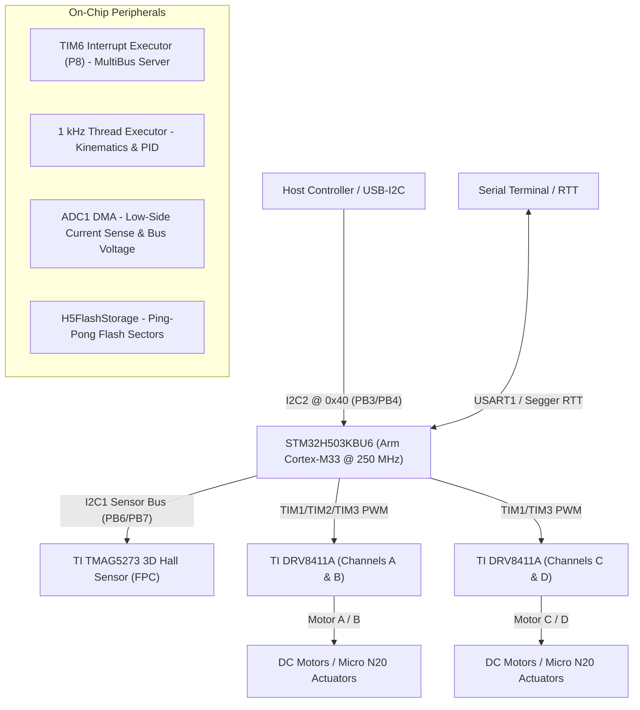

# FishyServo Reference Example (STM32H503KB)

The FishyServo example (`examples/fishyservo_stm32h5`) is the canonical BareFOC reference implementation for 4-axis multi-topology closed-loop brushed DC servo control. It runs on the [FishyServo hardware platform](https://github.com/rambros3d/FishyServo), pairing an STM32H503KBU6 microcontroller with dual Texas Instruments DRV8411A dual H-bridge motor drivers.

---

## Hardware Architecture



### Core Hardware Specifications

| Subsystem | Component | Pin Mapping | Description |
|---|---|---|---|
| **MCU** | STM32H503KBU6 | UFQFPN-32 | Arm Cortex-M33 @ up to 250 MHz, 128 KB Flash, 32 KB SRAM |
| **Bridge Drivers** | 2 × TI DRV8411ARTE | IN/IN Timer Channels | 4 full H-bridge channels, up to 1.5 A peak per bridge |
| **Angle Sensor** | TI TMAG5273 | `PB6` (SCL) / `PB7` (SDA) | 3D Hall-effect sensor on dedicated internal `I2C1` |
| **Host Bus** | MultiBus Target | `PB3` (SCL) / `PB4` (SDA) | I2C target at address `0x40` on `I2C2` |
| **Current Sense** | Low-Side Current Mirrors | `PA2`, `PA3`, `PA4`, `PA5` | $A_{IPROPI} = 200\ \mu\text{A/A}$ into 1 k$\Omega$ shunt ($0.2\text{ V/A}$) via ADC1 |
| **Bus Voltage** | Resistor Divider | `PB1` (VSENS) | 12-bit ADC1 bus voltage telemetry |
| **Debug & CLI** | USART1 / RTT | `PA11` (RX) / `PA12` (TX) | 115200 baud ASCII Commander & telemetry |
| **Status LEDs** | Dual LEDs | `PA0` (Blue), `PA1` (Red) | Active-low boot and error status indicators |

---

## Key Firmware Capabilities

### 1. Multi-Topology Kinematics (`ActuatorAssembly`)

The firmware instantiates BareFOC's `ActuatorAssembly<4, 4>` to map joint targets into motor setpoints at 1 kHz with outer-loop decimation:

- **`Four1Dof`**: 4 independent 1-DOF joints (default).
- **`Differential2Dof`**: 2-DOF differential transmission coupling (e.g. wrist pitch/yaw).
- **`Parallel2Dof`**: 2-DOF parallel linkage coupling.
- **`QuadCoordinated`**: Synchronized 4-wheel drive or Cartesian coordination.

Topology presets can be switched at runtime without resetting via MultiBus register `0x78` (`REG_TOPOLOGY_MODE`) or Commander command `KM <mode>`.

### 2. TMAG5273 Zero-Config Auto-Discovery

At startup, the firmware runs `Tmag5273::discover(&mut i2c1, &CLOCK)` across candidate addresses (`0x35`, `0x22`, `0x78`, `0x44`) at both 400 kHz and 100 kHz bus speeds. Once discovered, the sensor is configured in continuous angle mode and bound to the primary closed-loop axis. If no sensor is detected on the FPC ribbon, the firmware falls back safely to open-loop voltage/velocity control.

### 3. Dedicated High-Priority MultiBus Server

Host communications on `I2C2` run inside an Embassy `InterruptExecutor` bound to `TIM6` with NVIC priority P8. This guarantees that host register transactions and bootloader handoff requests cannot be starved by the motor control loop.

Supported Control Table registers include:

- `0x00`..`0x07`: Model identifier (`0x0201`), firmware version, node ID, baud rates.
- `0x24`: `TORQUE_ENABLE` (1 = active drive, 0 = safe Hi-Z coast).
- `0x78`: `REG_TOPOLOGY_MODE` runtime preset selector.
- `0x80`..`0x8F`: Goal joint positions and velocities.
- `0x98`..`0xAF`: Real-time measured joint positions, velocities, and currents.
- `0xDC`: `REG_SAVE_CONFIG` (write `0x01` to trigger `H5FlashStorage` ping-pong write).
- `0xDE`: `REG_REBOOT_CMD` (write `0x01` for system reset, `0x02` for BareBoot/Katapult).

### 4. Hands-Free Katapult / BareBoot Entry

The firmware supports zero-touch entry into bootloader mode through two independent paths:
1. **Single-Byte Strobe**: Sending byte `0xF0` to I2C target address `0x40` invokes `bootloader_write_hook`, which writes the soft-reset mailbox token to SRAM (`0x2000_7FE0`) and calls `SCB::sys_reset()`.
2. **Register Command**: Writing `0x02` to register `0xDE` (`REG_REBOOT_CMD`) performs the same mailbox-guided reboot sequence.

---

## Building and Flashing

### Directory Location

```sh
cd bareFOC/examples/fishyservo_stm32h5
```

### Standalone Build

For running directly on bare metal without a bootloader:

```sh
cargo build --release
```

Flash using SWD:

```sh
cargo run --release
```

### Bootloader Relocated Build

When deploying via Katapult or BareBoot (application slot starting at `0x0800_2000`):

```sh
cargo build --release --features bootloader
```

Extract the raw binary image:

```sh
arm-none-eabi-objcopy -O binary \
  target/thumbv8m.main-none-eabihf/release/fishyservo_stm32h5 \
  target/thumbv8m.main-none-eabihf/release/fishyservo_stm32h5_bootloader.bin
```

---

## ASCII Commander Grammar

Connect an external UART adapter to `PA11` (RX) / `PA12` (TX) at 115200 baud, or open a SEGGER RTT console:

```
A <rad/s>     # Target velocity or angle for Motor A
B <rad/s>     # Target velocity or angle for Motor B
C <rad/s>     # Target velocity or angle for Motor C
D <rad/s>     # Target velocity or angle for Motor D
KT <j> <rad>  # Set Joint target angle (e.g. KT 0 1.5708)
KA <j>        # Read Joint measured angle (rad)
KV <j>        # Read Joint measured velocity (rad/s)
KM <mode>     # Set topology preset (0=Four1Dof, 1=Diff2Dof, 2=Parallel2Dof, 3=QuadCoord)
```
