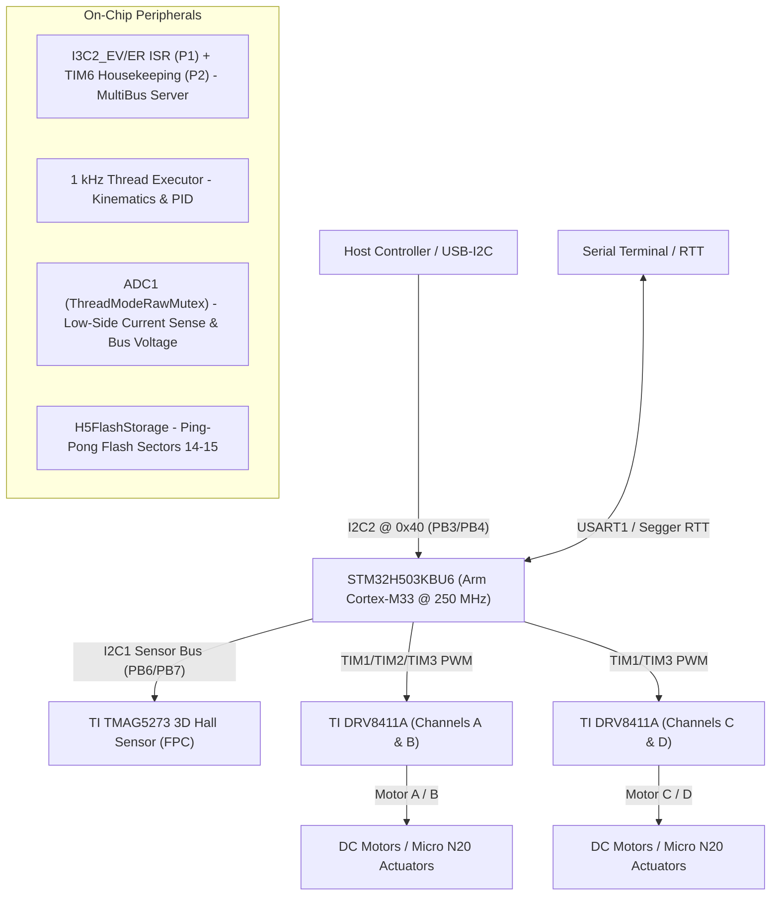

# FishyServo Reference Example (STM32H503KB)

The FishyServo board (`examples/fishyservo/barefoc.toml`) is the canonical BareFOC reference implementation for 4-axis multi-topology closed-loop brushed DC servo control, built via the unified `barefoc-firmware` crate. It runs on the [FishyServo hardware platform](https://github.com/rambros3d/FishyServo), pairing an STM32H503KBU6 microcontroller with dual Texas Instruments DRV8411A dual H-bridge motor drivers.

---

## Hardware Architecture



### Core Hardware Specifications

| Subsystem | Component | Pin Mapping | Description |
|---|---|---|---|
| **MCU** | STM32H503KBU6 | UFQFPN-32 | Arm Cortex-M33 @ up to 250 MHz, 128 KB Flash, 32 KB SRAM |
| **Bridge Drivers** | 2 × TI DRV8411ARTE | IN/IN Timer Channels | 4 full H-bridge channels, up to 1.5 A peak per bridge |
| **Angle Sensor** | TI TMAG5273 | `PB6` (SCL) / `PB7` (SDA) | 3D Hall-effect sensor on dedicated internal `I2C1` |
| **Host Bus** | MultiBus Target | `PB3` (SCL) / `PB4` (SDA) | I2C target at address `0x40` on `I2C2` |
| **Current Sense** | Low-Side Current Mirrors | `PA2`, `PA3`, `PA4`, `PA5` | $A_{IPROPI} = 200\ \mu\text{A/A}$ into 1 k$\Omega$ shunt ($0.2\text{ V/A}$) via ADC1 |
| **Bus Voltage** | Resistor Divider | `PB1` (VSENS) | 12-bit ADC1 bus voltage telemetry |
| **Debug & CLI** | USART1 / RTT | `PA11` (RX) / `PA12` (TX) | 115200 baud ASCII Commander & telemetry |
| **Status LEDs** | Dual LEDs | `PA0` (Blue), `PA1` (Red) | Active-low boot and error status indicators |

---

## Key Firmware Capabilities

### 1. Multi-Topology Kinematics (`ActuatorAssembly`)

The firmware instantiates BareFOC's `ActuatorAssembly<4, 4>` to map joint targets into motor setpoints at 1 kHz with outer-loop decimation:

- **`Four1Dof`**: 4 independent 1-DOF joints (default).
- **`Differential2Dof`**: 2-DOF differential transmission coupling (e.g. wrist pitch/yaw).
- **`Parallel2Dof`**: 2-DOF parallel linkage coupling.
- **`QuadCoordinated`**: Synchronized 4-wheel drive or Cartesian coordination.

Topology presets can be switched at runtime without resetting via MultiBus register `0x78` (`REG_TOPOLOGY_MODE`) or Commander command `KM <mode>`.

### 2. TMAG5273 Zero-Config Auto-Discovery

At startup, the firmware runs `Tmag5273::discover(&mut i2c1, &CLOCK)` across candidate addresses (`0x35`, `0x22`, `0x78`, `0x44`) at both 400 kHz and 100 kHz bus speeds. Once discovered, the sensor is configured in continuous angle mode and bound to the primary closed-loop axis. If no sensor is detected on the FPC ribbon, the firmware falls back safely to open-loop voltage/velocity control.

### 3. ISR-Driven MultiBus Server & Zero-Lockout Recovery

Host communications on `I3C2` are serviced directly inside the `I3C2_EV` and `I3C2_ER` interrupt handlers (`Priority::P1`) via `Stm32I3cTarget::service_once()`, eliminating `TIM6` task-switch latency on back-to-back `W [reg] -> R [data]` transactions under `1 kHz` closed-loop load. On `WritePhase`, the ISR latches updated motor commands into `SHARED_QUAD` and immediately re-arms `TGTTDR` via `preload_read()`. `Stm32I3cTarget::desired_ier()` (`desired_ier_for_tx()`) enables `EVR_TXFNFF` only while `read_pos < read_len` so multi-byte reads (`> 8` bytes) refill in ISR without FIFO underruns or idle interrupt storms. `Stm32I3cTarget::preload_read()` clamps read-prefetch lengths to the remaining map extent, skips `CFGR_TXFLUSH` when `EVR_TXFEF` is already set, and arms `TGTTDR` without toggling `I3C2_CFGR.EN`.

Meanwhile, `i3c_target_task` runs on an Embassy `InterruptExecutor` bound to `TIM6` (`Priority::P2`) every `1 ms`, masking `I3C2_EV` and `I3C2_ER` (`with_i3c2_target()`) while running `sync_telemetry_into_target()` (when `is_frame_idle()`) and `check_and_recover_stuck_sda()` (which pulses `RCC_APB3RSTR.I3C2RST` if `PB4` (`SDA`) remains low continuously for 50 ms), and feeding `IWDG` when `I3C2_BUS_HEALTHY` holds. `ADC1` uses `ThreadModeRawMutex` so analog conversions never mask bus interrupts.

Supported Control Table registers include:

- `0x00`..`0x07`: Model identifier (`0x0201`), firmware version, node ID, baud rates.
- `0x24`: `TORQUE_ENABLE` (1 = active drive, 0 = safe Hi-Z coast).
- `0x78`: `REG_TOPOLOGY_MODE` runtime preset selector.
- `0x80`..`0x8F`: Goal joint positions and velocities.
- `0x98`..`0xAF`: Real-time measured joint positions, velocities, and currents.
- `0xDC`: `REG_SAVE_CONFIG` (write `0x01` to trigger `H5FlashStorage` ping-pong write).
- `0xDE`: `REG_REBOOT_CMD` (write `0x01` for system reset, `0x02` for BareBoot/Katapult).

### 4. Hands-Free BareBoot Entry & Watchdog Hardening

The firmware supports zero-touch entry into BareBoot recovery through four independent paths (`barefoc` / `bareboot` feature):
1. **Single-Byte Strobe**: Sending byte `0xF0` to target address `0x40` invokes `bootloader_write_hook`, clears `BootLoopGuard`, writes `SoftResetMailbox` (`0x2000_7FE0`), and resets into BareBoot.
2. **Hardware Target Reset Pattern (`EVR_RSTF`) & CCC `RSTACT`**: Driving the MIPI I3C Target Reset Pattern or `CCC RSTACT` (`0x2A`/`0x9A`/`0xAA`, defining byte `0x02`) triggers `barefoc_failsafe_recovery()`.
3. **Register Command**: Writing `0x02` to register `0xDE` (`REG_REBOOT_CMD`) performs the same mailbox-guided reboot sequence.
4. **Watchdog, 3-Strike BootLoopGuard & Sector 15 Auto-Provisioning**: `fishyservo_stm32h5` feeds the ~2.0 s hardware `IWDG` only while `I3C2_BUS_HEALTHY` holds (withholding `IWDG` feeds if `SDA` stays stuck low after `RCC_APB3RSTR` recovery) and clears `BootLoopGuard` (`0x2000_7FD0`) after 50 ms (50 control-loop ticks) of healthy `I3C2` + motor execution. When Sector 15 (`0x0801_E000`) is blank (`0xFFFF_FFFF`) on first boot, `load_boot_config()` auto-provisions default `ControlTable` settings to `H5FlashStorage` and clears `FLASH_CORRUPT` (`0x80`) so `HwErr` boots at `0x00`. The STM32H503 flash map allocates 16 KiB (`0x0800_0000..0x0800_3FFF`, Sectors 0–1) to `bareBoot` and 88 KiB (`0x0800_4000..0x0801_9FFF`, Sectors 2–12, `_stack_start = 0x2000_7FD0`) to the application slot, preserving Sector 13 (`CommitStore`, `0x0801_A000..0x0801_BFFF`) and Sectors 14–15 (`H5FlashStorage`, `0x0801_C000..0x0801_FFFF`).

---

## Building and Flashing

### Directory Location

```sh
cd bareFOC/barefoc-firmware
```

### Standalone Build

For running directly on bare metal without a bootloader:

```sh
BAREFOC_BOARD=../examples/fishyservo/barefoc.toml cargo build --release --target thumbv8m.main-none-eabihf --features stm32h5
```

Flash using SWD:

```sh
BAREFOC_BOARD=../examples/fishyservo/barefoc.toml cargo run --release --target thumbv8m.main-none-eabihf --features stm32h5
```

### Bootloader Relocated Build

When deploying via BareBoot (16 KiB bootloader at `0x0800_0000..0x0800_3FFF`, 88 KiB application slot at `0x0800_4000..0x0801_9FFF`):

```sh
BAREFOC_BOARD=../examples/fishyservo/barefoc.toml cargo build --release --target thumbv8m.main-none-eabihf --features stm32h5,bootloader
```

Extract the raw binary image:

```sh
arm-none-eabi-objcopy -O binary \
  target/thumbv8m.main-none-eabihf/release/barefoc-firmware \
  ../examples/fishyservo/fishyservo_stm32h5_i3c.bin
```

---

## ASCII Commander Grammar

Connect an external UART adapter to `PA11` (RX) / `PA12` (TX) at 115200 baud, or open a SEGGER RTT console:

```
A <rad/s>     # Target velocity or angle for Motor A
B <rad/s>     # Target velocity or angle for Motor B
C <rad/s>     # Target velocity or angle for Motor C
D <rad/s>     # Target velocity or angle for Motor D
KT <j> <rad>  # Set Joint target angle (e.g. KT 0 1.5708)
KA <j>        # Read Joint measured angle (rad)
KV <j>        # Read Joint measured velocity (rad/s)
KM <mode>     # Set topology preset (0=Four1Dof, 1=Diff2Dof, 2=Parallel2Dof, 3=QuadCoord)
```

---

## Runtime Kinematics & TOML Commissioning (Flash-Once Workflow)

FishyServo separates fixed PCB hardware pinouts (`barefoc.toml`, auto-deriving `memory.x` in `build.rs` from `board.mcu` and `bootloader`) from per-joint robot kinematics (`TopologyPreset`, `sensor_map`, `DynamicTransmission` variant, `CoupledDifferential` matrix, `LinearGear` ratio/backlash, `FourBarLinkage` lengths, `LutTransmission` table, joint zero offsets, and outer joint PIDs).

### Non-Volatile Persistence (`H5FlashStorage` v2)

`H5FlashStorage` (`FLASH_SCHEMA_VERSION = 2`) stores a 320-byte ping-pong record (32-byte header + 96-byte `ControlTable` EEPROM + 192-byte `KinematicsFlashConfig`) protected by IEEE 802.3 CRC32 across Bank 2 Sectors 14 & 15 (`0x0801_C000..0x0802_0000`). On `SaveConfig` (`0x55` written to `REG_SAVE_CONFIG` at `0x230`), both motor settings and active kinematics are committed atomically and restored on every cold boot.

### Host TOML Commissioning (`configure_fishyservo_i3c.py`)

Boards can be flashed once with `fishyservo_stm32h5_i3c.bin` and commissioned over native `AgentLaI3c` USB from any `.toml` profile using stdlib `tomllib`:

```sh
# 1. Scan I3C bus via RSTDAA + ENTDAA
python3 FishyServo/test-scripts/configure_fishyservo_i3c.py --scan

# 2. Read current kinematics, topology, sensor_map, and PIDs
python3 FishyServo/test-scripts/configure_fishyservo_i3c.py --addr 0x40 --show

# 3. Commission from a TOML profile and persist to Bank 2 Sectors 14 & 15
python3 FishyServo/test-scripts/configure_fishyservo_i3c.py --addr 0x40 --config servo_profile.toml --save --show
```

Supported TOML sections include `[identity]` (`node_id`), `[kinematics]` (`topology`, `sensor_map`, `transmission`, `gear_ratio`, `backlash_delta`, `joint_offset_alpha`, `joint_offset_beta`, `outer_downsample`), `[kinematics.differential]` (`matrix`), `[kinematics.linkage]` (`l1..l4`), `[kinematics.lut]` (`mot_min`, `mot_max`, `table`), `[kinematics.outer_pid_alpha]`, `[kinematics.outer_pid_beta]`, and `[defaults]` / `[motor]`.
