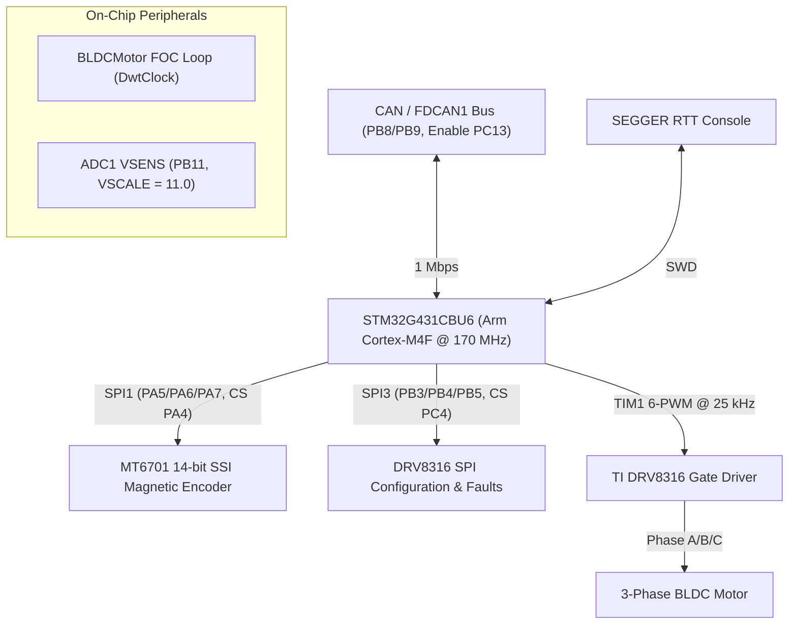

# MicroSpora Reference Example (STM32G431CB)

The **MicroSpora** example (`examples/microspora_stm32g4`) targets the **officially recommended hardware platform for BareFOC and SimpleFOC**. Designed as a compact, high-performance brushless DC (BLDC) Field-Oriented Control (FOC) driver, MicroSpora pairs an `STM32G431CBU6` microcontroller with a Texas Instruments `DRV8316` 3-phase smart gate driver, an `MT6701` 14-bit magnetic encoder, onboard `FDCAN1` transceiver, and bus voltage sensing.

- **Hardware Design (OSHWLab)**: [Nano-8316 Motor Driver (MicroSpora)](https://oshwlab.com/rambros/nano-8316-motor-driver)
- **Available for Purchase**: [Makerfabs SimpleFOC MicroSpora](https://www.makerfabs.com/simplefoc-microspora.html)

---

## Hardware Architecture



### Pinout & Hardware Specifications

| Subsystem | Signal / Function | MCU Pin | Notes |
|---|---|---|---|
| **Microcontroller** | `STM32G431CBU6` | UFQFPN-48 | Arm Cortex-M4F @ 170 MHz, 128 KiB Flash, 32 KiB RAM |
| **Phase A High / Low** | `PHA_H` / `PHA_L` | `PA10` / `PB15` | `TIM1_CH3` / `TIM1_CH3N` |
| **Phase B High / Low** | `PHB_H` / `PHB_L` | `PA9` / `PB14` | `TIM1_CH2` / `TIM1_CH2N` |
| **Phase C High / Low** | `PHC_H` / `PHC_L` | `PA8` / `PB13` | `TIM1_CH1` / `TIM1_CH1N` |
| **DRV8316 SPI** | `SPI_SCK` / `SPI_MISO` / `SPI_MOSI` / `DRV_CS` | `PB3` / `PB4` / `PB5` / `PC4` | `SPI3` Mode 1, `drv83xx-rs` (`Drv8316S` + `Drv8316Driver6PWM`) |
| **MT6701 Encoder** | `ENC_CLK` / `ENC_SDO` / `ENC_NC` / `ENC_CS` | `PA5` / `PA6` / `PA7` / `PA4` | `SPI1` Mode 1 @ 8 MHz, `mt6xxx-rs` (`Mt6701`) |
| **CAN Bus** | `CAN_RX` / `CAN_TX` / `CAN_ENABLE` | `PB8` / `PB9` / `PC13` | `FDCAN1` @ 1 Mbps |
| **Bus Voltage Sense** | `VSENS` | `PB11` | `ADC1`, resistor divider `VSCALE = 11.0` |
| **Status LED** | `LED_BUILTIN` | `PC6` | Active-high status indicator |

---

## Board Manifest (`barefoc.toml`)

`examples/microspora_stm32g4/barefoc.toml` declares the MCU, safety limits, default FOC gains, gate driver, encoder, and CAN connector mapping, and `build.rs` auto-derives `memory.x` directly from it:

```toml
[board]
name = "microspora-stm32g4"
description = "MicroSpora BLDC FOC Motor Driver (STM32G431CBU6 + DRV8316 + MT6701)"
mcu = "stm32g431cbu6"
family = "stm32g4"
system_clock_hz = 170000000

[bootloader]
enabled = false
type = "bareboot"
transport = "can"
boot_window_ms = 250

[safety]
max_voltage_v = 24.0
max_current_a = 8.0
max_velocity_rad_s = 100.0
thermal_cutoff_c = 85.0
default_voltage_limit = 6.0
default_current_limit = 2.0

[gate_driver]
driver_type = "drv8316"
pwm_frequency_hz = 25000
pwm_timer = "TIM1"
inh_a = "PA10"
inh_b = "PA9"
inh_c = "PA8"
inl_a = "PB15"
inl_b = "PB14"
inl_c = "PB13"

[sensor]
sensor_type = "mt6701"
bus = "SPI1"
cs_pin = "PA4"
clk_pin = "PA5"
data_pin = "PA6"
cpr = 16384

[connectors]
bus_type = "can"
tx_scl_pin = "PB9"
rx_sda_pin = "PB8"
default_baud = 1000000
```

---

## Building and Flashing

### Check and Build

```sh
cd examples/microspora_stm32g4
cargo check --target thumbv7em-none-eabihf
cargo build --release --target thumbv7em-none-eabihf
```

### Flash over SWD (`probe-rs`)

```sh
cd examples/microspora_stm32g4
cargo run --release --target thumbv7em-none-eabihf
```

Or flash the compiled ELF directly:

```sh
probe-rs run --chip STM32G431CBUx target/thumbv7em-none-eabihf/release/microspora_stm32g4
```
