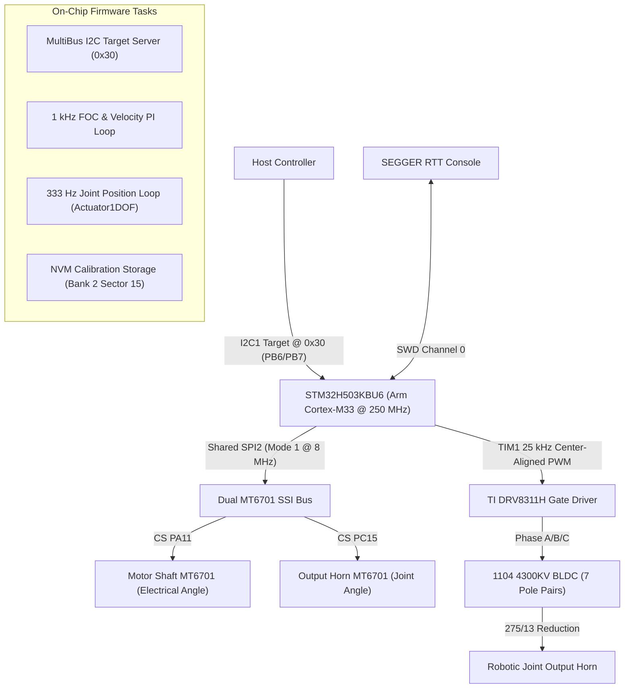

# Miniata Reference Example (STM32H503KB)

The Miniata example (`examples/miniata_stm32h5`) is the canonical BareFOC reference implementation for high-performance brushless DC (BLDC) Field-Oriented Control (FOC) smart servos. It runs on the [Miniata robotic joint platform](https://github.com/rambros3d/Miniata), combining an STM32H503KBU6 microcontroller with a Texas Instruments DRV8311H 3-phase gate driver, dual absolute magnetic encoders, and compound reduction gearing.

---

## Hardware Architecture



### Core Hardware Specifications

| Subsystem | Component | Pin Mapping | Description |
|---|---|---|---|
| Microcontroller | STM32H503KBU6 | UFQFPN-32 | Arm Cortex-M33 @ 250 MHz, 128 KB Flash, 32 KB SRAM |
| Gate Driver | TI DRV8311HRRWR | PB5, PA9, PA8, PB1, PB0, PA7, PB15 | 3x PWM Hardware Mode, 5 A peak, center-aligned 25 kHz |
| Motor | 1104 4300KV BLDC | Phase A, B, C | 12N14P configuration (7 pole pairs), ~0.55 Ohm resistance |
| Motor Angle Sensor | MagnTek MT6701QT | PA12 (SCK), PA15 (MISO), PA11 (CS) | 14-bit SSI absolute encoder on motor rotor |
| Joint Angle Sensor | MagnTek MT6701QT | PA12 (SCK), PA15 (MISO), PC15 (CS) | 14-bit SSI absolute encoder on output horn |
| Reduction Gearbox | Compound Planetary | Gear ratio 275 / 13 (~21.1538 : 1) | Inverted kinematic sign (-21.1538) |
| Host Bus | MultiBus I2C Target | PB6 (SCL), PB7 (SDA) | Slave address 0x30, standard control table |
| Interactive Console | SEGGER RTT | Channel 0 Up / Down | Real-time ASCII Commander console |
| Status Indicators | Red / Blue LEDs | PC14 (Red), PB8 (Blue) | Active-low status indicators |

---

## Kinematics & Dual-Rate Cascaded Control

Miniata implements a dual-loop cascaded robotic joint control pipeline:

1. **Outer Joint Position Loop (333 Hz)**:
   - Evaluated every 3rd control tick using `barefoc::kinematics::Actuator1DOF` and `LinearGear::new(275 / 13).with_inverted(true)`.
   - Compares the commanded output-shaft setpoint against the direct joint-horn MT6701 encoder.
   - Computes required joint velocity demand via position P gain (`pos_kp`).
   - Maps joint velocity to motor rotor velocity via the inverted gear Jacobian ($v_{mot} = -21.1538 \cdot v_{joint}$).
2. **Inner Velocity & Commutation Loop (1 kHz)**:
   - Evaluates motor rotor velocity using low-pass filtered derivatives from the motor MT6701 encoder.
   - Computes signed voltage effort using a PI controller with acceleration damping and stiction breakaway boost.
   - Derives electrical angle $\theta_e = (\theta_m - \theta_0) \cdot \text{dir} \cdot 7.0 + \theta_{offset}$.
   - Modulates center-aligned complementary PWM outputs to the DRV8311 gate driver via `apply_vector`.

---

## NVM Calibration Persistence

Miniata stores its commutation parameters in Flash Bank 2 Sector 15 (`0x0801_E000..0x0802_0000`, 8 KB). Because the application resides entirely in Bank 1, erasing and programming Sector 15 never halts instruction execution in the control loop.

The record structure is 64 bytes wide and 16-byte aligned (quadword programming):
- `magic`: `0x4D49_4E49` ("MINI")
- `version`: `0x0002`
- `flags`: Calibration validity bitfield
- `zero_electrical_angle`: Calibrated electrical zero angle (`f32`)
- `sensor_dir`: Commutation direction (`+1.0` or `-1.0`)
- `i2c_addr`: Persisted I2C target address (default `0x30`)
- `joint_slot`: Robotic joint slot index
- `checksum`: IEEE 802.3 CRC32 over the preceding 60 bytes.

On cold boot, the firmware inspects Sector 15. If valid, calibration parameters are loaded automatically, bypassing the physical rotating calibration step.

---

## Building and Flashing

### Standalone Build (Origin 0x08000000)

```sh
cd examples/miniata_stm32h5
cargo build --release
```

Flash directly with probe-rs over SWD:

```sh
cargo run --release
```

### Katapult / BareBoot Relocated Build (Origin 0x08002000)

When operating behind a resident Katapult or BareBoot bootloader occupying sector 0:

```sh
cd examples/miniata_stm32h5
cargo build --release --features bootloader
```

Extract the raw binary image:

```sh
arm-none-eabi-objcopy -O binary \
  target/thumbv8m.main-none-eabihf/release/miniata_stm32h5 \
  target/thumbv8m.main-none-eabihf/release/miniata_stm32h5_bootloader.bin
```

---

## Interactive RTT Commander Console

Connect via RTT Channel 0 using `scripts/rtt_console.py`:

```sh
python3 scripts/rtt_console.py
```

Available commands:
- `c`: Perform rotating sensor calibration (measures zero angle and direction).
- `P <deg>`: Move motor rotor to signed angle offset in degrees.
- `J <deg>`: Move output horn to signed angle offset in degrees.
- `O <deg>`: Open-loop position step without encoder feedback.
- `S`: Commutation sweep verification.
- `g`: Arm motor.
- `s`: Disarm motor.
- `v`: Step voltage limit up by 0.5 V.
- `V <volts>`: Set explicit voltage limit (e.g. `V 1.2`).
- `f`: Persist current calibration to Flash Bank 2 Sector 15.
- `?`: Query diagnostic status and command help.
