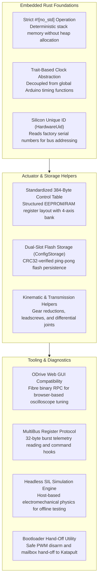
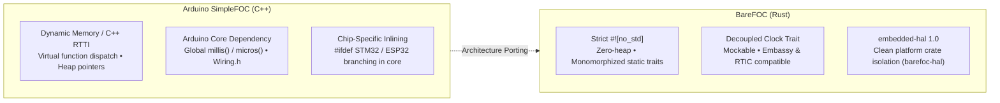

# BareFOC Feature Catalog & Parity Matrix

BareFOC is an embedded Rust port of the [Arduino SimpleFOC](https://simplefoc.com) motor control library, targeting `#![no_std]` real-time microcontrollers via the `embedded-hal` 1.0 trait ecosystem. While faithfully maintaining algorithmic and mathematical alignment with SimpleFOC, BareFOC incorporates design adaptations required for bare-metal `#![no_std]` environments, multi-axis robotics, and modern embedded Rust tooling.

---

## 1. BareFOC Additions & Quality-of-Life Conveniences

Arduino SimpleFOC provides an accessible, versatile, and well-designed foundation for motor control across educational, maker, and hobbyist platforms.

When porting these algorithms to embedded Rust, BareFOC introduced several design adaptations and supplementary modules. These additions primarily address the constraints of bare-metal `#![no_std]` microcontrollers, integration with modern Rust embedded tooling, and specific multi-axis robotics requirements:

### Overview of BareFOC Additions

1. **Strict `#![no_std]` Zero-Heap Design**:
   Because many real-time microcontrollers operate without dynamic memory allocators, all core algorithms, state machines, and register maps execute strictly on the stack or in static memory with zero runtime heap allocation (`alloc`-free). Memory usage is deterministic and known at compile time.

2. **Trait-Based Monotonic `Clock` Abstraction**:
   Rather than relying on global Arduino `millis()` or `micros()` functions, timing is abstracted behind the `barefoc::traits::Clock` trait. This allows applications to use RTIC monotonic timers, Embassy async timers, or inject deterministic mock clocks for automated unit testing on the host without real hardware.

3. **Standardized 384-Byte Control Table (`barefoc::control_table`)**:
   Designed for multi-axis smart actuators and modular servos, this module provides a structured register layout with explicit boundaries between non-volatile configuration memory (EEPROM: `0x00..0xDF`, 224 bytes) and volatile operational telemetry (RAM: `0xE0..0x17F`, 160 bytes), including a dedicated 4-axis motor parameter bank (`0x60..0xDF`, 32 bytes per motor).

4. **Kinematic & Transmission Utilities (`barefoc::kinematics`)**:
   Supplementary helpers for common mechanical configurations, including gear reduction ratios, leadscrew translation, 1-DOF and 2-DOF differential joint kinematics, and continuous multi-turn shaft angle unwrapping (`MultiTurnAccumulator`).

5. **Headless Software-in-the-Loop Simulation (`barefoc-sim`)**:
   A lightweight, host-based electromechanical simulation harness implementing coupled state equations for electrical $d$-$q$ dynamics and Newtonian rotational physics. This allows algorithms and control loops to be tested and validated offline on desktop machines without physical motor hardware.

6. **ODrive Web GUI Tooling Compatibility (`barefoc-fibre`)**:
   An optional communication bridge implementing the binary Fibre RPC protocol, allowing developers who prefer browser-based graphical tuning to connect to the official [ODrive Web GUI](https://gui.odriverobotics.com) alongside SimpleFOCStudio.

7. **MultiBus Register Framework (`barefoc-multibus`)**:
   A descriptor-based register server for addressable multi-drop buses (I2C, SPI, I3C), offering convenient 32-byte telemetry burst reads and autonomous command self-clearing hooks (`CMD_SAVE_CONFIG`, `CMD_REBOOT_BOOTLOADER`).

8. **Bootloader Hand-Off Utility (`BootloaderHandoff`)**:
   A standardized hand-off helper targeting Katapult/BareBoot bootloaders. It ensures gate driver outputs are safely disarmed into high-impedance coast mode before writing a request token to SRAM and executing a soft-reset.

9. **Dual-Slot Flash Persistence (`ConfigStorage`)**:
   A simple on-chip flash storage driver providing atomic ping-pong slot rotation, CRC32 verification, and wear leveling for boards lacking dedicated external EEPROM ICs.

10. **Silicon Electronic Signature Trait (`HardwareUid`)**:
    A lightweight hardware trait to read factory-programmed unique electronic signatures across STM32, ESP32, RP2350, and CH32 microcontrollers, simplifying node address assignment on shared multi-drop buses.

11. **SEGGER RTT Stream Transport (`barefoc-rtt`)**:
    A convenience stream adapter implementing `embedded-io` over SWD debug probe RTT channels, enabling console logging and Commander CLI interaction without dedicating hardware UART pins.

---

## 2. Upstream Parity Overview

The status of BareFOC features relative to upstream Arduino SimpleFOC is categorized into three levels:
- **Parity**: Direct port of SimpleFOC algorithms, mathematical models, control loops, and driver behaviors.
- **Exceeds Parity (Extended)**: Additional modules, zero-allocation Rust architecture, or specialized tooling conveniences not present in the upstream Arduino library.
- **Lacks Parity (Not Ported)**: Upstream SimpleFOC features or legacy microcontroller platforms (e.g., 8-bit AVR) that are currently unimplemented or outside BareFOC's 32-bit scope.

| Functional Domain | Parity Status | Description |
|---|:---:|---|
| **Coordinate Transforms & Math** | **Parity** | Forward/Inverse Clarke, Forward/Inverse Park, SVPWM, SinePWM |
| **Control Regimes & PID Loops** | **Parity** | Angle, Velocity, Torque (Voltage, DC Current, FOC Current) |
| **BLDC & Stepper Motor Topologies** | **Parity** | 3-phase BLDC, 2-phase Stepper, Hybrid Stepper, Brushed DC |
| **Inverter Driver Interfaces** | **Parity** | 3-PWM, 6-PWM complementary with dead-time, 4-PWM, 2-PWM |
| **Sensor Trait & Implementations** | **Parity** | Magnetic SPI, Magnetic I2C, PWM, Quadrature ABI, Digital Hall |
| **Current Sensing Systems** | **Parity** | Inline, Low-side, phase alignment, Clarke/Park current calculation |
| **SimpleFOC Commander Grammar** | **Parity** | Full compatibility with SimpleFOC ASCII serial command syntax |
| **Multi-Axis Kinematics & Transmissions** | **Exceeds Parity** | Reduction ratios, leadscrews, 2-DOF differential coupling, unwrapping |
| **Universal Control Table & Motor Bank** | **Exceeds Parity** | Standardized 384-byte memory map with 4-axis motor parameter bank |
| **ODrive GUI & Fibre RPC Protocol** | **Exceeds Parity** | Binary RPC protocol natively compatible with ODrive Web GUI |
| **MultiBus Protocol & Burst Telemetry** | **Exceeds Parity** | Register server for I2C/SPI with 32-byte burst read and hooks |
| **Software-in-the-Loop (SIL) Engine** | **Exceeds Parity** | 4th-order ODE electromechanical simulation with mock peripherals |
| **Hardware Bootloader Hand-Off** | **Exceeds Parity** | Dynamic vector table mailbox hand-off with guaranteed PWM disarm |
| **Flash Ping-Pong Persistence** | **Exceeds Parity** | Atomic dual-slot flash rotation with 32-bit CRC verification |
| **Silicon Unique ID (`HardwareUid`)** | **Exceeds Parity** | Silicon electronic serial extraction across STM32, ESP32, RP2350, CH32 |
| **Real-Time Terminal (RTT) Transport** | **Exceeds Parity** | Embedded SWD debug channel streaming via `embedded-io` |
| **Memory & Execution Safety** | **Exceeds Parity** | `#![no_std]`, zero heap allocation, compile-time memory safety |
| **Target Architecture Breadth** | **Lacks Parity** | Focuses on 32-bit Cortex-M, ESP32, RISC-V; excludes 8-bit AVR / SAMD21 |
| **Arduino IDE Library Manager** | **Lacks Parity** | BareFOC uses Cargo and Crates.io; not distributed via Arduino IDE |
| **High-Side Current Sensing** | **Lacks Parity** | High-side sensing drivers are currently not ported |

---

## 3. Detailed Parity Matrix by Subsystem

### A. Core Mathematical Engines & Transforms

| Algorithm / Feature | SimpleFOC (C++) | BareFOC (Rust) | Status | Notes |
|---|:---:|:---:|:---:|---|
| **Clarke Transform** | `_clarke()` | `barefoc::math::clarke()` | **Parity** | Identical forward 3-phase to 2-phase orthogonal transform |
| **Inverse Clarke Transform** | `_inv_clarke()` | `barefoc::math::inv_clarke()` | **Parity** | Reconstructs phase voltages from $\alpha$-$\beta$ frame |
| **Park Transform** | `_park()` | `barefoc::math::park()` | **Parity** | Projects stationary $\alpha$-$\beta$ coordinates onto rotating $d$-$q$ frame |
| **Inverse Park Transform** | `_inv_park()` | `barefoc::math::inv_park()` | **Parity** | Transforms rotating $d$-$q$ setpoints back to stationary $\alpha$-$\beta$ |
| **Space Vector PWM (SVPWM)** | Included | `barefoc::math::space_vector_pwm()` | **Parity** | Maximizes bus voltage utilization by $\approx 15.5\%$ |
| **Sinusoidal Modulation** | Included | `barefoc::math::sine_pwm()` | **Parity** | Pure sinusoidal duty cycle modulation |
| **Trapezoidal 120° / 150° Modulation** | Included | `barefoc::math::trapezoidal_pwm()` | **Parity** | Six-step and extended-conduction commutation |
| **Float Math Engine** | `math.h` (`sin`, `cos`) | `libm` (`sinf`, `cosf`) | **Parity** | `#![no_std]` software float math using `libm` |

---

### B. Control Loops, Regimes & Signal Conditioning

| Feature | SimpleFOC (C++) | BareFOC (Rust) | Status | Notes |
|---|:---:|:---:|:---:|---|
| **Torque Control: Voltage** | `MotionControlType::torque` | `OperatingMode::Torque` | **Parity** | Direct voltage vector angle alignment |
| **Torque Control: DC Current** | `TorqueControlType::dc_current` | `TorqueControlType::dc_current` | **Parity** | Uses single current magnitude feedback |
| **Torque Control: FOC Current** | `TorqueControlType::foc_current` | `TorqueControlType::foc_current` | **Parity** | Full closed-loop $i_d = 0$, $i_q = I_{\text{target}}$ control |
| **Velocity Closed Loop** | `MotionControlType::velocity` | `OperatingMode::Velocity` | **Parity** | Cascaded angle derivative PID loop |
| **Position Closed Loop** | `MotionControlType::angle` | `OperatingMode::Position` | **Parity** | Single-turn angle P control $[-\pi, +\pi]$ |
| **Multi-Turn Position** | Limited | `OperatingMode::MultiTurnPosition` | **Exceeds Parity** | Dedicated extended unwrapped position accumulator |
| **Current-Based Position** | Limited | `OperatingMode::CurrentBasedPosition`| **Exceeds Parity** | Active current clamping during position moves |
| **Open-Loop Regimes** | Voltage, Velocity, Angle | Voltage, Velocity, Angle | **Parity** | Deterministic open-loop commutation modes |
| **PID Anti-Windup Clamping** | Integrated | Integrated | **Parity** | Integrator saturation prevention |
| **PID Output Ramp Limiting** | Integrated | Integrated | **Parity** | Limits rate of change of output per iteration |
| **PID Derivative Filter** | First-order LPF | First-order LPF | **Parity** | Low-pass filtered derivative on error signal |
| **Monotonic Timing Source** | Global `millis()`/`micros()` | Trait-based `Clock` | **Exceeds Parity** | Allows deterministic mock clocks, Embassy, or RTIC |

---

### C. Actuator Topologies & Kinematics

| Feature | SimpleFOC (C++) | BareFOC (Rust) | Status | Notes |
|---|:---:|:---:|:---:|---|
| **Brushless DC (BLDC)** | `BLDCMotor` | `BLDCMotor` | **Parity** | 3-phase permanent magnet synchronous motors |
| **Stepper Motor FOC** | `StepperMotor` | `StepperMotor` | **Parity** | 2-phase bipolar stepper FOC control |
| **Hybrid Stepper** | Partial / Community | `HybridStepperMotor` | **Exceeds Parity** | Dual-regime open-loop / closed-loop with stall detection |
| **Brushed DC Motor** | Community drivers | `DCMotor` | **Parity** | Single-phase H-bridge closed-loop PID control |
| **1-DOF Joint Modeling** | Not supported | `barefoc::kinematics::Joint1DOF` | **Exceeds Parity** | Models gear reductions, leadscrews, and limits |
| **2-DOF Differential Joint** | Not supported | `barefoc::kinematics::Joint2DOF` | **Exceeds Parity** | Differential kinematics for wrist and pan/tilt mechanisms |
| **Trapezoidal Trajectory Profile**| Limited / External | `TrapezoidalTrajectory` | **Exceeds Parity** | Real-time position, velocity, and acceleration profiling |
| **Actuator Multi-Axis Assembly** | Not supported | `ActuatorAssembly` | **Exceeds Parity** | Multi-motor coordination up to 4 axes per controller |

---

### D. Sensors & Encoders

| Sensor Type | SimpleFOC (C++) | BareFOC (Rust) | Status | Notes |
|---|:---:|:---:|:---:|---|
| **Magnetic Sensor SPI** | `MagneticSensorSPI` | `MagneticSensorSPI` | **Parity** | 14-bit, 12-bit SPI encoders with parity checks |
| **Magnetic Sensor I2C** | `MagneticSensorI2C` | `MagneticSensorI2C` | **Parity** | AS5600, AS5048B, and compatible I2C sensors |
| **Magnetic Sensor PWM** | `MagneticSensorPWM` | `MagneticSensorPWM` | **Parity** | Duty-cycle pulse length encoding |
| **Quadrature Encoder (ABI)** | `Encoder` | `Encoder` | **Parity** | Hardware timer or GPIO interrupt quadrature inputs |
| **Digital Hall Sensors** | `HallSensor` | `HallSensor` | **Parity** | 3-phase 60°/120° commutation sectors |
| **MagnTek MT6701 SSI Driver** | In `Arduino-FOC-drivers`| `mt6xxx-rs` | **Parity** | Fast SSI bus interface with CRC validation |
| **TI TMAG5273 3D Hall** | In `Arduino-FOC-drivers`| `tmag-rs` | **Parity** | I2C 3D Hall angle and temperature sensor |

---

### E. Gate Inverter Drivers

| Driver Topology | SimpleFOC (C++) | BareFOC (Rust) | Status | Notes |
|---|:---:|:---:|:---:|---|
| **BLDC 3-PWM** | `BLDCDriver3PWM` | `BLDCDriver3PWM` | **Parity** | 3 half-bridges with individual PWM |
| **BLDC 6-PWM** | `BLDCDriver6PWM` | `BLDCDriver6PWM` | **Parity** | Complementary PWM with hardware dead-time |
| **Stepper 4-PWM** | `StepperDriver4PWM` | `StepperDriver4PWM` | **Parity** | Dual full-bridge stepper drive |
| **Stepper 2-PWM** | `StepperDriver2PWM` | `StepperDriver2PWM` | **Parity** | Step/direction or dual half-bridge drive |
| **TI DRV8316 / DRV8311 Drivers**| In `Arduino-FOC-drivers`| `drv83xx-rs` | **Parity** | SPI register diagnostics, PGA gain, and fault flags |

---

### F. Current Sensing & Phase Alignment

| Architecture | SimpleFOC (C++) | BareFOC (Rust) | Status | Notes |
|---|:---:|:---:|:---:|---|
| **Inline Current Sensing** | `InlineCurrentSense` | `InlineCurrentSense` | **Parity** | Shunt resistors in series with motor phases |
| **Low-Side Current Sensing** | `LowsideCurrentSense` | `LowsideCurrentSense` | **Parity** | Synchronized ADC reading at bottom PWM peaks |
| **Phase Alignment (`driver_align`)** | Integrated | Integrated | **Parity** | Automates current sensor gain sign and phase mapping |
| **Current Reconstruction** | Clarke & Park | Clarke & Park | **Parity** | Computes $i_d$ and $i_q$ from measured phase currents |
| **High-Side Current Sensing** | Partial / Experimental | Not supported | **Lacks Parity** | Currently omitted in favor of inline/low-side |

---

### G. Communication Protocols & Diagnostics

| Protocol / Tool | SimpleFOC (C++) | BareFOC (Rust) | Status | Notes |
|---|:---:|:---:|:---:|---|
| **Commander ASCII Protocol** | `Commander` | `barefoc-commander` | **Parity** | SimpleFOC command grammar compatibility |
| **Smart Servo Commander** | Not supported | `SmartServoCommander` | **Exceeds Parity** | Multi-motor setpoints, kinematics, and bootloader |
| **ODrive Web GUI (Fibre RPC)** | Not supported | `barefoc-fibre` | **Exceeds Parity** | Binary RPC over WebSerial for ODrive GUI |
| **MultiBus Protocol (I2C/SPI)** | Not supported | `barefoc-multibus` | **Exceeds Parity** | Register server with 32-byte telemetry burst window |
| **CAN Bus Frame Architecture** | Community examples | `barefoc::communication::can` | **Exceeds Parity** | Standardized 8-byte setpoints, feedback, and boot triggers |
| **SEGGER RTT Transport** | Not supported | `barefoc-rtt` | **Exceeds Parity** | High-speed SWD debugging implementing `embedded-io` |
| **SimpleFOCStudio Integration** | Supported via ASCII | Supported via ASCII | **Parity** | Compatible with the Python SimpleFOCStudio GUI |

---

### H. Platform Hardware Support

| Microcontroller Platform | SimpleFOC (C++) | BareFOC (Rust) | Status | Notes |
|---|:---:|:---:|:---:|---|
| **STM32 (Cortex-M4/M7/M33)** | Primary platform | `barefoc-stm32` | **Parity** | Advanced timer 6-PWM, ADC injected sampling, flash |
| **ESP32 / ESP32-S3** | Primary platform | `barefoc-esp32` | **Parity** | MCPWM, LEDC, PCNT pulse accumulation |
| **Raspberry Pi RP2040 / RP2350** | Arduino-Pico core | `barefoc-rp` | **Parity** | RP2350 dual-core ARM Cortex-M33 / Hazard3 RISC-V |
| **CH32 RISC-V (WCH)** | Partial / Community | `barefoc-ch32` | **Parity** | QingKe RISC-V timer PWM and ADC sampling |
| **8-Bit AVR (ATMega328P)** | Supported | Not supported | **Lacks Parity** | BareFOC targets 32-bit embedded platforms |
| **SAMD21 / SAMD51** | Supported | Not supported | **Lacks Parity** | Can be implemented via generic `embedded-hal` |
| **Teensy / NXP i.MX RT** | Supported | Not supported | **Lacks Parity** | Can be implemented via generic `embedded-hal` |

---

## 4. Software Architecture & Design Differences

### Key Architectural Differences

1. **Memory Model & Allocation**:
   - *SimpleFOC*: Utilizes C++ virtual tables, dynamic object instantiation, and pointers.
   - *BareFOC*: Strict `#![no_std]` zero-allocation design. All data structures, buffers, and parsers are statically bounded at compile time without dynamic heap allocation.

2. **Hardware Abstraction Boundary**:
   - *SimpleFOC*: Embeds architecture-specific `#ifdef` macros throughout the core library to support various Arduino boards.
   - *BareFOC*: Strict separation of concerns. The core `bareFOC` crate contains purely hardware-independent algorithms, mathematical transforms, and traits. Silicon-specific drivers reside in dedicated crates (`barefoc-stm32`, `barefoc-esp32`, `barefoc-rp`, `barefoc-ch32`) adhering to `embedded-hal` 1.0.

3. **Asynchronous & Multi-Rate Execution**:
   - *SimpleFOC*: Typically executes inside the standard Arduino `loop()` function, combining sensor reading, PID computation, PWM modulation, and serial communications in a single cooperative thread.
   - *BareFOC*: Designed for cooperative multitasking and interrupt-driven execution (such as Embassy and RTIC). Fast control loops (e.g. 20 kHz current loops) run inside high-priority timer interrupts, while telemetry, trajectory generation, and multi-transport communications execute in lower-priority background tasks.
