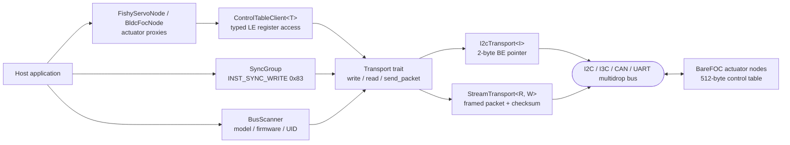
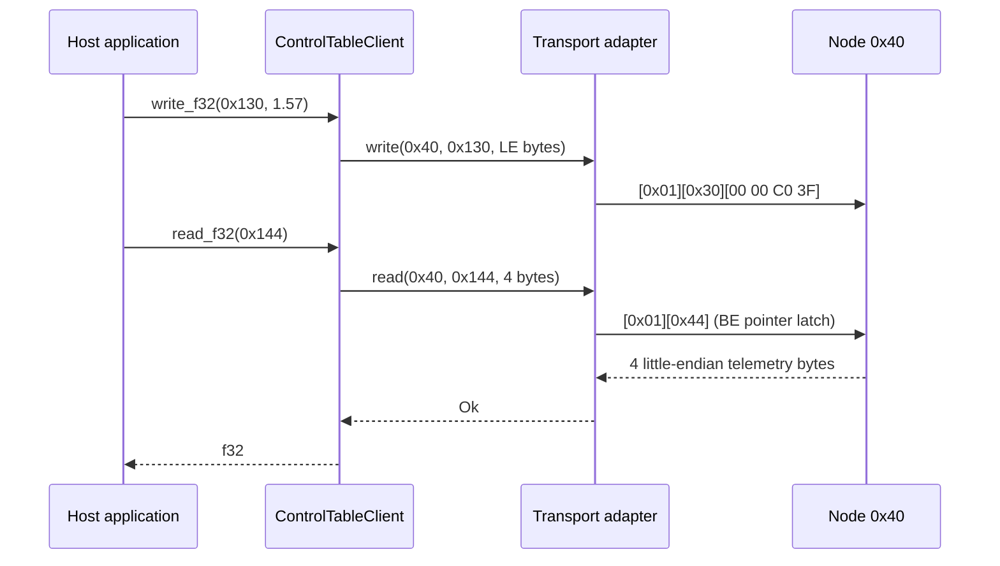

# Master Controller SDK (`barefoc-master`)

`barefoc-master` is a `#![no_std]`, zero-heap host-side SDK for discovering,
synchronizing, and commanding multi-axis BareFOC actuator nodes over multidrop
buses. It intentionally depends only on `embedded-hal` 1.0, `embedded-io`, and
`heapless`, so a main MCU (STM32H7, RP2350, ESP32) or Linux companion computer
does not need to link motor commutation math, ADC drivers, or gate-driver code.

The crate speaks the target firmware's canonical 512-byte control table
described in [Universal Control Table](/actuators/control_table/) and the servo
instruction set implemented by [MultiBus](/communication/multibus/).

---

## 1. Architecture



Register values are **little-endian** on the wire (matching
`ControlTable::read_u16` / `read_f32` in the firmware). Register addresses are
`u16` because RAM registers exceed `0xFF`. The I2C register pointer itself is a
two-byte **big-endian** address.

### 1.1 Crate layout

| Module | Responsibility |
|---|---|
| `registers` | `u16` register offsets, instruction constants, `OperatingMode` / `TopologyPreset` enums |
| `transport` | `Transport` trait, `TransportError<E>`, `I2cTransport<I>`, `StreamTransport<R, W>` |
| `client` | `ControlTableClient<T>` typed read/write and bounds validation |
| `proxies` | `FishyServoNode<T>` and `BldcFocNode<T>` actuator proxies |
| `sync` | `SyncGroup<T>` atomic `INST_SYNC_WRITE` frames and broadcast disarm |
| `scanner` | `BusScanner<T>` address scan, fingerprinting, bounded inventory |

All packet buffers are stack arrays or `heapless::Vec`; the crate never
allocates. `unsafe_code` is forbidden by workspace lint inheritance.

---

## 2. Register map used by the master

| Address | Name | Type | Master use |
|---|---|---|---|
| `0x00` | `REG_MODEL_NUMBER` | `u16` | Fingerprinting |
| `0x02` | `REG_FIRMWARE_VERSION` | `u8` | Fingerprinting |
| `0x04` | `REG_HARDWARE_UID` | `[u8; 12]` | 96-bit silicon UID fingerprinting |
| `0xE0` | `REG_OPERATING_MODE` | `u8` | `BldcFocNode::set_operating_mode` (Position = `2`) |
| `0xE2` | `REG_TOPOLOGY_PRESET` | `u8` | `FishyServoNode::set_topology_mode` |
| `0x120` | `REG_TORQUE_ENABLE` | `u8` | Emergency broadcast disarm (write `0`) |
| `0x124` | `REG_SAVE_CONFIG_CMD` | `u8` | NVM commit trigger (`0x55`) |
| `0x130` | `REG_GOAL_POSITION` | `f32` | Joint 0 / angle setpoint, sync target |
| `0x134` | `REG_GOAL_VELOCITY` | `f32` | Velocity setpoint |
| `0x138` | `REG_GOAL_CURRENT` | `f32` | Torque / current setpoint |
| `0x13C` | `REG_GOAL_VOLTAGE` | `f32` | Voltage setpoint |
| `0x140` | `REG_HARDWARE_ERROR_STATUS` | `u16` | Legacy 16-bit fault bitfield read (unchanged) |
| `0x144` | `REG_PRESENT_POSITION` | `f32` | Telemetry |
| `0x148` | `REG_PRESENT_VELOCITY` | `f32` | Telemetry |
| `0x14C` | `REG_PRESENT_CURRENT` | `f32` | Telemetry |
| `0x16C` | `REG_JOINT_TARGET_BASE` | `f32` | Base of extended slot array (slot `i` = base + `i*4`) |
| `0x170`–`0x178` | joint 1..3 targets | `f32` | Extended angle targets for joints 1, 2, 3 |
| `0x184` | `REG_PRESENT_BUS_POWER` | `f32` | Extended power telemetry |
| `0x1AC` | `REG_GOAL_TORQUE_FF` | `f32` | Torque feedforward setpoint |
| `0x1C0` | `REG_WATCHDOG_TIMEOUT_MS` | `u16` | Watchdog keepalive / timeout |
| `0x1D8` | `REG_HARDWARE_ERROR_STATUS_EXT` | `u32` | Extended 32-bit fault flags (bits 16..20) |
| `0x1E0` | `REG_TOTAL_REVOLUTIONS` | `f64` | Lifetime odometer |
| `0x1F8` | `REG_HARDWARE_CAPABILITIES` | `u32` | Capability discovery; `0x1FC..0x1FF` reserved |

`CONTROL_TABLE_SIZE` is `512` (`0x200`): EEPROM `0x00..0xDF` (224 bytes) and RAM
`0xE0..0x1FF` (288 bytes). Every bulk access is checked against this bound and
returns a dedicated `BoundsError::OutOfBounds`. The client adds `read_u32` /
`write_u32` and `read_f64` / `write_f64` for the capability, extended-error and
odometer channels; all other offsets and semantics from the 384-byte map are
unchanged. The capability mask at `0x1F8` does not overlap the 15-byte
`BoardName` field, so a full-length board name cannot corrupt hardware
detection.

`TopologyPreset` discriminants are preserved verbatim from firmware:
`Independent4x1Dof = 0`, `Differential2x2Dof = 1`, `Hybrid1Dof2Dof = 2`,
`Hybrid2x1Dof2Dof = 3`, `Custom = 0xFF`. `OperatingMode` variants likewise:
`Torque = 0`, `Velocity = 1`, `Position = 2`, `MultiTurnPosition = 3`,
`CurrentBasedPosition = 4`, `OpenLoopVoltage = 5`, `OpenLoopVelocity = 6`,
`OpenLoopAngle = 7`.

---

## 3. Transport model



**I2C.** `I2cTransport<I, const MAX_FRAME: usize = 18>` stages a two-byte
big-endian pointer plus payload in a fixed buffer, emits one write transaction,
and latches the pointer with a write before a burst read. Oversize writes return
`TransportError::BufferTooSmall`; raise `MAX_FRAME` for larger bulk transfers.

**Serial streams.** `StreamTransport<R, W>` frames each packet as
`[0xA5][node][reg_hi][reg_lo][len][payload...][checksum]` with an XOR checksum.
Reads send a zero-length request and decode a framed response; writes wait for
a zero-length ACK. `embedded_io::Read + Write` is the only requirement.

Both adapters are unit tested on the host with `embedded-hal-mock`.

---

## 4. API examples

### 4.1 `ControlTableClient`

```rust
use barefoc_master::{
    ControlTableClient, CAP_DUAL_ENCODER, REG_HARDWARE_CAPABILITIES, REG_MODEL_NUMBER,
    REG_PRESENT_BUS_POWER, REG_PRESENT_POSITION,
};

let mut client = ControlTableClient::new(0x40, i2c_transport);
let model: u16 = client.read_u16(REG_MODEL_NUMBER)?;
let angle: f32 = client.read_f32(REG_PRESENT_POSITION)?;
client.write_u8(0xE0, 2)?; // Position mode

// Capability discovery at 0x1F8 (u32, read-only on the node).
let caps = client.read_u32(REG_HARDWARE_CAPABILITIES)?;
if caps & CAP_DUAL_ENCODER != 0 {
    let power: f32 = client.read_f32(REG_PRESENT_BUS_POWER)?;
}
```

### 4.2 `FishyServoNode`

Joint 0 targets `REG_GOAL_POSITION` (`0x130`). Joints 1..3 use slots 1..3 of
`REG_JOINT_TARGET_BASE` (`0x16C + joint_index*4`, i.e. `0x170`, `0x174`,
`0x178`) in the spare RAM tail, avoiding the velocity/current/voltage goal
registers.

```rust
use barefoc_master::{FishyServoNode, TopologyPreset};

let mut servo = FishyServoNode::new(0x40, i2c_transport);
servo.set_topology_mode(TopologyPreset::Independent4x1Dof)?;
servo.set_joint_target(0, 1.5708)?;
servo.set_joint_target(2, -0.75)?;
let position = servo.present_position()?;
let faults = servo.hardware_error_status()?;
servo.save_config()?; // writes 0x55 to 0x124
```

### 4.3 `BldcFocNode`

```rust
use barefoc_master::{BldcFocNode, OperatingMode};

let mut motor = BldcFocNode::new(0x41, i2c_transport);
motor.set_operating_mode(OperatingMode::Velocity)?;
motor.set_velocity(12.5)?;      // 0x134
motor.set_voltage(6.0)?;        // 0x13C
motor.set_angle(0.0)?;          // 0x130
motor.set_torque(0.8)?;         // 0x138
```

### 4.4 `SyncGroup`

A single `INST_SYNC_WRITE` (`0x83`) frame carries every `(node_id, f32 target)`
pair so coupled joints update with no inter-node bus latency.

```text
FF FF FD 00 | FE | len(u16 LE) | 83 | addr(u16 LE) | 04 00 | [id][f32 LE] ... | crc(u16 LE)
```

```rust
use barefoc_master::{SyncGroup, REG_GOAL_POSITION};

let mut group = SyncGroup::new(stream_transport);
group.sync_write_position(&[(1, 0.35), (2, -0.35), (3, 1.20)])?;
group.emergency_stop()?; // broadcast INST_WRITE: 0x120 = 0
```

Up to `MAX_NODES = 16` targets are accepted; frames are bounded by
`MAX_PACKET_LEN = 128` bytes. The CRC is the Dynamixel v2 CRC-16 (polynomial
`0x8005`), so frames parse directly in the target's `StreamingServoParser`.

### 4.5 `BusScanner`

```rust
use barefoc_master::BusScanner;

let mut scanner = BusScanner::new(i2c_transport);
let nodes = scanner.scan_all_i2c()?; // 0x08..=0x77, at most MAX_NODES = 16
for node in nodes.iter() {
    // node.address, node.model_number, node.firmware_version, node.uid
}
```

Silent addresses are skipped; a responding node is fingerprinted from
`REG_MODEL_NUMBER`, `REG_FIRMWARE_VERSION`, and the 96-bit `REG_HARDWARE_UID`.

---

## 5. Verification

```bash
cargo check -p barefoc-master
cargo check --workspace
cargo test -p barefoc-master
cargo test --workspace
```

The crate contains host unit tests for register constants, transport frame
bytes (I2C pointer and stream framing), typed client reads/writes and bounds,
actuator proxy setpoints, `INST_SYNC_WRITE` / disarm packing, and scanner
fingerprinting. No test requires real hardware.

---

## Related pages

- [Universal Control Table](/actuators/control_table/)
- [MultiBus register transport](/communication/multibus/)
- [Flash Once and Play architecture](/actuators/flash_once_play/)
