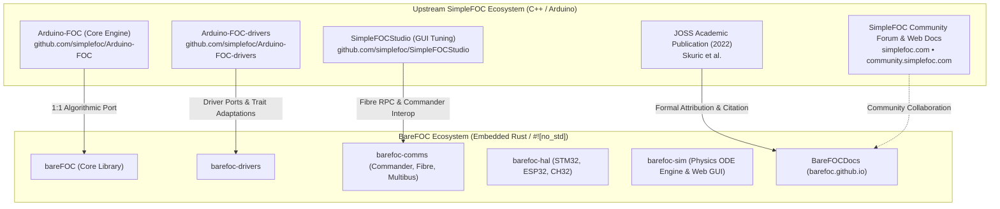

# Original Project: Arduino SimpleFOC

BareFOC is an embedded Rust port of the groundbreaking open-source **[Arduino SimpleFOC](https://simplefoc.com)** project created by **Antun Skuric** and the SimpleFOC community.

---

## 1. Upstream Lineage & History

Field Oriented Control (FOC) was historically confined to proprietary, closed-source industrial motor drives, high-end automotive ESCs, or vendor-locked evaluation SDKs (such as TI InstaSPIN or ST MotorControl Workbench). These solutions typically required high-cost microcontrollers, closed toolchains, and complex register-level setup.

In 2020, **Antun Skuric** founded **SimpleFOC** (`Arduino-FOC`) with the vision of making FOC accessible, modular, and easy to understand for hobbyists, roboticists, students, and engineers using affordable off-the-shelf microcontrollers and brushless motors. Joined by key core contributors—including **Hasan Sinan Bank**, **Richard Unger**, **Owen Williams**, and **David González-Reyes**—the project established a universal, hardware-agnostic architecture for real-time motor control.

---

## 2. Core Architectural Innovations of SimpleFOC

SimpleFOC established several fundamental architectural paradigms that BareFOC directly preserves:

1. **Decoupled Actuator & Sensing Trait Abstraction**:
   Sensors, inverters, and current-sense amplifiers operate as independent components. A user can freely combine any position sensor (SPI, I2C, ABI, Hall) with any power stage (3-PWM, 6-PWM, discrete H-Bridge) and any motor type (BLDC, Stepper).

2. **Unified Cascaded Motion Pipeline**:
   Hierarchical control loops are structured symmetrically:
   $$\text{Target Position (rad)} \xrightarrow{\text{Angle P}} \text{Target Velocity (rad/s)} \xrightarrow{\text{Velocity PID}} \text{Target Torque / Voltage} \xrightarrow{\text{SVPWM}} \text{PWM Duty Cycles}$$

3. **Space Vector Modulation (SVPWM)**:
   Maximizes DC bus voltage utilization by $15.5\%$ over pure sinusoidal PWM while minimizing harmonic distortion and acoustic noise.

4. **Automated Zero-Angle & Direction Alignment (`initFOC()`)**:
   Eliminates manual phase-to-encoder alignment by injecting an open-loop electrical angle vector along Phase A, measuring rotor deflection, and computing electrical zero offset and pole pair direction on boot.

5. **Human-Readable Commander Protocol**:
   A streamlined ASCII serial grammar allowing users to tune PID gains, limits, and motion targets dynamically without re-flashing firmware.

---

## 3. Why BareFOC? The Transition to `#![no_std]` Rust

While SimpleFOC revolutionized accessibility in the Arduino and C++ ecosystem, high-reliability robotics, medical actuators, and aerospace mechanisms demand guarantees that C++ cannot enforce at compile time. BareFOC was created to bring SimpleFOC's algorithms into modern embedded systems:

| Architectural Metric | Upstream SimpleFOC (C++) | BareFOC (Embedded Rust) |
|---|---|---|
| **Memory Allocation** | Dynamic heap permitted (`new`, `String`) | Strict `#![no_std]` zero-allocation (`no heap`) |
| **Safety Guarantees** | Manual pointer checks; risk of UB | Compile-time memory safety, thread safety, zero UB |
| **HAL Integration** | Arduino Core abstraction | Standardized `embedded-hal` 1.0 & `embedded-io` traits |
| **Concurrency Models** | Monolithic `loop()` busy-waiting | Compatible with RTIC, Embassy async, and zero-overhead IRQs |
| **Hardware Math** | `float` via standard math lib | High-speed `libm` with hardware CORDIC acceleration |
| **Verification & CI** | Physical hardware in-the-loop | Host-based Software-in-the-Loop (`barefoc-sim`) ODE physics engine |
| **Tooling & GUI** | SimpleFOCStudio (Python/PyQt) | Native ODrive Web GUI compatibility via Fibre RPC |

---

## 4. Upstream SimpleFOC Ecosystem Resources

The upstream SimpleFOC community offers a wealth of educational materials, hardware schematics, and tuning guides:

| Resource | Description | Link |
|---|---|---|
| **Official Website** | Project portal, release blogs, and hardware showcases | [simplefoc.com](https://simplefoc.com) |
| **Documentation Hub** | Comprehensive SimpleFOC user manual and hardware guides | [docs.simplefoc.com](https://docs.simplefoc.com) |
| **Core Repository** | `Arduino-FOC` C++ source code and platform implementations | [github.com/simplefoc/Arduino-FOC](https://github.com/simplefoc/Arduino-FOC) |
| **Drivers Repository** | `Arduino-FOC-drivers` extended sensors, gate drivers, and shields | [github.com/simplefoc/Arduino-FOC-drivers](https://github.com/simplefoc/Arduino-FOC-drivers) |
| **Community Forum** | Active international forum for hardware design, troubleshooting, and tuning | [community.simplefoc.com](https://community.simplefoc.com) |
| **SimpleFOCStudio** | Python-based desktop GUI for real-time serial tuning and plotting | [github.com/simplefoc/SimpleFOCStudio](https://github.com/simplefoc/SimpleFOCStudio) |

---

## 5. Academic Publication & Attribution

SimpleFOC was formally published as an open-source peer-reviewed research project in the *Journal of Open Source Software (JOSS)*. 

If you use these algorithms in scientific research, academic publications, or open hardware projects, please cite the original authors:

> **SimpleFOC: A Field Oriented Control (FOC) Library for Controlling Brushless Direct Current (BLDC) and Stepper Motors**  
> Antun Skuric, Hasan Sinan Bank, Richard Unger, Owen Williams, David González-Reyes  
> *Journal of Open Source Software*, 7(74), 4232 (2022).  
> DOI: [10.21105/joss.04232](https://doi.org/10.21105/joss.04232)

See [Citing SimpleFOC](/citing/) for complete BibTeX and academic citation formats.

---

## 6. Upstream Parity & Synchronization Commitment

BareFOC maintains a living tracking document, [`PARITY-REPORT.md`](https://github.com/bareFOC/bareFOC/blob/main/PARITY-REPORT.md), tracking every feature, mathematical transformation, sensor driver, and inverter topology across both repositories. When upstream SimpleFOC releases new features or improvements, BareFOC synchronizes algorithms to ensure parity while upholding ethical open-source attribution.
