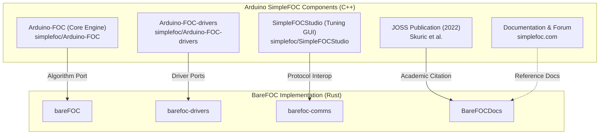

# Original Project: Arduino SimpleFOC

BareFOC is an embedded Rust port of the open-source **[Arduino SimpleFOC](https://simplefoc.com)** library created by **Antun Skuric** and the SimpleFOC community.

---

## 1. Upstream Project & Authors

The SimpleFOC project (`Arduino-FOC`) was created in 2020 by **Antun Skuric**, with contributions from **Hasan Sinan Bank**, **Richard Unger**, **Owen Williams**, **David González-Reyes**, and the wider open-source motor control community. The library implements Field Oriented Control (FOC) for Brushless DC (BLDC) and Stepper motors across multiple microcontroller architectures.

---

## 2. SimpleFOC Architecture

The upstream library is designed around the following core concepts:

1. **Decoupled Peripheral Interfaces**:
   Sensors, inverter drivers, and current sensing amplifiers are decoupled behind standard interfaces. Any supported sensor (SPI, I2C, ABI quadrature, digital Hall) can be paired with any driver stage (3-PWM, 6-PWM, discrete half-bridges) and motor topology (BLDC, Stepper).

2. **Cascaded Motion Control Pipeline**:
   The control loops are structured hierarchically:
   $$\text{Target Position (rad)} \xrightarrow{\text{Angle P}} \text{Target Velocity (rad/s)} \xrightarrow{\text{Velocity PID}} \text{Target Torque / Voltage} \xrightarrow{\text{SVPWM}} \text{Duty Cycles}$$

3. **Modulation Strategies**:
   Includes implementations for Space Vector PWM (SVPWM), Sinusoidal PWM, and open/closed-loop trapezoidal modulation.

4. **Automated Alignment (`initFOC`)**:
   Determines the sensor zero-electrical-angle offset and rotation direction by applying a stationary voltage vector along Phase A and measuring rotor response during initialization.

5. **Commander Protocol**:
   An ASCII serial communication grammar that enables runtime inspection and configuration of PID gains, limits, and setpoints.

---

## 3. Upstream Repositories & Community Resources

The official resources maintained by the SimpleFOC project:

| Resource | Description | URL |
|---|---|---|
| **Official Website** | Project overview and release announcements | [simplefoc.com](https://simplefoc.com) |
| **Documentation** | User manual and hardware setup guides | [docs.simplefoc.com](https://docs.simplefoc.com) |
| **Core Repository** | `Arduino-FOC` C++ source code | [github.com/simplefoc/Arduino-FOC](https://github.com/simplefoc/Arduino-FOC) |
| **Drivers Repository** | `Arduino-FOC-drivers` extended driver library | [github.com/simplefoc/Arduino-FOC-drivers](https://github.com/simplefoc/Arduino-FOC-drivers) |
| **Community Forum** | Discussion forum for hardware design and tuning | [community.simplefoc.com](https://community.simplefoc.com) |
| **SimpleFOCStudio** | Python/PyQt serial interface for motor tuning | [github.com/simplefoc/SimpleFOCStudio](https://github.com/simplefoc/SimpleFOCStudio) |

---

## 4. Academic Publication & Citation

The SimpleFOC library was formally published in the *Journal of Open Source Software (JOSS)*:

> **SimpleFOC: A Field Oriented Control (FOC) Library for Controlling Brushless Direct Current (BLDC) and Stepper Motors**  
> Antun Skuric, Hasan Sinan Bank, Richard Unger, Owen Williams, David González-Reyes  
> *Journal of Open Source Software*, 7(74), 4232 (2022).  
> DOI: [10.21105/joss.04232](https://doi.org/10.21105/joss.04232)

For complete BibTeX formatting, refer to [Citing SimpleFOC](/citing/).
