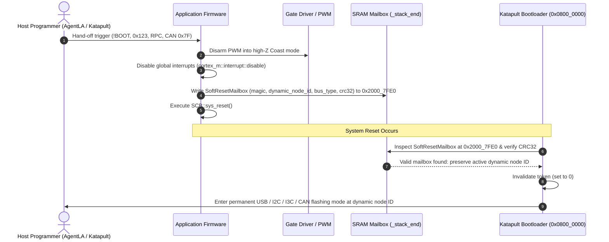

# Bootloader Soft-Reset (`barefoc::traits::bootloader`)

Compact robotics actuators often lack physical reset buttons, tactile switches, or exposed SWD programming headers once mechanically enclosed.

The `barefoc::traits::bootloader` module and `barefoc-stm32` HAL drivers coordinate hands-free over-the-air (OTA) bootloader hand-offs between running application firmware and embedded recovery bootloaders (such as **Katapult** or **BareBoot**) using persistent SRAM mailbox tokens.

---

## 1. Hand-Off Sequence & Safety Guarantee

When a host initiates a firmware update over I2C, UART, CAN, or USB, the actuator must transition cleanly from closed-loop commutation to the bootloader without mechanical jerking, dead-time shoot-through, or runaway motion:



---

## 2. Dynamic Mailbox Architecture (`SoftResetMailbox`)

In multidrop networks (I3C, I2C, CAN), nodes dynamically assigned an address (e.g. `0x42`) must retain that address when rebooting into the bootloader to prevent bus collisions or requiring NOR flash erases.

The system uses `SoftResetMailbox` placed at uninitialized SRAM (`0x2000_7FE0..0x2000_8000` on STM32H503):

```rust
#[repr(C)]
#[derive(Clone, Copy, Debug, PartialEq, Eq)]
pub struct SoftResetMailbox {
    pub magic: u64,           // REQUEST_BOOTLOADER, REQUEST_APP, or REQUEST_START_APP
    pub dynamic_node_id: u8,   // Active dynamic bus address
    pub bus_type: u8,          // Comms bus (1=I2C, 2=I3C, 3=CAN, 4=UART)
    pub flags: u16,            // Reserved
    pub can_assigned_id: u32,  // CAN dynamic arbitration ID
    pub reserved: [u32; 3],    // Alignment padding
    pub crc32: u32,            // IEEE 802.3 CRC32 over bytes 0..28
}
```

### Supported Magic Tokens

The mailbox supports bidirectional handoff between bootloader and application:

| Token Constant | Value (Hex) | ASCII / Label | Purpose |
|---|---|---|---|
| `REQUEST_BOOTLOADER` | `0x5984_E3FA_6CA1_589B` | Magic Seed | Application requests entry into recovery bootloader |
| `REQUEST_APP` | `0x4649_5348_4150_5031` | `"FISHAPP1"` | Bootloader requests execution of application firmware |
| `REQUEST_START_APP` | `0x5354_4152_5441_5050` | `"STARTAPP"` | Alternate start-app request token |

`SoftResetMailbox::is_valid()` validates that `magic` matches one of these accepted tokens and that `crc32` correctly matches the IEEE 802.3 CRC over the first 28 bytes.

### Mailbox Inspection Helper

```rust
// Read mailbox from SRAM location (e.g. 0x2000_7FE0)
if let Some(mb) = barefoc_stm32::bootloader::read_soft_reset_mailbox(0x2000_7FE0 as *const _) {
    if mb.is_valid() {
        let node_id = mb.dynamic_node_id;
        // Apply dynamic node address
    }
}
```

### Warm Reboot Validation Flow
1. **Application**: Prior to reset, writes `SoftResetMailbox` with `dynamic_node_id` and CRC32 to `0x2000_7FE0`.
2. **Bootloader**: Checks `0x2000_7FE0`. If `magic` matches and CRC32 is valid, BareBoot binds immediately to `dynamic_node_id` with zero flash wear.
3. **Fallback**: If uninitialized or corrupted, the bootloader falls back to persistent flash storage (Sector 14/15) or deterministic UID hash addressing.

---

## 3. Dynamic Vector Table Derivation (Katapult Compatibility)

Rather than hard-coding static SRAM addresses (which change across chip variants and memory configurations), `Stm32H5Bootloader` calculates the SRAM mailbox address dynamically from the initial stack pointer defined in the hardware vector table:

```rust
// Vector table entry 0 at FLASH_BASE (0x0800_0000) points to the top of SRAM (_stack_end)
let stack_end = core::ptr::read_volatile(0x0800_0000 as *const u32);
let mailbox = (stack_end - 8) as *mut u64;
```

This guarantees 100% binary compatibility between bootloader builds and application images regardless of linker script adjustments.

---

## 3. The `BootloaderHandoff` Trait

Core abstraction in `barefoc::traits::bootloader`:

```rust
pub trait BootloaderHandoff {
    /// Disarm PWM outputs, configure gate drivers into safe coast/high-Z,
    /// write the bootloader request token to the SRAM mailbox, and trigger system reset.
    fn enter_bootloader(&mut self) -> !;
}
```

---

## 4. Hardware Implementation on STM32H5

```rust,no_run
use barefoc::traits::bootloader::BootloaderHandoff;
use barefoc_stm32::stm32h5::bootloader::Stm32H5Bootloader;

// Create bootloader handler for STM32H5 (optionally passing gate driver enable/fault pins)
let mut bootloader = Stm32H5Bootloader::new(None);

// When triggered by bus command:
bootloader.enter_bootloader();
```

### Safety Steps Executed by `enter_bootloader`:

1. **Gate Driver Disarm**:
   Pulls gate driver enable pins low (`nSLEEP` or `ENABLE = LOW`) and floats half-bridge outputs, placing the rotor in passive Coast mode.
2. **Critical Section**:
   Masks all system interrupts using `cortex_m::interrupt::disable()`.
3. **Mailbox Inscription**:
   Writes `0x5984_E3FA_6CA1_589B` (`REQUEST_BOOTLOADER`) to the top 64-bit word of SRAM.
4. **Data Synchronization Barrier**:
   Executes `cortex_m::asm::dsb()` to flush bus write pipelines.
5. **System Soft-Reset**:
   Calls `cortex_m::peripheral::SCB::sys_reset()`.

---

## 5. Bus Invocation Triggers

The bootloader hand-off can be initiated through any supported communication protocol:

| Bus Interface | Invocation Syntax / Payload | Handling Module | Context |
|---|---|---|---|
| **MultiBus / I2C Target** | Raw byte `0xF0` or write `0xF0` to `0x63` / `0x123` | `barefoc-multibus::strobe`, `barefoc-stm32::bus_target_i2c` | Hardware Peripheral ISR / Interrupt Executor |
| **I3C Target** | CCC `RSTACT` (defining byte `0x02`) or raw byte `0xF0` | `barefoc-multibus::strobe`, `barefoc-stm32::bus_target_i2c` | Hardware Peripheral ISR / Interrupt Executor |
| **Commander ASCII** | Command `!BOOT\n` or `B\n` | `barefoc-commander::SmartServoCommander` | Task Stream / Line Processor |
| **Fibre RPC** | Call method `reboot_bootloader()` | `barefoc-fibre::servo` | RPC Endpoint Dispatcher |
| **CAN Bus** | Admin frame `0x3F0` or frame `0x07F` with token `0x5984_E3FA_6CA1_589B` | `barefoc::communication::can` | CAN Frame Filter |

---

## 6. Interrupt-Level In-Band Strobe Preemption

To prevent application lockout when motor control loops, busy telemetry streaming, or blocked cooperative tasks monopolize the CPU, in-band bootloader strobes are processed in hardware interrupt service routine (ISR) context rather than in cooperative tasks:

- **I2C / I3C Peripheral ISR Hook**: The `i2c_isr_strobe_hook` evaluates incoming write frames directly inside the event interrupt handler or on a dedicated Embassy `InterruptExecutor` (such as TIM6 on STM32H5).
- **Deterministic Latency**: Host strobe `0xF0` is decoded within microseconds, immediately disarming the motor driver and triggering system reset into BareBoot even if background application tasks are starved or non-yielding.
- **Wire Safety**: Single-byte `0xF0` frames bypass application register map latching and immediately trigger warm reset, avoiding corruption of live actuator registers.

---

## 7. Failsafe HardFault and Panic Recovery Trampoline

When an unhandled CPU exception (HardFault, divide-by-zero, memory fault) or software panic occurs during high-speed motor execution, the default `#![no_std]` behavior of spinning in an infinite loop (`loop {}`) can leave active H-bridge power FETs conducting, risking thermal runaway and motor winding damage while locking out host communication.

BareFOC provides `barefoc_failsafe_recovery()` in `barefoc-stm32` as the central exception and panic recovery handler:

```rust
#[inline(never)]
#[panic_handler]
fn panic(_info: &core::panic::PanicInfo) -> ! {
    barefoc_stm32::bootloader::barefoc_failsafe_recovery();
}

#[cortex_m_rt::exception]
unsafe fn HardFault(_ef: &cortex_m_rt::ExceptionFrame) -> ! {
    barefoc_stm32::bootloader::barefoc_failsafe_recovery();
}
```

### Trampoline Execution Steps:
1. **Interrupt Masking**: Masks all interrupts (`cpsid i`) to prevent recursive faults.
2. **PWM Timer Shutdown**: Immediately writes zero to Capture/Compare Enable Registers (TIM1 CCER, TIM3 CCER, TIM2, TIM4, TIM8, TIM20) and disables Main Output Enable (BDTR MOE = 0), forcing all half-bridge FETs off into safe high-impedance mode.
3. **Gate Driver Low-Power Sleep**: Asserts gate driver `DRV_SLEEP` low (e.g. PB15 on STM32H503) to disable gate driver charge pumps.
4. **Driver Disarm Hook**: Invokes any application-registered `before_reset_hook` callback.
5. **Mailbox Preservation**: Writes the active dynamic node ID, bus type, and CRC32 into `SoftResetMailbox` at `0x2000_7FE0` and writes `REQUEST_BOOTLOADER` (`0x5984E3FA6CA1589B`) to the bootloader SRAM mailbox.
6. **D-Cache Clean & Barriers**: Cleans D-Cache lines covering the mailboxes on Cortex-M7/M33 and executes Data Synchronization Barrier (`dsb()`) and Instruction Synchronization Barrier (`isb()`).
7. **System Reset**: Writes `SYSRESETREQ` (`(0x05FA << 16) | (1 << 2)`) to `SCB_AIRCR`, resetting directly into BareBoot recovery mode for host inspection and reflashing.

