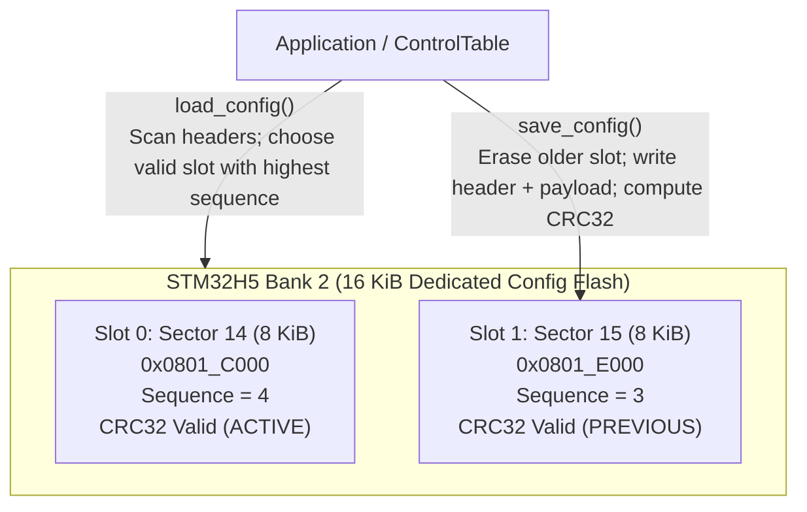

# Flash Configuration Persistence (`barefoc::traits::storage`)

The `barefoc::traits::storage` module and `barefoc-stm32` platform drivers provide power-loss-resilient, ping-pong Flash storage for actuator configuration, PID gains, soft limits, and calibration offsets.

---

## 1. Dual-Slot Ping-Pong Architecture

Writing directly to active flash pages risks parameter corruption if an unexpected power disruption occurs mid-erase or mid-write. `H5FlashStorage` uses a dual-sector ping-pong strategy with rolling sequence numbers and IEEE 802.3 CRC32 verification:



### Flash Partitioning Reference (STM32H503KB 128 KiB Flash):

```
0x0800_0000 ┌────────────────────────────────────────┐
            │ Katapult Recovery Bootloader (8 KiB)   │ Sector 0
0x0800_2000 ├────────────────────────────────────────┤
            │                                        │
            │ Application Firmware Slot (104 KiB)    │ Sectors 1..13
            │                                        │
0x0801_C000 ├────────────────────────────────────────┤
            │ Config Flash Slot 0 (8 KiB)            │ Sector 14
0x0801_E000 ├────────────────────────────────────────┤
            │ Config Flash Slot 1 (8 KiB)            │ Sector 15
0x0802_0000 └────────────────────────────────────────┘
```

---

## 2. 32-Byte Header Format

Each 8 KiB storage slot begins with a quadword-aligned 32-byte header:

| Byte Offset | Field Name | Data Type | Encoding | Description |
|:---:|---|---|:---:|---|
| `0x00` – `0x03` | `magic` | `u32` | `0x464F435F` | ASCII `"FOC_"` signature identifier |
| `0x04` – `0x05` | `version` | `u16` | Little-Endian | Storage schema layout version (`0x0001`) |
| `0x06` – `0x07` | `sequence` | `u16` | Little-Endian | Monotonically incrementing write sequence counter |
| `0x08` – `0x0B` | `payload_len` | `u32` | Little-Endian | Length of following data payload (96 bytes for EEPROM) |
| `0x0C` – `0x0F` | `crc32` | `u32` | Little-Endian | IEEE 802.3 CRC32 checksum computed over the payload |
| `0x10` – `0x1F` | `reserved` | `[u8; 16]` | Zeroes | Alignment padding for 32-byte quadword flash writes |

---

## 3. The `ConfigStorage` Trait

Core abstraction in `barefoc::traits::storage`:

```rust
pub trait ConfigStorage {
    type Error: core::fmt::Debug;

    /// Load persisted configuration into the provided Control Table.
    /// If flash is empty or corrupt, returns an error.
    fn load_config(&mut self, table: &mut ControlTable) -> Result<(), Self::Error>;

    /// Commit the active Control Table EEPROM section into flash.
    fn save_config(&mut self, table: &ControlTable) -> Result<(), Self::Error>;

    /// Reset configuration parameters to factory defaults and commit to flash.
    fn factory_reset(&mut self, table: &mut ControlTable) -> Result<(), Self::Error>;
}
```

---

## 4. Hardware Implementation (`H5FlashStorage`)

```rust,no_run
use barefoc::traits::storage::ConfigStorage;
use barefoc_stm32::stm32h5::H5FlashStorage;
use embassy_stm32::flash::Flash;
use embassy_stm32::mode::Blocking;

// 1. Initialize Flash peripheral driver
let flash = Flash::new_blocking(p.FLASH);

// 2. Initialize H5FlashStorage targeting Bank 2 Sectors 14 & 15 (0x0801_C000)
let mut storage = H5FlashStorage::new(flash, 0x0801_C000);

// 3. Load configuration on startup with automatic fallback to factory defaults
if let Err(e) = storage.load_config(&mut table) {
    table.load_factory_defaults();
    let _ = storage.save_config(&table);
}
```

### Power-Loss Resilience Workflow:

1. **Write Phase**:
   When `save_config()` is called, the driver identifies the inactive slot (the one with the lower sequence number), erases its sector, writes the data payload, and then writes the 32-byte header with the incremented sequence counter and calculated CRC32.
2. **Boot Recovery**:
   On reset, `load_config()` inspects both sectors. If power was cut while erasing or writing Sector 15, its CRC32 or magic header will fail validation. The driver automatically discards Sector 15 and loads valid parameters from Sector 14 without data loss.
