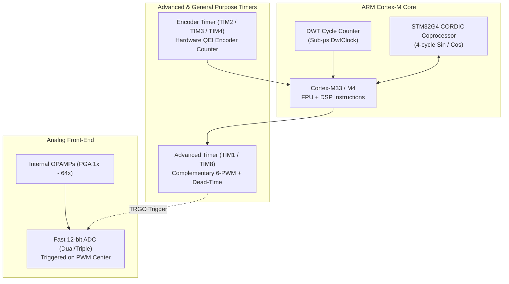

# STM32 Hardware Bridge (`barefoc-stm32`)

`barefoc-stm32` bridges the `embassy-stm32` HAL to BareFOC traits across STM32F4, STM32G4, and STM32H5 microcontrollers.

---

## STM32 Motor Control Timer Allocation

| Peripheral | Typical Hardware Use | Channels / Features |
|---|---|---|
| **`TIM1` / `TIM8`** | 3-Phase Complementary Inverter | `CH1/CH1N`, `CH2/CH2N`, `CH3/CH3N` center-aligned + Dead-Time + Break Input (`BKIN`) |
| **`TIM2` / `TIM5`** | 32-bit Quadrature Encoder | `CH1/CH2` in SMS Encoder Mode 3, 32-bit overflow accumulator |
| **`TIM3` / `TIM4`** | 16-bit Quadrature Encoder | `CH1/CH2` in SMS Encoder Mode 3, 16-bit counter |
| **`ADC1` / `ADC2`** | Synchronized Phase Current Sampling | Injected group triggered on `TIM1_TRGO` at PWM counter peak |
| **`DWT_CYCCNT`** | High-Precision Monotonic Clock | Single-cycle resolution timestamps up to 170 MHz / 250 MHz |

Leverages Advanced Control Timers (`TIM1`, `TIM8`):
- Generates 3 complementary PWM pairs (`CH1/CH1N`, `CH2/CH2N`, `CH3/CH3N`).
- Center-aligned (up-down) counting mode.
- Configurable hardware dead-time register insertion (`DTG`).
- Hardware Break Input (`BKIN`) pin support for instantaneous hardware over-current fault shutdown.

---

## 2. Hardware Quadrature Decoder (`Stm32Encoder`)

Bridges general-purpose timers (`TIM2`, `TIM3`, `TIM4`, `TIM5`) configured in SMS (Slave Mode Selection) Encoder Mode 3:
- Counts both Channel A and Channel B transitions with hardware digital input filters.
- Eliminates CPU interrupt overhead at high rotational speeds.

---

## 3. STM32G4 Hardware Acceleration

The STM32G4 family includes specialized peripherals for motor control:

### Hardware CORDIC (`Stm32G4Cordic`):
Calculates sine, cosine, and arctangent in hardware. Offloads Clarke/Park trigonometric evaluations to execute in just 4 to 8 clock cycles.

### Internal OPAMP Configuration (`Stm32G4OpAmp`):
Configures the STM32G4's internal rail-to-rail operational amplifiers in Programmable Gain Amplifier (PGA) mode (up to $64\times$ gain), routing phase shunt voltages directly into internal ADC channels without external op-amp components.

---

## 4. High-Resolution Clock (`DwtClock`)

Implements the `barefoc::traits::Clock` trait using the ARM Cortex-M Data Watchpoint and Trace (DWT) cycle counter, delivering sub-microsecond timing accuracy for PID loop $\Delta t$ calculations.

---

## 5. Hardware Electronic Signature (`Stm32Uid`)

Provides access to the 96-bit unique factory electronic signature via `embassy_stm32::uid::uid()`, implementing `barefoc::traits::HardwareUid` with zero-allocation canonical uppercase hex formatting for bus node identity and control table serialization.
