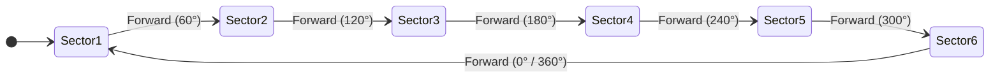

# Hall Effect Sensors

Hall effect sensors detect rotor magnet polarity, providing discrete or continuous position feedback.

---

## 1. Digital 3-Phase Hall Sensors (`HallSensor`)

Standard BLDC motors often feature three digital Hall sensors placed at 120° electrical intervals inside the stator slots.

```rust,no_run
use barefoc::sensors::hall::HallSensor;
use barefoc::traits::sensor::Sensor;

// Initialize with GPIO pins connected to Hall A, B, C
let mut hall = HallSensor::new(pin_a, pin_b, pin_c, 7 /* pole pairs */);
hall.init();

// Updates state machine and interpolates position between 60° commutation steps
hall.update();
let angle = hall.get_mechanical_angle();
```

### 60° Commutation Sector State Machine:



### Digital Hall Sensor Truth Table:

| Sector | Hall A | Hall B | Hall C | Binary Code | Nominal Electrical Angle ($\theta_e$) |
|:---:|:---:|:---:|:---:|:---:|:---:|
| **1** | `1` | `0` | `1` | `0b101` (5) | $0^\circ$ ($0.0\text{ rad}$) |
| **2** | `1` | `0` | `0` | `0b100` (4) | $60^\circ$ ($\frac{\pi}{3}\text{ rad}$) |
| **3** | `1` | `1` | `0` | `0b110` (6) | $120^\circ$ ($\frac{2\pi}{3}\text{ rad}$) |
| **4** | `0` | `1` | `0` | `0b010` (2) | $180^\circ$ ($\pi\text{ rad}$) |
| **5** | `0` | `1` | `1` | `0b011` (3) | $240^\circ$ ($\frac{4\pi}{3}\text{ rad}$) |
| **6** | `0` | `0` | `1` | `0b001` (1) | $300^\circ$ ($\frac{5\pi}{3}\text{ rad}$) |

### Interpolation Algorithm:
Because three digital Hall sensors provide only 6 discrete state transitions per electrical revolution (60° electrical resolution), BareFOC continuously measures the elapsed time $\Delta t_{\text{sector}}$ between Hall transitions and interpolates the intermediate electrical angle:

$$\theta_e(t) = \theta_{e,\text{sector}} + \omega_e \cdot (t - t_{\text{transition}})$$

---

## 2. 3D Magnetic Flux Hall Sensors (`tmag-rs`)

For high-resolution contactless angle measurement without external diametric disc magnets, `tmag-rs` provides a driver for the Texas Instruments TMAG5273 3D Hall-effect sensor:

- Measures magnetic field intensity across all three spatial axes ($B_X, B_Y, B_Z$).
- Computes in-plane angle using coordinate arc-tangents: $\theta = \text{atan2}(B_Y, B_X)$.
- Supports ultra-fast 1-byte read modes delivering up to 20,000 samples per second.

```rust,no_run
use tmag_rs::{TMAG5273, AxisConfig, SamplingRate};
use barefoc::traits::sensor::Sensor;

let mut tmag = TMAG5273::new(i2c_bus, AxisConfig::XY, SamplingRate::Sps10k);
tmag.init();

// Implements Sensor trait with zero allocation
tmag.update();
let shaft_angle = tmag.get_angle();
```
