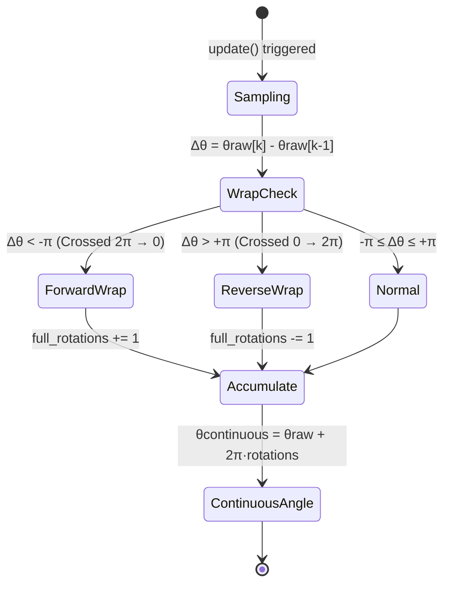
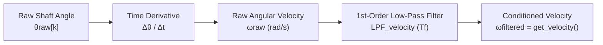

# The `Sensor` Trait

All position and velocity sensors in BareFOC implement the `Sensor` trait defined in `barefoc::traits::sensor::Sensor`.

---

## Trait Definition

```rust
pub trait Sensor {
    /// Read the raw mechanical shaft angle in radians within [0, 2π)
    fn get_mechanical_angle(&mut self) -> f32;

    /// Update internal tracking state (unwraps angle, updates velocity calculation)
    fn update(&mut self);

    /// Get continuous multi-turn shaft angle in radians (-∞ to +∞)
    fn get_angle(&mut self) -> f32;

    /// Get current shaft rotational velocity in radians/second
    fn get_velocity(&mut self) -> f32;

    /// Reset multi-turn counter to zero at current position
    fn reset_angle(&mut self);
}
```

---

## Multi-Turn Angle Unwrapping

Most absolute magnetic sensors report raw angles bounded strictly within $[0, 2\pi)$. For position servo control across multiple revolutions, BareFOC maintains a continuous multi-turn accumulator:

$$\Delta\theta = \theta_{\text{raw}}[k] - \theta_{\text{raw}}[k-1]$$

- If $\Delta\theta < -\pi$, a forward wrap occurred (transition from $\approx 2\pi$ to $\approx 0$): `full_rotations += 1`.
- If $\Delta\theta > +\pi$, a reverse wrap occurred (transition from $\approx 0$ to $\approx 2\pi$): `full_rotations -= 1`.

The continuous multi-turn angle is then evaluated as:

$$\theta_{\text{continuous}} = \theta_{\text{raw}} + 2\pi \cdot \text{full\_rotations}$$

### Unwrapping State Machine:



---

## Velocity Estimation & Conditioning

Shaft angular velocity is calculated on each `update()` call by differentiating consecutive angle samples:

$$\omega = \frac{\Delta\theta}{\Delta t}$$

When sampling at high frequencies or using sensors with finite bit depth (e.g., 12-bit or 14-bit resolution), quantization steps cause discrete jumps in $\Delta\theta$. BareFOC conditions the velocity estimate using an internal first-order lowpass filter (`LPF_velocity`) to ensure smooth derivative action in velocity PID loops:



---

## Supported Sensor Topologies

| Sensor Family | Common ICs | Bus Interface | Type | Resolution | Max Refresh Rate |
|---|---|---|---|---|---|
| **I2C Magnetic** | AS5600, MLX90393 | `embedded-hal::i2c` | Absolute on-axis | 12-bit (4096 CPR) | $\approx 1\text{ kHz}$ |
| **SPI Magnetic** | AS5048A, AS5047P, MA730 | `embedded-hal::spi` | Absolute on-axis | 14-bit (16384 CPR) | $\ge 25\text{ kHz}$ |
| **SSI Magnetic** | MT6701, MagnTek series | Synchronous Serial | Absolute on-axis | 14-bit (16384 CPR) | $\ge 25\text{ kHz}$ |
| **Quadrature (ABI)** | Optical / Magnetic Encoders | Timer QEI / GPIO IRQ | Relative increment | Up to 100,000 CPR | $\gt 1\text{ MHz}$ edge rate |
| **3-Phase Hall** | Digital Hall latches (U, V, W) | GPIO IRQ / Timer capture | Commutation feedback | 60° electrical (6 CPR/elec) | Dynamic interpolation |
