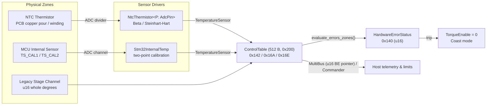

# Multi-Zone Temperature Sensing

BareFOC monitors three independent physical zones: the power inverter MOSFET stage, the microcontroller silicon, and the motor stator windings. Each zone has its own telemetry register, shutdown limit, and error bit. A zone with no sensor fitted reports `f32::NAN` and does not trip a limit.

---

## 1. Acquisition Pipeline



The shared contract is `barefoc::traits::temperature::TemperatureSensor`:

```rust,no_run
use barefoc::traits::temperature::TemperatureSensor;

fn sample<S: TemperatureSensor>(sensor: &mut S) -> Result<f32, S::Error> {
    sensor.read_temperature() // degrees Celsius or a typed driver error
}
```

It is `#![no_std]`, zero-heap, and does not depend on an MCU family. Concrete drivers consume `barefoc::traits::adc::AdcPin` raw samples and return degrees Celsius.

---

## 2. NTC Thermistor Driver

`barefoc_drivers::temperature::NtcThermistor<P>` reads an ADC divider and converts the sampled resistance to temperature. The divider topology is $V_{REF} \rightarrow R_{series} \rightarrow \text{ADC node} \rightarrow R_{NTC} \rightarrow GND$:

$$
R_{NTC} = R_{series}\,\frac{n}{n_{max} - n}
$$

where $n$ is the raw ADC count and $n_{max}$ is the converter full-scale count. An open circuit drives $n \ge n_{max}$ and reports `f32::NAN`; a short to ground drives $n = 0$ and reports the negative saturation value $-273.15\,^\circ\mathrm{C}$.

Two conversion models are available:

| Model | Equation | Parameters |
|---|---|---|
| Beta ($B_{25/85}$) | $\frac{1}{T} = \frac{1}{T_{25}} + \frac{1}{B}\ln\!\left(\frac{R}{R_{25}}\right)$ | `beta`, `r25` |
| Steinhart–Hart | $\frac{1}{T} = A + B\ln R + C(\ln R)^3$ | `a`, `b`, `c` |

$T_{25} = 298.15\,\mathrm{K}$. All transcendental math uses `libm::logf` and `libm::powf`; the driver is feature-gated by `barefoc-drivers/temperature`.

```rust,no_run
use barefoc::traits::adc::AdcPin;
use barefoc::traits::temperature::TemperatureSensor;
use barefoc_drivers::{NtcThermistor, ThermistorModel};

struct DividerPin(u16);
impl AdcPin for DividerPin {
    fn read(&mut self) -> u16 { self.0 }
}

fn example() {
    // R25 = 10 kOhm, series resistor = 10 kOhm, 12-bit ADC midpoint -> 25 C.
    let mut sensor = NtcThermistor::new(
        DividerPin(2048),
        ThermistorModel::Beta { beta: 3950.0 },
        10_000.0,
        10_000.0,
        4096,
    );
    let _celsius: Result<f32, ()> = sensor.read_temperature();

    // Three-coefficient variant (coefficients from the thermistor fit):
    let mut sh = NtcThermistor::with_steinhart_hart(
        DividerPin(2048),
        1.0e-3, // A
        2.5e-4, // B
        5.0e-8, // C
        10_000.0,
        10_000.0,
        4096,
    );
    let _ = sh.read_temperature();
}
```

---

## 3. Factory-Calibrated MCU Temperature

`barefoc_stm32::Stm32InternalTemp<P, TS_CAL1, TS_CAL2>` converts the internal sensor channel using the factory-programmed half-words for the target silicon. The caller reads those words from the family system-memory calibration region in HAL-level code and supplies them as const parameters; no calibration address is encoded in the library.

$$
T = 30 + (110 - 30)\,\frac{n - TS_{CAL1}}{TS_{CAL2} - TS_{CAL1}}
$$

| Calibration word | Reference temperature | Typical use |
|---|:---:|---|
| `TS_CAL1` | $30\,^\circ\mathrm{C}$ | Lower interpolation anchor |
| `TS_CAL2` | $110\,^\circ\mathrm{C}$ | Upper interpolation anchor |

A non-increasing pair (`TS_CAL2 <= TS_CAL1`) indicates a corrupt calibration region and yields `f32::NAN`. The driver is enabled by the `internal-temp` feature, which the `stm32f4`, `stm32g4`, and `stm32h5` family features enable automatically.

```rust,no_run
use barefoc::traits::adc::AdcPin;
use barefoc::traits::temperature::TemperatureSensor;
use barefoc_stm32::Stm32InternalTemp;

struct InternalChannel(u16);
impl AdcPin for InternalChannel {
    fn read(&mut self) -> u16 { self.0 }
}

fn example() {
    // The two factory words are read from system memory by the family HAL and
    // supplied as const parameters (example values below).
    let mut sensor = Stm32InternalTemp::<_, 1650, 2010>::new(InternalChannel(1650));
    assert_eq!(sensor.read_temperature(), Ok(30.0)); // TS_CAL1 anchor
}
```

---

## 4. Control Table Register Map

The Control Table is 512 bytes (`0x200`). Every temperature-sensing offset is preserved: the MOSFET zone shares the legacy channels, and the two new zones occupy the previously unallocated RAM tail. See [Universal Control Table](/actuators/control_table/) and [Extended Telemetry](/actuators/telemetry/) for the complete map.

| Logical register | Offset | Type | Default | Description |
|---|:---:|:---:|:---:|---|
| `REG_PRESENT_TEMP_MOSFET` | `0x142` | `u16` | `0` | Alias of `PresentTemperature`, whole degrees |
| `REG_PRESENT_TEMP_MCU` | `0x16A` | `f32` | `NAN` | MCU die temperature |
| `REG_PRESENT_TEMP_MOTOR` | `0x16E` | `f32` | `NAN` | Motor winding temperature |
| `REG_TEMP_LIMIT_MOSFET` | `0x100` | `f32` | `75.0` | Alias of `TemperatureLimit` |
| `REG_TEMP_LIMIT_MCU` | `0x172` | `f32` | `75.0` | MCU shutdown threshold |
| `REG_TEMP_LIMIT_MOTOR` | `0x176` | `f32` | `75.0` | Winding shutdown threshold |

Bytes `0x17A..0x17F` remain reserved; the extended telemetry block begins at `0x180` and the capability bitmask is at `0x1F8`, so none of the thermal offsets moved. The MOSFET alias keeps `u16` whole-degree encoding because a four-byte `f32` at `0x142` would overlap `REG_PRESENT_POSITION` at `0x144`.

The read-only capability mask at `0x1F8` publishes `capabilities::TEMPERATURE` (bit 2) when at least one of the three zones is fitted. A master can use this bit to skip thermal queries on nodes with no sensor; per-zone absence is still reported as `f32::NAN` telemetry.

### Fault bits

`HardwareErrorStatus` remains a 16-bit register. The aggregate `OVERHEAT` flag (bit 1) is set together with the zone-specific bit:

| Bit | Constant | Zone |
|:---:|---|---|
| `1 << 1` | `OVERHEAT` | Aggregate thermal trip |
| `1 << 8` | `OVERHEAT_MOSFET` | Inverter MOSFET stage |
| `1 << 9` | `OVERHEAT_MOTOR` | Motor stator windings |
| `1 << 10` | `OVERHEAT_MCU` | Microcontroller silicon |

A zone violation sets the zone flag, the aggregate flag, and clears `REG_TORQUE_ENABLE` (Coast mode). Flags latch until firmware clears them. The legacy `evaluate_errors(current, bus_voltage, temp)` entry point treats its temperature argument as the MOSFET zone; `evaluate_errors_zones(current, bus_voltage, ThermalReadings)` evaluates all three zones independently. `f32::NAN` readings never trip a limit.

---

## 5. Commander & MultiBus Interfaces

| Command | Action |
|---|---|
| `TM` | Report MOSFET temperature (integer, legacy whole-degree channel) |
| `TU` | Report MCU temperature (two decimal places, or `NAN`) |
| `TW` | Report motor winding temperature (two decimal places, or `NAN`) |
| `LT F <deg>` / `LT TM <deg>` | Set MOSFET limit |
| `LT U <deg>` / `LT TU <deg>` | Set MCU limit |
| `LT M <deg>` / `LT W <deg>` / `LT TW <deg>` | Set motor winding limit |

`LT` accepts values in $(0, 200]\,^\circ\mathrm{C}$; out-of-range or malformed arguments return an error string. The MultiBus `control_table_profile` exposes the thermal telemetry as read-only registers and the limits as read/write registers at the canonical 16-bit offsets listed above. A register pointer is latched as two big-endian bytes (`[ptr_hi, ptr_lo]`), so a host addresses `0x16A` directly; read/write payloads are little-endian and the pointer auto-increments across bytes. See [MultiBus](/communication/multibus/) for the wire protocol.
