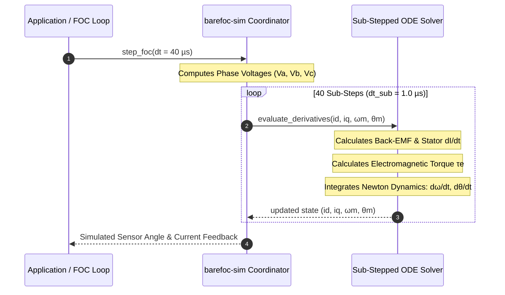

# Physics Engine & ODE Solver

`barefoc-sim` models a permanent magnet synchronous motor as a coupled system of continuous ordinary differential equations (ODEs).

---

## 1. Electrical Differential Equations ($d$-$q$ Frame)

Stator phase currents evolve according to winding resistance, phase inductance, and cross-coupling back-EMF:

$$\begin{aligned}
L_d \frac{di_d}{dt} &= V_d - R \cdot i_d + \omega_e L_q i_q \\
L_q \frac{di_q}{dt} &= V_q - R \cdot i_q - \omega_e L_d i_d - \omega_e \lambda_{pm}
\end{aligned}$$

Where:
- $R$ is phase resistance ($\Omega$).
- $L_d, L_q$ are stator inductances ($\text{H}$).
- $\omega_e = PP \cdot \omega_m$ is electrical rotational velocity ($\text{rad/s}$).
- $\lambda_{pm} = \frac{60}{\sqrt{3} \cdot \pi \cdot KV \cdot PP}$ is permanent magnet flux linkage ($\text{Wb}$).

---

## 2. Mechanical Rotational Dynamics

Electromagnetic torque accelerates rotor inertia against load torque and friction:

$$\tau_e = \frac{3}{2} PP \left( \lambda_{pm} i_q + (L_d - L_q) i_d i_q \right)$$

$$\frac{d\omega_m}{dt} = \frac{1}{J} \left( \tau_e - \tau_{\text{load}} - B \cdot \omega_m - \tau_{\text{coulomb}} \operatorname{sgn}(\omega_m) \right)$$

$$\frac{d\theta_m}{dt} = \omega_m$$

Where:
- $J$ is rotor moment of inertia ($\text{kg}\cdot\text{m}^2$).
- $B$ is viscous damping coefficient ($\text{N}\cdot\text{m}\cdot\text{s/rad}$).
- $\tau_{\text{coulomb}}$ is Coulomb stiction/friction ($\text{N}\cdot\text{m}$).

---

## 3. Sub-Stepped Numerical Integration

Low-inductance motors (such as drone or micro-gimbal motors where $L \approx 15\,\mu\text{H}$) have small electrical time constants ($\tau_e = \frac{L}{R} \approx 27\,\mu\text{s}$).

If the simulation step size matches the outer FOC frequency (e.g. $\Delta t = 40\,\mu\text{s}$ at 25 kHz), simple Euler integration becomes numerically unstable, causing currents to diverge to infinity.

To resolve this, `barefoc-sim` **sub-steps the physics solver**: while the FOC algorithm updates at 25 kHz ($\Delta t_{\text{foc}} = 40\,\mu\text{s}$), the internal ODE solver integrates the continuous physics in micro-steps of $\Delta t_{\text{phys}} \le 1\,\mu\text{s}$, guaranteeing numerical stability and physical fidelity:

---

## Motor Simulation Parameter Reference

| Symbol | Parameter Name | SI Units | Description & Typical Values |
|---|---|---|---|
| $R$ | Phase Resistance | $\Omega$ | Stator coil resistance ($0.05\,\Omega$ – $10.0\,\Omega$) |
| $L_d, L_q$ | Direct & Quadrature Inductance | $\text{H}$ | Stator winding inductances ($15\,\mu\text{H}$ – $5\,\text{mH}$) |
| $PP$ | Pole Pairs | Integer | Stator magnetic pole pair count ($1$ – $50$) |
| $KV$ | Motor Velocity Constant | $\text{RPM/V}$ | Back-EMF voltage constant ($100$ – $5000\text{ RPM/V}$) |
| $\lambda_{pm}$ | PM Flux Linkage | $\text{Wb}$ | Derived from $KV$: $\lambda_{pm} = \frac{60}{\sqrt{3}\pi \cdot KV \cdot PP}$ |
| $J$ | Rotor Moment of Inertia | $\text{kg}\cdot\text{m}^2$ | Rotational mass inertia ($10^{-7}$ – $10^{-3}\text{ kg}\cdot\text{m}^2$) |
| $B$ | Viscous Damping | $\text{N}\cdot\text{m}\cdot\text{s/rad}$ | Fluid/windage drag coefficient ($10^{-6}$ – $10^{-4}$) |
| $\tau_{\text{coulomb}}$ | Coulomb Friction | $\text{N}\cdot\text{m}$ | Stiction breakaway torque ($0.001$ – $0.05\text{ N}\cdot\text{m}$) |
