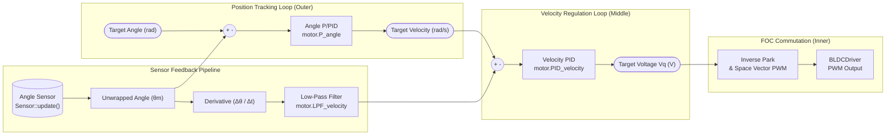

# Controllers & Filters

BareFOC uses discrete cascaded control loops to achieve precise velocity and angle tracking while protecting the motor and inverter from over-current and over-voltage conditions.

---

## Cascaded Loop Architecture



---

## PID Controller Parameter Matrix

| Parameter | Field Name | Typical Range | Function & Tuning Impact |
|---|---|---|---|
| **Proportional Gain** | `P` | `0.01` – `2.0` | Primary stiffness. Increase to reduce tracking error; excessive values cause high-frequency oscillation. |
| **Integral Gain** | `I` | `0.1` – `50.0` | Eliminates steady-state droop under constant load. Too high causes low-frequency overshoot and ringing. |
| **Derivative Gain** | `D` | `0.000` – `0.01` | Adds transient damping against velocity shocks. Sensitive to sensor noise; always pair with low-pass filtering. |
| **Output Saturation** | `limit` | $0$ – $V_{supply}$ | Clamps maximum output voltage or current, protecting driver stages and preventing motor overheating. |
| **Acceleration Ramp** | `output_ramp` | `100.0` – `5000.0` | Maximum rate of change ($dU / dt$). Prevents sudden mechanical shock and inrush current spikes. |
| **Derivative Filter** | `Tf` | `0.001` – `0.020` | Time constant of the derivative filter. Suppresses quantization noise from discrete encoder edges. |

---

## 1. The `PIDController` Algorithm

The BareFOC PID implementation in `barefoc::common::pid::PIDController` provides essential real-time motion control features:
- **Proportional term ($P$)**: Immediate error response.
- **Integral term ($I$) with Anti-Windup Clamping**: Eliminates steady-state error without allowing the integrator to wind up during actuator saturation.
- **Derivative term ($D$) with Low-Pass Filtering**: Provides phase lead and damping on rapid transients without amplifying high-frequency sensor noise.
- **Output Ramp Limiting**: Restricts maximum acceleration ($\Delta \text{Output} / \Delta t$) to prevent high inrush currents and mechanical shudder.

### PID State Equations:
$$\begin{aligned}
e[k] &= \text{target} - \text{measured} \\
u_P &= P \cdot e[k] \\
u_I[k] &= \text{clamp}(u_I[k-1] + I \cdot e[k] \cdot \Delta t, -u_{\text{limit}}, u_{\text{limit}}) \\
u_D &= D \cdot \frac{e[k] - e[k-1]}{\Delta t + T_f} \\
u_{\text{raw}} &= u_P + u_I[k] + u_D \\
u[k] &= \text{clamp\_ramp}(u_{\text{raw}}, u[k-1], \text{ramp\_limit} \cdot \Delta t)
\end{aligned}$$

### Rust Usage:
```rust
use barefoc::common::pid::PIDController;

let mut pid = PIDController::new();
pid.P = 0.1;
pid.I = 2.0;
pid.D = 0.001;
pid.limit = 6.0;            // Saturated output (Volts or Amps)
pid.output_ramp = 500.0;     // Maximum rate of change (Units / second)

let control_output = pid.step(target, actual, dt);
```

---

## 2. Discrete Low-Pass Filter (`LowPassFilter`)

Rotary position sensors derive velocity by differentiating shaft angle across time ($\omega = \Delta \theta / \Delta t$). This differentiation amplifies quantization steps and jitter.

BareFOC provides a first-order exponential moving average filter in `barefoc::common::lowpass_filter::LowPassFilter`:

$$y[k] = \alpha \cdot u[k] + (1 - \alpha) \cdot y[k-1]$$

Where the smoothing factor $\alpha$ is derived from the filter time constant $T_f$ and the elapsed sample time $\Delta t$:

$$\alpha = \frac{\Delta t}{T_f + \Delta t}$$

### Frequency Response:
- For frequencies $f \ll \frac{1}{2\pi T_f}$, signals pass with unity gain.
- For frequencies $f \gg \frac{1}{2\pi T_f}$, signals attenuate at $-20\text{ dB/decade}$.

### Rust Usage:
```rust
use barefoc::common::lowpass_filter::LowPassFilter;

let mut lpf = LowPassFilter::new();
lpf.Tf = 0.005; // 5 millisecond time constant

let filtered_vel = lpf.step(raw_velocity, dt);
```
