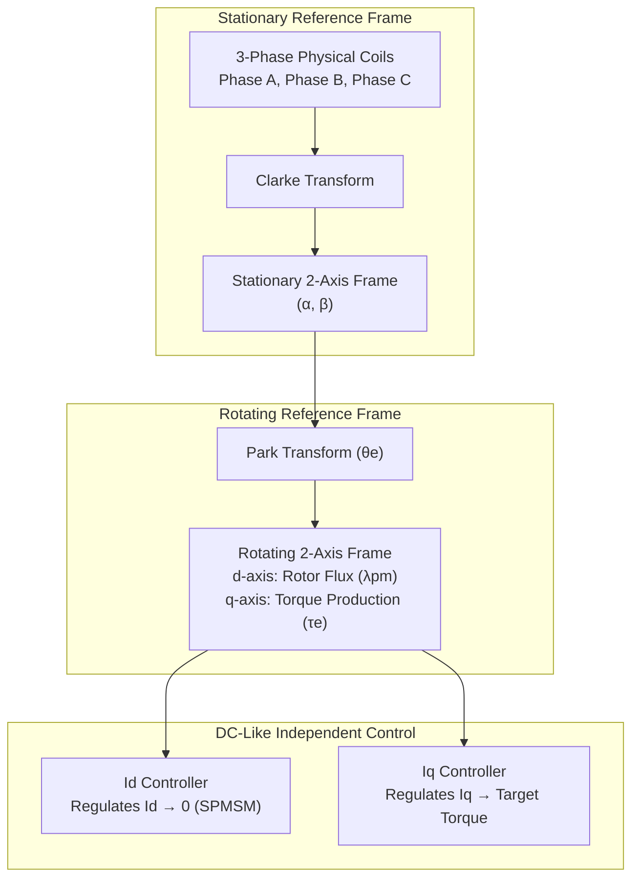

# FOC Principles

Field Oriented Control (FOC) controls a 3-phase permanent magnet motor by continuously orienting the stator magnetic field at exactly 90 electrical degrees ahead of the rotor permanent magnet field.

---

## The Electromagnetic Torque Vector

In a permanent magnet synchronous motor (PMSM / BLDC), the electromagnetic torque produced is governed by the cross product of the stator flux linkage vector $\boldsymbol{\psi}_s$ and the rotor flux linkage vector $\boldsymbol{\psi}_r$:

$$\boldsymbol{\tau}_e = \frac{3}{2} PP \cdot (\boldsymbol{\psi}_s \times \boldsymbol{\psi}_r)$$

Where:
- $PP$ is the number of motor **pole pairs**.
- $\boldsymbol{\psi}_r = \lambda_{pm}$ is the permanent magnet flux linkage (aligned with the rotor north pole).

When the stator field is maintained perpendicular to the rotor field (an angle of $\delta = 90^\circ$ or $\frac{\pi}{2}$ electrical radians), the cross product $\sin(\delta) = 1$, generating **maximum torque per ampere (MTPA)**.

---

## The $d$-$q$ Rotating Reference Frame

To control this interaction, we define an orthogonal coordinate system rotating synchronously with the rotor:

---

## Commutation Method Comparison

| Feature | 6-Step Trapezoidal (BLDC) | Sinusoidal Commutation | Space Vector FOC (BareFOC) |
|---|---|---|---|
| **Phase Activation** | 2 phases energized, 1 floating | All 3 phases continuously energized | All 3 phases continuously modulated via space vectors |
| **Torque Ripple** | High (15% - 30% ripple at sector commutations) | Moderate at high velocities | Minimal (< 1% ripple across entire speed range) |
| **Acoustic Noise** | Loud audible clicking / harmonic whine | Low | Virtually silent operation |
| **DC Bus Utilization** | 100% of trapezoidal ceiling | $86.6\%$ ($V_{dc} / \sqrt{3}$) | **$100\%$ ($V_{dc} / \sqrt{3} \times 1.15 = V_{dc}$)** with SVPWM |
| **Dynamic Response** | Slow phase recovery | Medium bandwidth | Instantaneous dynamic response to load transients |
| **Zero-Speed Holding** | Poor; high jitter and dead-bands | Moderate holding stiffness | Exact zero-speed position holding with maximum stiffness |

- **Direct Axis ($d$-axis)**: Collinear with the rotor permanent magnet flux. Stator current along this axis ($I_d$) produces no torque; it either strengthens or weakens the magnetic field. In surface-mounted permanent magnet motors (SPMSM), $I_d$ is typically regulated to zero ($I_d = 0$).
- **Quadrature Axis ($q$-axis)**: Perpendicular ($+90^\circ$ electrical) to the rotor flux. Stator current along this axis ($I_q$) interacts with $\lambda_{pm}$ to produce electromagnetic torque:

$$\tau_e = \frac{3}{2} PP \cdot \lambda_{pm} \cdot I_q$$

---

## Electrical vs. Mechanical Angle

Microcontrollers measure the **mechanical angle** of the shaft ($\theta_m$) using rotary sensors. Because a motor may have multiple magnetic pole pairs distributed around the stator, one full mechanical revolution corresponds to multiple electrical cycles:

$$\theta_e = PP \cdot \theta_m - \theta_{\text{offset}}$$

Where:
- $\theta_m$ is the absolute mechanical shaft angle in radians $[0, 2\pi)$.
- $PP$ is the pole pair count (e.g. 7 for a 12-stator-slot, 14-rotor-magnet BLDC).
- $\theta_{\text{offset}}$ is the zero-offset determined during the `init_foc()` alignment routine.
- $\theta_e$ is the electrical angle, normalized to $[0, 2\pi)$ using `barefoc::math::normalize_angle`.
