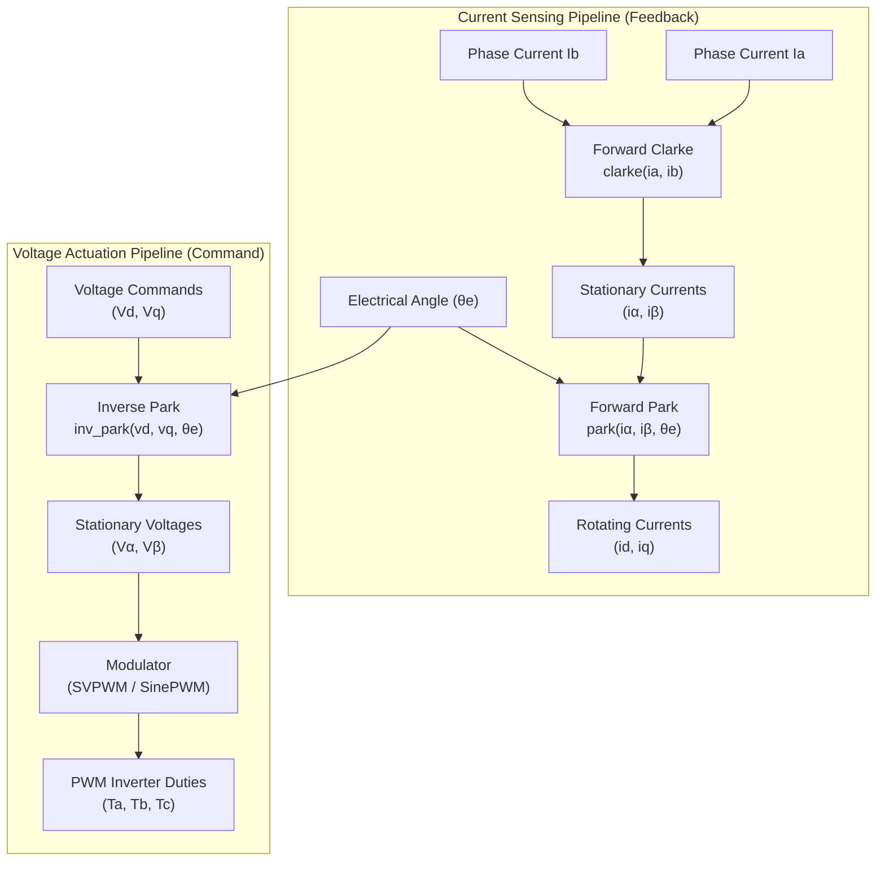

# Coordinate Transforms

BareFOC implements the mathematical transformations required to convert between three-phase physical coordinates ($a, b, c$), stationary two-axis orthogonal coordinates ($\alpha, \beta$), and rotating rotor-aligned coordinates ($d, q$).

---

## 1. Clarke Transform (3-Phase to Stationary Orthogonal)

The Clarke transform projects balanced three-phase quantities ($a, b, c$) onto a stationary orthogonal 2D frame ($\alpha, \beta$):


---

## Transform Execution Pipeline

In a complete FOC loop iteration, data passes through forward transforms for sensing and inverse transforms for actuation:



---

## Coordinate Frame Properties

| Reference Frame | Coordinates | Alignment & Rotation | Physical Meaning |
|---|---|---|---|
| **Phase Coordinates** | $a, b, c$ | Stationary, spaced $120^\circ$ apart | Individual stator winding terminal currents and voltages |
| **Clarke Frame** | $\alpha, \beta$ | Stationary orthogonal, $\alpha$ along phase $a$ | Equivalent two-phase stationary stator vector |
| **Park Frame** | $d, q$ | Rotating synchronously with rotor at speed $\omega_e$ | DC quantities: $d$ controls flux, $q$ produces torque |

Assuming a balanced 3-phase system with isolated neutral ($i_a + i_b + i_c = 0$), the transformation equations implemented in `barefoc::math::clarke` are:

$$\begin{aligned}
i_\alpha &= i_a \\
i_\beta &= \frac{1}{\sqrt{3}} (i_a + 2 i_b) = \frac{1}{\sqrt{3}} i_a + \frac{2}{\sqrt{3}} i_b
\end{aligned}$$

### Rust Signature:
```rust
use barefoc::math::clarke;

let (i_alpha, i_beta) = clarke(i_a, i_b);
```

---

## 2. Park Transform (Stationary to Rotating Frame)

The Park transform rotates the stationary $(\alpha, \beta)$ reference frame by the rotor electrical angle $\theta_e$ into the rotating $(d, q)$ frame:

$$\begin{aligned}
i_d &= i_\alpha \cos(\theta_e) + i_\beta \sin(\theta_e) \\
i_q &= -i_\alpha \sin(\theta_e) + i_\beta \cos(\theta_e)
\end{aligned}$$

### Rust Signature:
```rust
use barefoc::math::park;

let (i_d, i_q) = park(i_alpha, i_beta, theta_e);
```

---

## 3. Inverse Park Transform (Rotating to Stationary Frame)

After the PID controllers compute the required control voltages $V_d$ and $V_q$, the Inverse Park transform projects them back to the stationary $(\alpha, \beta)$ stator frame:

$$\begin{aligned}
V_\alpha &= V_d \cos(\theta_e) - V_q \sin(\theta_e) \\
V_\beta &= V_d \sin(\theta_e) + V_q \cos(\theta_e)
\end{aligned}$$

### Rust Signature:
```rust
use barefoc::math::inv_park;

let (v_alpha, v_beta) = inv_park(v_d, v_q, theta_e);
```

---

## 4. Inverse Clarke Transform

The Inverse Clarke transform converts $(\alpha, \beta)$ voltages back into three-phase terminal voltages $(V_a, V_b, V_c)$:

$$\begin{aligned}
V_a &= V_\alpha \\
V_b &= -\frac{1}{2} V_\alpha + \frac{\sqrt{3}}{2} V_\beta \\
V_c &= -\frac{1}{2} V_\alpha - \frac{\sqrt{3}}{2} V_\beta
\end{aligned}$$

---

## 5. Angle Normalization

All trigonometric operations require angle inputs bounded within $[0, 2\pi)$. BareFOC provides a branchless normalization utility in `barefoc::math::normalize_angle`:

```rust
use barefoc::math::normalize_angle;

let bounded_theta = normalize_angle(raw_angle); // Returns angle in [0, 2π)
```
