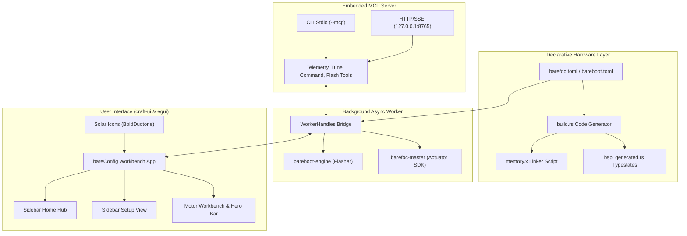

# bareConfig Graphical Workbench

`bareConfig` is the unified, cross-platform graphical workbench for flashing, calibrating, tuning, and monitoring BareFOC motor control hardware and BareBoot bootloaders across Desktop, Android, and WebAssembly targets.

---

## 1. System Architecture

`bareConfig` unifies declarative board support definitions (`barefoc.toml` and `bareboot.toml`), Katapult bootloader deployment (`bareboot-engine`), host-side multidrop bus discovery (`barefoc-master`), real-time FOC telemetry visualization, and an embedded Model Context Protocol (MCP) server into an agentic, zero-emoji application.



---

## 2. Solar Icons (BoldDuotone) Vector Catalog

`bareConfig` embeds curated resolution-independent vector icons in `BoldDuotone` style from the Solar Icons library via `craft-ui`'s `SvgIconSet` and `egui_extras`.

- **Style & Tinting**: Monochromatic SVG assets with primary fills and 50% opacity secondary fills that dynamically tint to the active theme palette.
- **Zero Emojis**: Strictly enforced across all labels, buttons, cards, logs, and telemetry.
- **Curated Vector Catalog**:
  - `cpu`: BareFOC mode indicator, board and MCU pinout routing.
  - `bolt`: BareBOOT mode indicator, Katapult bootloader flashing.
  - `danger-circle`: Emergency Stop button on Universal Hero Bar.
  - `check-circle`: Motor calibration workspace and verification.
  - `chart-square`: High-rate 60 FPS real-time oscilloscope.
  - `tuning-square`: Closed-loop cascaded PID diagram.
  - `compass`: FOC $(d, q)$ vector and SVPWM space vector scope.
  - `clipboard-list`: Control table hex and register inspector.
  - `code`: Multi-protocol bus traffic sniffer.
  - `link`: Host communication bus (UART, I2C, CAN, USB).
  - `document-text`: TOML configuration editor.
  - `folder`: Project directories and file browser.
  - `add-circle`: New BareFOC project and BareBOOT target dialogs.
  - `copy`: 1-click clipboard exporter for MCP configuration.
  - `server`: MCP agent connection status indicator.
  - `shield-check`: Pin arbiter safety contract verification (`initial_safe_pins!`).
  - `play` / `stop`: Closed-loop velocity jog CW / CCW and coast disarm.
  - `refresh`: Transport reconnect and alignment retry.
  - `settings`: System setup and board configurations.
  - `sun` / `moon`: High-contrast theme mode switcher.

---

## 3. Strict Theme Palette (DaisyUI Lofi Light & Black Dark)

All surfaces, cards, borders, text, and badges strictly derive from DaisyUI `lofi` and `black` palette tokens without arbitrary saturated colors:

- **Light Mode (`lofi` palette)**:
  - Base canvas (`base-100`): Pure white (`#FFFFFF`)
  - Elevated surfaces (`base-200`): Off-white (`#F7F7F7`)
  - Elevated secondary: Light neutral (`#EFEFEF`)
  - Border strokes (`base-300`): 1px outline (`#F0F0F0`)
  - Typography (`base-content`): Pure black (`#000000`) with muted text (`#737373`)
  - Brand accents: Primary (`#292929`), Info / BareFOC (`#5FCFDD`), Warning / BareBOOT (`#FFCE69`), Success (`#69FEC3`), Error (`#FF9181`).
- **Dark Mode (`black` palette)**:
  - Base canvas (`base-100`): True pitch black (`#000000`)
  - Elevated surfaces (`base-200`): Charcoal (`#1E1E1E`)
  - Elevated secondary: Deep neutral (`#262626`)
  - Border strokes (`base-300`): Dark stroke (`#242424`)
  - Typography (`base-content`): Light gray (`#DEDEDE`) with muted text (`#888888`)
  - Brand accents: Primary (`#4D4D4D`), Info / BareFOC (`#38BDF8`), Warning / BareBOOT (`#FBBF24`), Success (`#22C55E`), Error (`#EF4444`).

---

## 4. Sidebar-Driven Home Hub

The Home Hub features a left navigation sidebar and a card-based project workspace:

### Left Navigation Sidebar
1. **Quick Connection**:
   - Transport selector: Simulation (SIL Node), UART Serial, I2C Bus, CAN Bus.
   - Dynamic port entry and baud rate selector (e.g. 250000 baud).
   - `Connect Hardware` button with connection state feedback.
2. **Project Shortcuts**:
   - `New BareFOC Project`: Opens actuator modal (MCU, gate driver, magnetic sensor).
   - `New BareBOOT Target`: Opens Katapult bootloader modal (bus, boot window).
   - `Open TOML / Directory`: Quick access to board definitions.
3. **Workspace Mode Toggle (Pinned at Bottom)**:
   - `[cpu] BareFOC Mode`: Focuses the UI on FOC motor firmware, calibration, and tuning.
   - `[bolt] BareBOOT Mode`: Focuses the UI on Sector 0 Katapult bootloaders, bus transports, and safe-pin verification.

### Main Content Area
- **Saved Projects & Targets**: Cards with `base-200` fill and `base-300` border showing MCU, driver, sensor, and bus parameters with 1-click `Open Setup`.
- **1-Click Example Templates**: Pre-configured hardware presets:
  - Miniata 1104 Drone Motor Preset (STM32H503 + DRV8311H + Dual MT6701 SSI, 7 pole pairs).
  - FishyServo Direct-Drive Gimbal (CH32V203 / RP2350 multi-axis servo controller).
  - Generic Katapult Bootloader (Sector 0 bootloader for STM32 and RP2350).

---

## 5. Dynamic Tab Navigation & Conditional Motor Workbench

The top navigation bar dynamically adapts to the active mode and hardware connectivity:
- In **BareFOC Mode**:
  - Tab 1: `BareFOC Setup` (always available for board and flashing configuration).
  - Tab 2: `Motor Workbench` (dynamically rendered **ONLY** when actively connected to a hardware or simulation node).
- In **BareBOOT Mode**:
  - Tab 1: `BareBOOT Setup` (motor-specific tabs are omitted).
- **Disconnect Fallback**: If physical connection is lost while operating in the Motor Workbench, the application automatically falls back to `BareFOC Setup` or `Home Hub`.
- **Header Tools**:
  - Theme mode toggle (`sun` / `moon` Solar Icon).
  - MCP Server readiness indicator (`MCP: 8765 Ready`) with 1-click `Copy MCP Config`.
  - Active hardware bus status and transport reconnect controls.

---

## 6. Overhauled Setup View (Sidebar Navigation)

Motor calibration has been decoupled entirely from board setup. Setup is dedicated purely to silicon configuration and flashing:

1. **Board & Pin Mapping**:
   - Visual MCU pinout table for PWM phases (`INH_A..C`, `INL_A..C`), gate sleep/fault, current sense ADC, encoder SPI/SSI bus, and host communication pins.
   - **Pin Arbiter Verification**: Displays `[ VALID - initial_safe_pins! OK ]` contract badge, verifying that all bridge enables and gates are safely held low/disabled during boot.
2. **Host Communication**:
   - UART: Baud rate (115200 to 2000000 baud), TX/RX pin routing.
   - I2C / I3C: 7-bit slave address, SCL/SDA pins, clock speed (100k, 400k, 1000k).
   - CAN Bus: Bitrate (250k, 500k, 1M), Node ID (1..127), TX/RX pins.
   - USB: Katapult CDC and DFU settings.
   - **Protocol Synchronization Rule**: Enforces atomic updates when switching shared pins (e.g. PB6/PB7) between UART and I2C.
3. **BareBoot Flasher**:
   - Sector 0 Katapult bootloader programming (`0x08000000`–`0x08001FFF`).
   - `Preserve Persistent Settings (Sector 15 NVM)` toggle to prevent accidental erasure of calibration data.
   - Real-time build and deployment logs console.
4. **BareFOC Flasher**:
   - Application firmware compilation and flashing to Sector 1+ (`0x08002000+`).
   - Sector 15 NVM preservation toggle for seamless OTA updates.
   - `Export Settings to TOML` button for saving live gains to disk.
5. **TOML Configuration Editor**:
   - Dual-mode structured and raw editor for `barefoc.toml` and `bareboot.toml`.
   - Real-time schema linting and syntax validation.

---

## 7. Overhauled Motor Workbench

When connected to a BareFOC target, the Motor Workbench unlocks comprehensive real-time diagnostics:

### Persistent Universal Hero Telemetry Bar
Positioned at the top of all sub-pages, streaming at up to 60 FPS:
- **Live Rotor Angle Dial**: Graphical direction pointer and exact position in degrees (`142.5 deg`) and radians (`2.49 rad`).
- **Angular Velocity**: Dual RPM and rad/s telemetry (`1250 RPM (130.9 rad/s)`).
- **Phase Current Vector**: Direct and quadrature current measurements ($I_q, I_d$).
- **DC Bus & Temperature**: Real-time voltage ($V_{bus}$) and MOSFET thermal monitoring.
- **Arm/Disarm Toggle**: Immediate closed-loop drive enable/disable.
- **Emergency Stop Button**: Prominent red button with `danger-circle` Solar Icon that commands immediate PWM shutdown and high-impedance coast state.

### Sidebar Workspaces
1. **Motor Calibration**:
   - Sensor integrity check (angle readout, magnetic field strength percentage, airgap status).
   - Automated electrical zero angle alignment (`init_foc()`) with safety gate confirmation.
   - Measured pole pairs validation and natural commutation direction discovery.
   - Safe closed-loop jog spin test with bidirectional velocity slider.
   - 1-click commitment of calibration data directly to Sector 15 NVM Flash.
2. **Oscilloscope & Benchmark**:
   - High-rate multi-channel plotter with selectable position, velocity, and current channels.
   - Automated step-response benchmark calculating Rise Time (ms), Settling Time (ms), and Overshoot percentage (%).
3. **Closed-Loop Tuning**:
   - Interactive cascaded block diagram with clickable gain pills for Position P, Velocity PID ($K_p, K_i, K_d$), Current PI, and low-pass filter time constants ($T_f$).
4. **Vector & SVPWM Scope**:
   - Rotating $(I_d, I_q)$ current space vector and Clarke transform $(\alpha, \beta)$ locus.
   - 6-sector space vector PWM hexagon with live duty cycle telemetry.
5. **Control Table Inspector**:
   - Full 384/512-byte register map with byte-level hex view, search filter, and live decoding.
6. **Bus Traffic Sniffer**:
   - Multi-protocol frame capture supporting Katapult, MultiBus, Dynamixel DXL2, and Commander protocols with pause and export.

---

## 8. Embedded Model Context Protocol (MCP) Server

`bareConfig` embeds a dual-transport Model Context Protocol (MCP) server supporting JSON-RPC 2.0, enabling autonomous AI agents (such as Antigravity, Claude Desktop, and Cursor) to monitor telemetry, tune parameters, control motion, flash targets, and validate configurations.

### Dual Transport Modes
1. **CLI Stdio Transport (`bareconfig --mcp`)**:
   Runs headless in terminal and automation pipelines, reading JSON-RPC requests from standard input and writing responses to standard output.
2. **In-App Background HTTP/SSE Transport (`127.0.0.1:8765`)**:
   Automatically spawned when the desktop workbench starts. Exposes an SSE stream at `http://127.0.0.1:8765/sse` and accepts POST requests at `http://127.0.0.1:8765/`.

### Available MCP Tool Suite

| Tool Name | Parameters | Purpose |
|---|---|---|
| `bareconfig_telemetry` | `node_id` (int) | Returns rotor angle (deg/rad), velocity (RPM/rad/s), $I_q, I_d$, $V_{bus}$, and MOSFET temp. |
| `bareconfig_tune` | `node_id`, `vel_p`, `vel_i`, `vel_d`, `ang_p`, `current_p`, `current_i`, `lpf_vel_tf` | Adjusts PID gains and low-pass filter cutoff frequencies live in actuator RAM. |
| `bareconfig_command` | `node_id`, `mode` ("position" / "velocity" / "voltage"), `target` (number) | Transmits motion setpoints in radians, rad/s, or volts. |
| `bareconfig_emergency` | `node_id` (int) | Immediately shuts down gate drives and places motor bridge in safe high-impedance state. |
| `bareconfig_flash` | `chip_name` (string), `target_bin` (string), `preserve_nvm` (bool) | Deploys firmware via Katapult with Sector 15 calibration preservation control. |
| `bareconfig_registers` | `node_id`, `address` (int), `length` (int), `write_bytes` (array) | Reads or writes raw byte sequences in the 384/512-byte control table. |
| `bareconfig_config` | `path` (string), `raw_content` (string) | Validates and parses `barefoc.toml` or `bareboot.toml` declarative definitions. |
| `bareconfig_connect` | `bridge` ("agentla" / "serial" / "i2c_tinyusb" / "can" / "sim"), `host`, `port`, `node_id`, `bus_address` | Connects to an actuator node or bridge interface (AgentLA MCP, USB serial, I2C/I3C bus address, CAN node). |
| `bareconfig_scan_bus` | `bus` ("i2c" / "i3c" / "can" / "uart"), `start_addr`, `end_addr` | Scans the communication bus to discover bareFOC nodes, connected sensors, and bootloader state. |
| `bareconfig_step_benchmark` | `node_id`, `step_target` (number), `mode` ("position" / "velocity"), `duration_ms` (int) | Runs automated step response benchmark, measuring rise time, settling time, overshoot percentage, and steady-state error. |
| `bareconfig_calibrate_alignment` | `node_id`, `voltage_align` (number), `persist` (bool) | Executes electrical zero / encoder alignment routine, measuring pole pairs, zero angle offset, sensor direction, and saving to Sector 15 NVM. |

### Client Configuration Snippet

Clicking **"Copy MCP Config"** in the bareConfig header generates the following client configuration:

```json
{
  "mcpServers": {
    "bareconfig": {
      "url": "http://127.0.0.1:8765/sse",
      "command": "bareconfig",
      "args": ["--mcp"]
    }
  }
}
```

---

## 9. Building & Running

### Desktop GUI Workbench
```bash
cd bareFOC/bareConfig
cargo run --release
```

### Headless MCP Agent Mode
```bash
cd bareFOC/bareConfig
cargo run --release -- --mcp
```

### WebAssembly Target (WebSerial)
```bash
cd bareFOC/bareConfig
trunk serve --release
```
