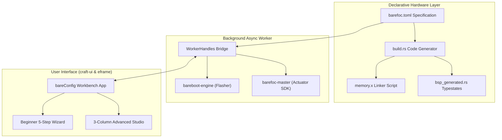

# bareConfig Graphical Workbench

`bareConfig` is the unified, cross-platform graphical workbench for flashing, calibrating, tuning, and monitoring BareFOC motor control hardware and BareBoot bootloaders across Desktop, Android, and WebAssembly targets.

---

## 1. System Architecture

`bareConfig` unifies declarative board support definitions (`barefoc.toml` and `bareboot.toml`), bootloader compilation and flashing (`bareboot-engine`), host-side multidrop bus discovery (`barefoc-master`), and real-time visualization into a responsive application.



---

## 2. Declarative BSP Specification (`barefoc.toml`)

`barefoc.toml` defines the silicon target, memory map, bootloader protocol, power envelopes, and gate driver topologies in a single declarative file.

### Sample: Miniata STM32H5 Actuator (`boards/miniata-stm32h5/barefoc.toml`)

```toml
[board]
name = "miniata-stm32h5"
description = "Miniata Ultra-Compact Integrated FOC Actuator (STM32H503KB)"
mcu = "stm32h503kbu6"
family = "stm32h5"
system_clock_hz = 250000000

[memory]
flash_origin = 0x08000000
flash_size = 131072
ram_origin = 0x20000000
ram_size = 32768
bootloader_origin = 0x08000000
bootloader_size = 8192
app_origin = 0x08002000
app_size = 114688
nvm_origin = 0x0801E000
nvm_size = 8192

[bootloader]
enabled = true
type = "katapult"
transport = "uart"
boot_window_ms = 250
baud_rate = 250000
mailbox_address = 0x20007FF8
mailbox_magic = 0x5984E3FA6CA1589B

[safety]
max_voltage_v = 12.6
max_current_a = 5.0
max_velocity_rad_s = 200.0
thermal_cutoff_c = 85.0
default_voltage_limit = 6.0
default_current_limit = 2.0

[defaults]
node_id = 1
pole_pairs = 7
pid_velocity_p = 0.25
pid_velocity_i = 3.5
pid_velocity_d = 0.001
pid_velocity_output_ramp = 100.0
pid_angle_p = 25.0
pid_angle_i = 0.0
pid_angle_d = 0.05
lpf_velocity_tf = 0.015
lpf_angle_tf = 0.0
gear_ratio = 1.0

[gate_driver]
driver_type = "drv8311"
pwm_frequency_hz = 25000
pwm_timer = "TIM1"
inh_a = "PB5"
inh_b = "PA9"
inh_c = "PA8"
inl_a = "PB1"
inl_b = "PB0"
inl_c = "PA7"
sleep_pin = "PB15"

[sensor]
sensor_type = "mt6701_ssi"
bus = "SPI2"
cpr = 16384

[connectors]
bus_type = "uart"
tx_scl_pin = "PB6"
rx_sda_pin = "PB7"
default_baud = 250000
```

### Runtime Defaults & Persistence Contract
- The parameters declared under `[defaults]` serve as the authoritative factory defaults for the actuator's 512-byte control table.
- When Sector 15 flash (NVM) is blank or uncalibrated, firmware initializes its control table from these `barefoc.toml` defaults.
- **Export Live Settings**: bareConfig provides an "Export Live Settings to barefoc.toml" button that reads tuned RAM gains and updates the board definition on disk without requiring secondary configuration files.

---

## 3. OTA Preservation Contract

In the Flasher panel and Makeflash pipeline, an explicit checkbox is provided:

`[x] Preserve Calibration & Settings (Sector 15 NVM)` (checked by default).

- **When Checked**: OTA firmware deployment writes only to application sectors (`[0x08002000..0x0801E000)` on STM32H5). Motor electrical zero angle offset, natural commutation direction, PID gains, and node IDs remain intact across updates.
- **When Unchecked**: Signals a deliberate factory reset. Sector 15 flash is cleared, causing the new firmware on reboot to load the declarative factory defaults defined in `barefoc.toml`.

---

## 4. Beginner 5-Step "Zero-to-Spin" Wizard

For new hardware bring-up, bareConfig guides users through a linear, fail-safe 5-step workflow:

1. **Step 1: Board Detect & Flashing**:
   Discovers target BSP profiles and executes 1-click bring-up, automatically deploying Sector 0 Katapult bootloader and application slot via SWD.
2. **Step 2: Motor Preset Library & Power Limits**:
   Selects pre-configured motor profiles (e.g. 1104 4300KV micro-drone, 2204 gimbal, 5010 high-torque) and enforces safe voltage, current, and velocity bounds.
3. **Step 3: Live Sensor Rotary Gauge**:
   Renders an interactive real-time rotary dial following physical motor shaft rotation, reporting magnetic field strength (mT) and CRC status to verify encoder alignment before motor power is applied.
4. **Step 4: Automated Electrical Zero Alignment**:
   Protected by a safety confirmation gate, triggering `init_foc()` to apply an electrical vector, discover zero angle and natural sensor direction, and validate measured pole pairs.
5. **Step 5: Safe Jog Test & Flash Commit**:
   Enables low-speed jog testing with bidirectional velocity controls, followed by 1-click commitment of calibration data directly to Sector 15 NVM.

---

## 5. Advanced 3-Column Studio Workbench

Designed for high-performance motor tuning and multi-axis actuator networks:

### Column 1: Controls & Multi-Axis Management
- **Cascaded Loop Block Diagram**: Interactive visual diagram with clickable P/I/D pills for Position, Velocity, and Current loops. Modifying any pill writes directly to the actuator's RAM registers over the active bus.
- **Multi-Axis Bus Cockpit**: Manages multidrop nodes with individual enable/disable toggles, telemetry readouts, global Emergency Stop, and synchronized setpoint broadcast.

### Column 2: 60 FPS Telemetry Oscilloscope
- High-rate real-time charting using `egui_plot`.
- Channels: Commanded vs Actual Position, Velocity, and Quadrature Current ($I_q$).
- **Automated Step-Response Benchmark**: Injects square step setpoints and calculates Rise Time (ms), Settling Time (ms), and Overshoot percentage (%).

### Column 3: Vectors, Flasher & Memory Inspector
- **FOC Vector Scope**: Real-time display of $(I_d, I_q)$ direct/quadrature current vector and Clarke transform $(I_\alpha, I_\beta)$ rotating locus.
- **SVPWM 6-Sector Hexagon Scope**: Visualizes voltage vector $\vec{V}_s$ rotating inside the 6-sector space vector hexagon with live duty cycle telemetry.
- **Makeflash Pipeline**: Integrated firmware compiler and Katapult flasher with Sector 15 NVM preservation toggle.
- **512-Byte Control Table Hex Inspector**: Full memory grid with register tooltips, search filter, and real-time decoded values.
- **Standalone BareBoot Configurator**: Reads and edits `bareboot.toml` for custom target bootloader deployment.
- **Multi-Protocol Bus Traffic Sniffer**: Decodes Katapult, MultiBus, Dynamixel DXL2, and Commander packets in real time.

---

## 6. Building & Running

### Native Desktop (Linux, macOS, Windows)

```bash
cd bareFOC/bareConfig
cargo run --release
```

### WebAssembly (GitHub Pages)

`bareConfig` compiles to WebAssembly with WebSerial support via `web-sys`:

```bash
cd bareFOC/bareConfig
trunk serve
```
