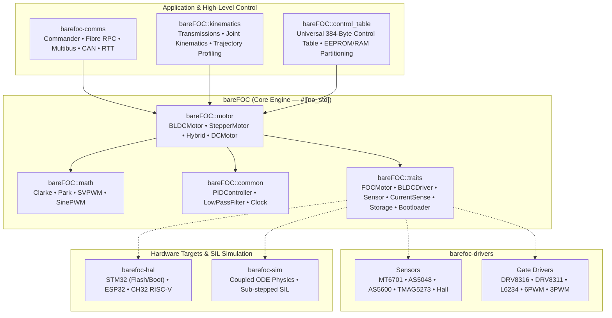
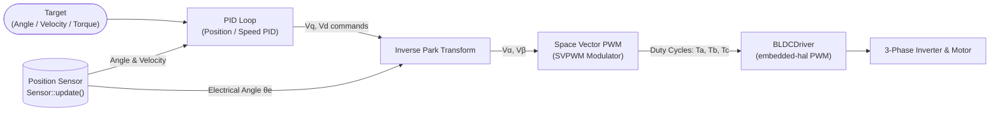

# BareFOC: Embedded Rust Field Oriented Control

BareFOC is a `#![no_std]` Rust implementation of Field Oriented Control (FOC) algorithms for Brushless DC (BLDC), Stepper, and brushed DC motors. Designed for real-time embedded systems, BareFOC operates within the `embedded-hal` 1.0 trait ecosystem, providing deterministic, zero-allocation motor commutation and motion control.

The project is ported directly from and semantically aligned with [Arduino SimpleFOC](https://simplefoc.com), preserving its modular architecture and mathematical rigor while taking full advantage of Rust's compile-time memory safety, trait abstraction, and async execution models (such as Embassy and RTIC).

For a comprehensive feature breakdown, SimpleFOC parity matrix, and BareFOC-exclusive quality-of-life additions, refer to [Features & Parity](/features/).

---

## Architectural Principles

BareFOC is engineered around five fundamental constraints:

1. **Strict `#![no_std]` Compatibility**:
   Core algorithms execute with zero dynamic memory allocation (`no heap`). All state structures, filters, and matrices reside on the stack or in static memory. Floating-point mathematics leverage `libm`.

2. **`embedded-hal` 1.0 Ecosystem**:
   Peripherals (PWM inverters, ADCs, SPI, I2C, UART) are decoupled through standard Rust traits (`embedded-hal`, `embedded-hal-async`, and `embedded-io`). Device drivers run identically on bare-metal registers, vendor HALs, or simulated test harnesses.

3. **Decoupled Actuator & Sensor Pipelines**:
   Motors, inverters, position sensors, and current sense amplifiers are independent components connected via traits (`FOCMotor`, `FOCDriver`, `Sensor`, `CurrentSense`). Any supported sensor can be combined with any inverter topology.

4. **Cascaded Control Architecture**:
   Hierarchical control loops execute at distinct frequencies: high-frequency inner current/voltage loops (typically 20 kHz to 50 kHz) feed into outer velocity (1 kHz to 5 kHz) and position/angle tracking loops.

5. **Software-in-the-Loop (SIL) Verification**:
   The entire motion control stack runs natively on the host platform under `barefoc-sim`, simulating electromechanical ODE physics with sub-stepped numerical integration for continuous integration testing and parameter tuning without physical hardware.

---

## Ecosystem Architecture

The BareFOC project is organized as a modular workspace of focused crates:



### Module Breakdown

| Component | Responsibility | Key Types & Features |
|---|---|---|
| **`bareFOC::math`** | Coordinate transforms & modulation | Forward/Inverse Clarke, Forward/Inverse Park, Space Vector PWM (SVPWM), Sine PWM, Trapezoidal modulation |
| **`bareFOC::common`** | Discrete-time signal conditioning | `PIDController` (anti-windup, ramp limit, derivative filter), `LowPassFilter`, monotonic `Clock` |
| **`bareFOC::motor`** | Actuator state machines | `BLDCMotor`, `StepperMotor`, `HybridStepperMotor`, `DCMotor`, open/closed-loop velocity and angle control |
| **`bareFOC::control_table`**| Universal actuator register map | Standardized 384-byte Control Table (224-byte EEPROM + 160-byte RAM), 4-axis motor bank, 8 operating modes, kinematics topology presets, soft limits, `HardwareErrorStatus` bitfield |
| **`bareFOC::kinematics`** | Transmission & motion profiling | Reduction ratios, leadscrews, 1-DOF / 2-DOF kinematics, `TrapezoidalTrajectory` generator, `MultiTurnAccumulator` unwrapping, joint homing and calibration |
| **`bareFOC::traits`** | Core device & persistence interfaces | `FOCMotor`, `FOCDriver`, `BLDCDriver`, `Sensor`, `CurrentSense`, `ConfigStorage`, `BootloaderHandoff` |
| **`barefoc-drivers`** | Extended sensors and gate driver ICs | `AS5600`, `AS5048A/B`, `AS5047P`, `mt6xxx-rs` (MT6701 SSI), `drv83xx-rs` (DRV8316, DRV8311), `tmag-rs` (TMAG5273 3D Hall), `DCDriver2PWM` |
| **`barefoc-comms`** | Telemetry and bus commanding | `barefoc-commander` (SmartServoCommander & ASCII parser), `barefoc-fibre` (ODrive GUI RPC), `barefoc-multibus` (384-byte Control Table profile), CAN frame mapping, `barefoc-rtt` (SWD stream) |
| **`barefoc-hal`** | Silicon-level peripheral glue | Complementary 6-PWM with dead-time, timer quadrature encoders, CORDIC math, OPAMPs, `H5FlashStorage` ping-pong flash, `Stm32H5Bootloader` hand-off |
| **`barefoc-sim`** | Host-based electromechanical SIL | Coupled $d$-$q$ electrical and Newtonian rotational physics ODE solver, live TCP Fibre GUI server |

---

## Control Loop Pipeline

A standard closed-loop FOC control iteration follows a deterministic sequence:



---

## Architectural Comparison: SimpleFOC vs BareFOC

| Attribute | Upstream SimpleFOC (C++) | BareFOC (Embedded Rust) |
|---|---|---|
| **Language & Safety** | C++11 (raw pointers, unchecked buffer indexing) | Rust 2021 (strict memory safety, zero undefined behavior) |
| **Allocation & Heap** | Dynamic heap allocation permitted (`new`, `String`) | Strict `#![no_std]` zero-allocation (`no heap`) |
| **HAL Portability** | Arduino Core peripheral abstraction | Standardized `embedded-hal` 1.0 & `embedded-io` traits |
| **Concurrency Support** | Monolithic `loop()` busy-waiting | Compatible with cooperative interrupts, RTIC, and async Embassy |
| **Mathematical Precision** | Single precision `float`, Arduino `sin()`/`cos()` | High-performance `libm` implementations, hardware CORDIC support |
| **Testing & CI** | Physical hardware required for integration tests | Host-based Software-in-the-Loop (`barefoc-sim`) ODE physics engine |
| **Protocol Support** | Basic blocking Commander serial parser | Commander, ODrive Fibre Web GUI (WebSocket), Multibus, RTT |

---

## Minimal Example: Velocity Control

The following snippet demonstrates configuring a 3-phase BLDC motor with an SSI magnetic encoder and a 3-PWM gate driver in `#![no_std]` Rust:

```rust,no_run
#![no_std]
#![no_main]

use barefoc::motor::bldc::BLDCMotor;
use barefoc::motor::enums::MotionControlType;
use barefoc::motor::base::FOCMotor;
use barefoc::traits::driver::BLDCDriver;
use barefoc::traits::sensor::Sensor;
use barefoc::traits::Clock;

pub fn run_foc_loop<D, S, C>(driver: &mut D, sensor: &mut S, clock: &C) -> !
where
    D: BLDCDriver,
    S: Sensor,
    C: Clock,
{
    // Configure BLDC motor: 7 pole pairs, 0.55 ohm phase resistance, 4300 KV
    let mut motor = BLDCMotor::new(7);
    motor.phase_resistance = 0.55;
    motor.kv_rating = 4300.0;

    // Set control regime
    motor.controller = MotionControlType::velocity;
    motor.voltage_limit = 2.0;       // Max phase voltage (V)
    motor.velocity_limit = 100.0;    // Max speed (rad/s)

    // Configure velocity PID gains
    motor.PID_velocity.P = 0.05;
    motor.PID_velocity.I = 1.0;
    motor.PID_velocity.output_ramp = 1000.0;
    motor.LPF_velocity.Tf = 0.005;

    // Link hardware peripherals and initialize
    motor.init(driver, sensor);
    motor.init_foc(driver, sensor, clock);

    let target_velocity = 30.0; // Target in rad/s

    loop {
        // High-frequency commutation update
        motor.loop_foc(driver, sensor, clock);

        // Motion control outer loop execution
        motor.move_motor(driver, sensor, clock, target_velocity);
    }
}
```

---

## Upstream Lineage & Attribution

BareFOC is a direct port of the foundational [Arduino-FOC](https://github.com/simplefoc/Arduino-FOC) and [Arduino-FOC-drivers](https://github.com/simplefoc/Arduino-FOC-drivers) libraries created by Antun Skuric and the SimpleFOC community. 

BareFOC maintains strict fidelity to SimpleFOC's algorithms, naming conventions, and mathematical models to allow engineers familiar with SimpleFOC to transition seamlessly to embedded Rust, while contributing back architecture-neutral improvements to the open-source motion control ecosystem.

For the full architectural history, upstream ecosystem links, academic citations, and attribution details, see the [Original Project](/original_project/) page.
